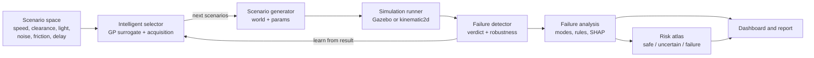
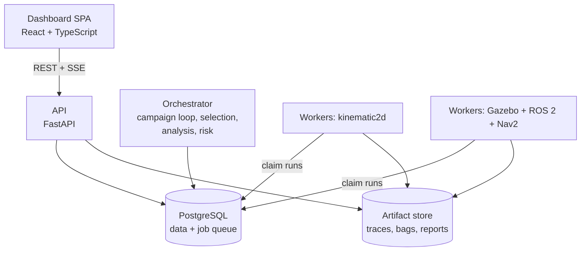
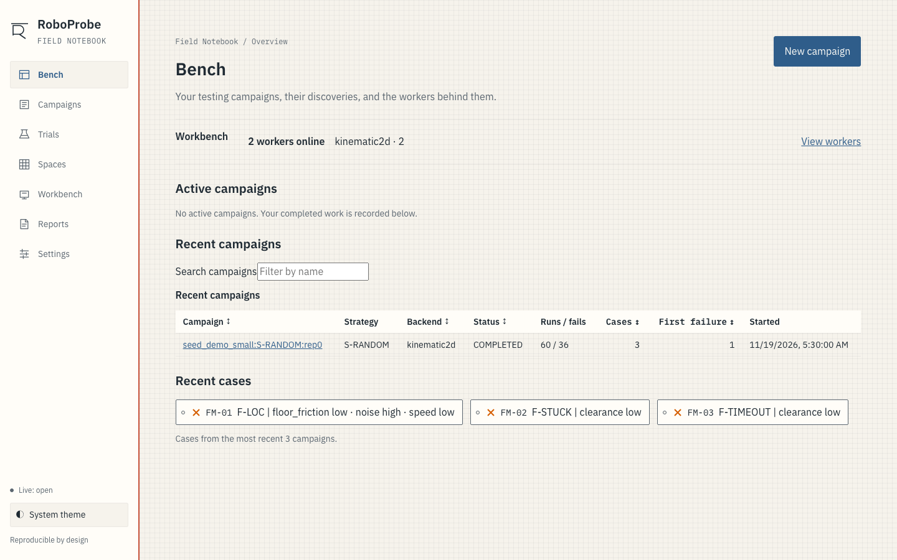
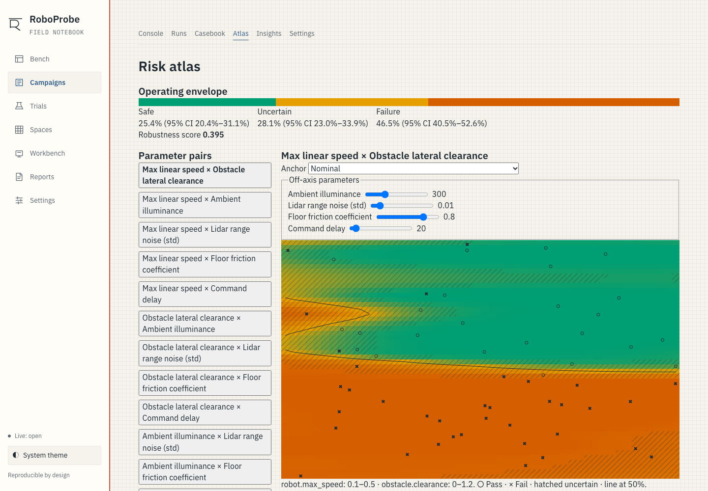

<div align="center">

# RoboProbe

**A virtual testing engineer for autonomous robots — it learns where your robot is weak and probes there.**

*Intelligent Virtual Robotics Testing & Failure Discovery Platform*

[](LICENSE)
[](#project-status--roadmap)
[](docs/15-tech-stack-and-adrs.md)
[](docs/10-simulator-integration.md)
[](docs/00-index.md)
[](CONTRIBUTING.md)
[](CODE_OF_CONDUCT.md)

[Documentation](docs/00-index.md) · [Roadmap](docs/22-roadmap-and-implementation-plan.md) · [PRD](docs/26-product-requirements-document.md) · [Architecture](docs/04-system-architecture.md) · [Contributing](CONTRIBUTING.md)

</div>

> [!IMPORTANT]
> **RoboProbe is in the design phase.** This repository currently contains the complete engineering
> specification (35 documents + 16 ADRs). **There is no runnable code yet** — implementation starts with
> milestone M1. Star/watch the repo to follow progress, and feedback on the design is very welcome.

## Table of contents

- [Why RoboProbe?](#why-roboprobe)
- [What it is](#what-it-is)
- [Key features](#key-features)
- [How it works](#how-it-works)
- [Architecture overview](#architecture-overview)
- [Example: the warehouse robot](#example-the-warehouse-robot)
- [Tech stack](#tech-stack)
- [Project status & roadmap](#project-status--roadmap)
- [Documentation map](#documentation-map)
- [Try the dashboard locally](#try-the-dashboard-locally)
- [Repository structure](#repository-structure)
- [Contributing](#contributing) · [Code of conduct](#code-of-conduct) · [Security](#security) · [License](#license)
- [Citation](#citation) · [Acknowledgements & prior art](#acknowledgements--prior-art) · [Author](#author)

## Why RoboProbe?

Testing autonomous robots on real hardware is slow, expensive and sometimes unsafe, and rare failures are hard
to reproduce. Simulators solve the "virtual robot" part — but **deciding which scenarios to simulate** is still
done by hand or at random. Random testing spends most of its budget on ordinary, passing cases, and
one-factor-at-a-time test plans miss the most dangerous class of bugs: **interaction failures**, where a
robot handles high speed, sensor noise and low light *individually* but collides when they occur *together*.

## What it is

RoboProbe is a **software-only, open-source testing layer on top of an established robotics simulator**
(Gazebo Harmonic + ROS 2 Jazzy + Nav2). It is *not* a simulator and *not* a robot. It:

1. generates test scenarios from a declared parameter space,
2. runs them headless on the simulator with parallel workers,
3. judges every run with robustness-valued failure oracles,
4. **learns from each outcome to choose the next, more informative scenarios**,
5. clusters failures into explained failure modes, and
6. maps the safe, uncertain and failure-prone regions of the robot's operating envelope.

## Key features

| | Feature | Spec |
|---|---------|------|
| 🎯 | **Intelligent test selection** — `S-PROBE`: Gaussian-process Bayesian optimisation on a continuous robustness score, diversity-seeking failure-mode search, level-set boundary learning | [07](docs/07-intelligent-test-selection-algorithms.md) |
| ⚖️ | **Fair baselines** — random, Latin hypercube, Sobol, grid and one-factor-at-a-time under identical budgets and seeds | [07 §3](docs/07-intelligent-test-selection-algorithms.md#3-baselines-precise-definitions) |
| 🚨 | **Failure oracles** — collision, timeout, stuck, localisation divergence, planner abort, instability, near-miss/oscillation warnings, each with an STL-style robustness value | [08](docs/08-failure-taxonomy-and-detection.md) |
| 🧭 | **Failure-mode analysis** — HDBSCAN clustering, SHAP importance & interaction values, human-readable rules, confirmed interaction failures | [09](docs/09-failure-analysis-and-risk-mapping.md) |
| 🗺️ | **Risk atlas** — calibrated `p_fail` maps classifying SAFE / UNCERTAIN / FAILURE regions, robustness score per robot configuration | [09 §5](docs/09-failure-analysis-and-risk-mapping.md#5-risk-mapping) |
| 🔁 | **Reproducibility** — hierarchical seeds, provenance manifests, one-click replays, failure → regression-scenario export | [21](docs/21-security-reproducibility-observability.md) |
| 🧪 | **Built-in fast simulator** — deterministic `kinematic2d` backend so the whole loop runs in CI and large experiments without ROS | [10 §7](docs/10-simulator-integration.md#7-kinematic2d-backend-development--evaluation-test-double) |
| 📊 | **Experiment harness** — 30-seed comparisons with Mann–Whitney U, Vargha–Delaney Â12, bootstrap CIs, Holm correction | [19](docs/19-evaluation-and-experiment-plan.md) |
| 📓 | **"Field Notebook" dashboard** — an original UI: live campaign console, casebook of failure modes, risk atlas, run replays | [13](docs/13-dashboard-ux-ui-spec.md) |
| 🧩 | **Pluggable by design** — simulators, strategies, oracles, analyzers and stores are entry-point plugins | [34](docs/34-design-principles-patterns-and-conventions.md) |
| 💸 | **100 % free & open source** — runs on a student laptop, no paid services | [15](docs/15-tech-stack-and-adrs.md) |

## How it works



Each finished run updates a surrogate model of *how close to failure* the robot is across the scenario space.
The selector then picks scenarios that are likely to fail in a **new** way, sit on the uncertain pass/fail
boundary, or refine a freshly found failure — so simulation time is concentrated where it is informative.

## Architecture overview



Hexagonal core with ports for simulators, storage and plugins; stateless pull-based workers scale
horizontally (more processes or more machines) with configuration only. Details: [04 Architecture](docs/04-system-architecture.md), [ADRs](docs/adr/README.md).

## Example: the warehouse robot

A TurtleBot 4 must deliver a package across the Nav2 warehouse world while a dropped pallet lies near its path.
RoboProbe varies **speed, obstacle clearance, illuminance, lidar noise, floor friction and command delay**
(plus obstacle position and lidar dropout). The robot passes with *high speed alone*, *noise alone* and
*low light alone* — but RoboProbe is designed to discover that **high speed + low light + sensor noise** makes
the pallet visible too late and ends in a collision, then confirm it is a genuine interaction, report the
rule (`speed > 0.38 m/s ∧ light < 32 lux ∧ noise > 0.04 m ⇒ collision`, illustrative), the minimal
reproducing scenario, a replay, and the region of the envelope where the risk lives.
See [06](docs/06-scenario-parameter-space-and-schema.md) for the exact parameter space.

## Tech stack

| Layer | Choice |
|-------|--------|
| Language | Python 3.12 (core), TypeScript (web) |
| Simulator | Gazebo Harmonic + ROS 2 Jazzy + Nav2, TurtleBot 4 (Docker, headless) · built-in `kinematic2d` |
| Intelligence | PyTorch (CPU), GPyTorch, BoTorch · scikit-learn (HDBSCAN, gradient boosting) · SHAP · SciPy QMC |
| Backend | FastAPI, Pydantic v2, pydantic-settings, SQLAlchemy 2, Alembic, Typer |
| Data | PostgreSQL 17 (store + queue + notifications), Parquet, MCAP |
| Frontend | React 19, Vite, TanStack Query, Radix UI, Plotly.js, CSS Modules with original design tokens |
| Ops | Docker Compose, GitHub Actions, GHCR, structlog, Prometheus (optional) |
| Quality | pytest, Hypothesis, Testcontainers, ruff, mypy, import-linter, Vitest, Playwright, axe-core |

Rationale and alternatives for each choice: [15 Tech stack & ADRs](docs/15-tech-stack-and-adrs.md).

## Project status & roadmap

| Milestone | Scope | Status |
|-----------|-------|--------|
| M0–M3 | Specification, settings, storage, CLI, runner and deterministic `kinematic2d` backend | Complete |
| M4–M6 | Baselines, metrics, S-PROBE, failure analysis and risk mapping | Complete |
| M7–M8 | REST/SSE API and Field Notebook dashboard | Complete |
| M9 | Gazebo, ROS 2 Jazzy and Nav2 warehouse integration | Warehouse launch and backend verified. Packaging and nightly tests in progress. |
| M10 | Preregistered experiments and reproducibility | In progress |
| M11 | Deployment verification and v1.0 release | In progress |

See the [implementation roadmap](docs/22-roadmap-and-implementation-plan.md), the
[test and experiment evidence](docs/evidence/README.md), and the current states
of [M9](https://github.com/CodewithJha/RoboProbe/issues/9),
[M10](https://github.com/CodewithJha/RoboProbe/issues/10), and
[M11](https://github.com/CodewithJha/RoboProbe/issues/11).

## Documentation map

Start at [docs/00-index.md](docs/00-index.md) for reading paths and conventions.

| # | Document | One-liner |
|---|----------|-----------|
| 00 | [Index](docs/00-index.md) | Map, reading paths, ID conventions, change control |
| 01 | [Vision & product brief](docs/01-vision-and-product-brief.md) | Problem, goals, MVP, success criteria, research question |
| 26 | [PRD](docs/26-product-requirements-document.md) | KPIs, MoSCoW requirements, journeys, release criteria, sign-off |
| 02 | [SRS](docs/02-software-requirements-specification.md) | IEEE-830-style FR/NFR with IDs and acceptance criteria |
| 03 | [Personas & use cases](docs/03-personas-user-stories-use-cases.md) | Personas, user stories, use-case specs |
| 04 | [System architecture](docs/04-system-architecture.md) | C4 views, layers & ports, scalability path |
| 05 | [Module design](docs/05-module-detailed-design.md) | Normative classes, interfaces and signatures for M1–M8 |
| 06 | [Scenario space & schema](docs/06-scenario-parameter-space-and-schema.md) | Parameters, physical models, YAML + JSON Schema |
| 07 | [Selection algorithms](docs/07-intelligent-test-selection-algorithms.md) | Baselines, GP surrogate, acquisitions, S-PROBE pseudocode |
| 08 | [Failure taxonomy & detection](docs/08-failure-taxonomy-and-detection.md) | Failure classes, oracle formulas, verdict engine |
| 09 | [Failure analysis & risk](docs/09-failure-analysis-and-risk-mapping.md) | Clustering, SHAP, rules, interaction test, risk atlas |
| 10 | [Simulator integration](docs/10-simulator-integration.md) | Gazebo/ROS 2/Nav2 adapter, kinematic2d, determinism |
| 11 | [Data model & DB](docs/11-data-model-and-database.md) | ER diagram, PostgreSQL DDL, queue SQL, artefacts |
| 12 | [API specification](docs/12-api-specification.md) | REST + SSE endpoints, schemas, errors, versioning |
| 13 | [Dashboard UX/UI](docs/13-dashboard-ux-ui-spec.md) | Original "Field Notebook" design language, screens, components |
| 14 | [Workflows & sequences](docs/14-workflows-and-sequences.md) | End-to-end sequence and state diagrams |
| 15 | [Tech stack & ADR summary](docs/15-tech-stack-and-adrs.md) | Every dependency with rationale; ADR index |
| 16 | [Repo structure & standards](docs/16-repository-structure-and-coding-standards.md) | Folder tree, layering rules, Python/TS/ROS/git conventions |
| 17 | [Dev environment & Docker](docs/17-dev-environment-and-docker.md) | Setup, compose services, images, troubleshooting |
| 18 | [Testing strategy](docs/18-testing-strategy-and-qa.md) | Test pyramid, contract suites, statistical algorithm tests |
| 19 | [Evaluation plan](docs/19-evaluation-and-experiment-plan.md) | Hypotheses, metric formulas, experiments, statistics |
| 20 | [CI/CD & DevOps](docs/20-ci-cd-and-devops.md) | GitHub Actions pipelines, release flow (free tier) |
| 21 | [Security, reproducibility, observability](docs/21-security-reproducibility-observability.md) | Controls, seed tree, manifests, logs/metrics |
| 22 | [Roadmap & tasks](docs/22-roadmap-and-implementation-plan.md) | Milestones M0–M11, task backlog for AI agents |
| 23 | [Risks](docs/23-risks-and-mitigations.md) | Risk register with mitigations |
| 24 | [Glossary](docs/24-glossary.md) | Terms and acronyms |
| 25 | [References & prior art](docs/25-references-and-prior-art.md) | Bibliography and positioning |
| 27 | [Configuration reference](docs/27-configuration-reference.md) | Every setting/env var; no hard-coded values |
| 28 | [Traceability matrix](docs/28-traceability-matrix.md) | PRD → SRS → design → tasks → tests |
| 29 | [Deployment guide](docs/29-deployment-guide.md) | Topologies, install, scaling, backup, rollback |
| 30 | [Operations runbook](docs/30-operations-runbook.md) | Incident procedures and maintenance |
| 31 | [Threat model](docs/31-threat-model.md) | STRIDE analysis |
| 32 | [Engineering process](docs/32-engineering-process-code-review-dor-dod.md) | DoR/DoD, PR and code-review rules, RFCs |
| 33 | [Versioning & release](docs/33-versioning-release-and-changelog-policy.md) | SemVer, schema/semantic versions, migrations |
| 34 | [Design principles & patterns](docs/34-design-principles-patterns-and-conventions.md) | SOLID, DI, patterns, error handling, logging |
| ADR | [Decision records](docs/adr/README.md) | ADR-0001 … ADR-0016 |
| — | [Templates](docs/templates/) · [RFCs](docs/rfc/README.md) · [Evidence](docs/evidence/README.md) | ADR/RFC/task/bug templates; proposals; results |

## Try the dashboard locally

Install Docker Engine with Compose v2, Git, Make, and Python 3. Then build and start
the dashboard, authenticated API, PostgreSQL, orchestrator, and kinematic2d workers.

```bash
git clone https://github.com/CodewithJha/RoboProbe.git && cd RoboProbe
cp .env.example .env
make up PROFILES=app
make demo PROFILES=app
```

Open `http://127.0.0.1:8080`, enter the token from `secrets/api_token` in
**Settings**, and open **Bench** to inspect the example warehouse campaign.
Choose **New campaign** to run your own warehouse scenarios. Use `make down`
when you finish. The [deployment guide](docs/29-deployment-guide.md) covers
installation details and artifact permissions on native Linux.





### Backend development

Requires `git`, `make` and [`uv`](https://docs.astral.sh/uv/) (uv installs Python 3.12 itself).

```bash
cp .env.example .env                        # environment template (docs/27)
cp roboprobe.example.toml roboprobe.toml    # optional config file template (docs/27 §5)
make setup        # uv sync --locked --all-extras in backend/ + pre-commit hooks
make lint         # ruff check + ruff format --check
make typecheck    # mypy --strict on backend/src
make test         # pytest (excludes `sim` and `slow` markers); `make test-fast` runs in parallel
make help         # list every target
```

## Repository structure

```text
RoboProbe/
├── backend/        Python API, CLI, simulation workers, analysis and database migrations
├── web/            Field Notebook dashboard and browser tests
├── ros_ws/         ROS 2 package and Gazebo integration
├── configs/        Scenario spaces, SUT profiles and experiment designs
├── tasks/          Simulator task definitions and warehouse assets
├── schemas/        Versioned external data formats
├── docker/         Runtime images and Compose profiles
├── scripts/        Development, verification and deployment utilities
├── docs/           Specifications, decision records and test evidence
└── .github/        CI workflows, issue templates and ownership
```

The [repository standards](docs/16-repository-structure-and-coding-standards.md)
describe package boundaries and file ownership.

## Contributing

See [CONTRIBUTING.md](CONTRIBUTING.md) for development and pull request conventions.
Coding agents should follow [AGENTS.md](AGENTS.md). More details are available in
[SUPPORT.md](SUPPORT.md) and [GOVERNANCE.md](GOVERNANCE.md).

## Code of conduct

This project follows the [Contributor Covenant 2.1](CODE_OF_CONDUCT.md). By participating, you agree to uphold it.

## Security

Please report vulnerabilities privately — see [SECURITY.md](SECURITY.md).

## License

[MIT](LICENSE) © 2026 Priyanshu Jha

## Citation

If RoboProbe or its design helps your work, please cite it (metadata in [CITATION.cff](CITATION.cff)):

```bibtex
@software{jha_roboprobe_2026,
  author  = {Jha, Priyanshu},
  title   = {RoboProbe: Intelligent Virtual Robotics Testing and Failure Discovery Platform},
  year    = {2026},
  url     = {https://github.com/CodewithJha/RoboProbe},
  license = {MIT}
}
```

## Acknowledgements & prior art

RoboProbe builds on ideas from falsification and scenario-based testing (S-TaLiRo, Breach, Scenic & VerifAI),
adaptive stress testing, search-based testing of autonomous systems, and Bayesian optimisation / active
learning (BoTorch, LogEI, level-set estimation), and on the open-source robotics ecosystem — ROS 2, Nav2 and
Gazebo. Full bibliography and positioning: [25 References & prior art](docs/25-references-and-prior-art.md).

## Author

**Priyanshu Jha** — [@CodewithJha](https://github.com/CodewithJha)
