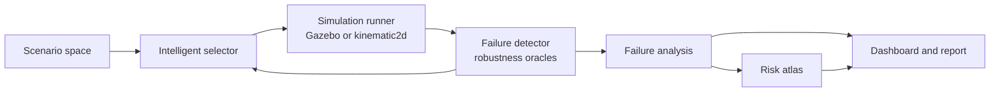

# RoboProbe

**Intelligent Virtual Robotics Testing & Failure Discovery Platform**

RoboProbe is a software-only, AI-driven testing layer on top of an established robotics simulator. It
automatically generates test scenarios for an autonomous robot, runs them in simulation, detects
failures, learns from every outcome, and deliberately searches for the rare *combinations* of
conditions (e.g. high speed + low light + sensor noise) that make the robot fail. It then explains
those failures and maps where the robot is safe, uncertain or failure-prone.

> **Status: Phase 0 — Specification complete.** This repository currently contains the full
> engineering documentation set. Implementation starts with milestone M1 (see
> [docs/22](docs/22-roadmap-and-implementation-plan.md)). No application code yet.

## At a glance

| | |
|---|---|
| Robot task (MVP) | TurtleBot 4 warehouse delivery with an injected low pallet |
| Simulator | Gazebo Harmonic + ROS 2 Jazzy + Nav2 (Docker, headless), plus the built-in `kinematic2d` backend for dev/CI |
| Scenario parameters | speed, obstacle clearance, illuminance, lidar noise, floor friction, command delay (+ obstacle position, lidar dropout) |
| Intelligent selection | `S-PROBE`: Gaussian-process Bayesian optimisation on a continuous robustness score + diversity-seeking mode search + level-set boundary learning (BoTorch) |
| Baselines | random, Latin hypercube, Sobol, grid, one-factor-at-a-time |
| Analysis | HDBSCAN failure modes, SHAP importance & interactions, decision rules, interaction confirmation, risk atlas |
| Stack | Python 3.12 · FastAPI · PostgreSQL 17 · React 19 + TypeScript · Docker Compose · GitHub Actions — 100 % free/open source |



## Documentation map

Start with [docs/00-index.md](docs/00-index.md) (reading paths and conventions).

| Area | Documents |
|------|-----------|
| Product | [01 Vision](docs/01-vision-and-product-brief.md) · [26 PRD](docs/26-product-requirements-document.md) · [02 SRS](docs/02-software-requirements-specification.md) · [03 Personas & use cases](docs/03-personas-user-stories-use-cases.md) |
| Architecture & design | [04 Architecture](docs/04-system-architecture.md) · [05 Module design](docs/05-module-detailed-design.md) · [34 Principles & patterns](docs/34-design-principles-patterns-and-conventions.md) · [ADRs](docs/adr/README.md) |
| Core science | [06 Scenario space](docs/06-scenario-parameter-space-and-schema.md) · [07 Selection algorithms](docs/07-intelligent-test-selection-algorithms.md) · [08 Failure detection](docs/08-failure-taxonomy-and-detection.md) · [09 Analysis & risk](docs/09-failure-analysis-and-risk-mapping.md) · [19 Evaluation](docs/19-evaluation-and-experiment-plan.md) |
| Integration & data | [10 Simulator](docs/10-simulator-integration.md) · [11 Data model](docs/11-data-model-and-database.md) · [12 API](docs/12-api-specification.md) · [27 Configuration](docs/27-configuration-reference.md) |
| UI | [13 Dashboard UX/UI](docs/13-dashboard-ux-ui-spec.md) · [14 Workflows](docs/14-workflows-and-sequences.md) |
| Engineering | [15 Tech stack](docs/15-tech-stack-and-adrs.md) · [16 Repo & standards](docs/16-repository-structure-and-coding-standards.md) · [18 Testing](docs/18-testing-strategy-and-qa.md) · [28 Traceability](docs/28-traceability-matrix.md) · [32 Process, DoR/DoD, review](docs/32-engineering-process-code-review-dor-dod.md) · [33 Versioning & release](docs/33-versioning-release-and-changelog-policy.md) |
| Operations | [17 Dev environment](docs/17-dev-environment-and-docker.md) · [20 CI/CD](docs/20-ci-cd-and-devops.md) · [29 Deployment](docs/29-deployment-guide.md) · [30 Runbook](docs/30-operations-runbook.md) · [21 Security, reproducibility, observability](docs/21-security-reproducibility-observability.md) · [31 Threat model](docs/31-threat-model.md) |
| Planning | [22 Roadmap & tasks](docs/22-roadmap-and-implementation-plan.md) · [23 Risks](docs/23-risks-and-mitigations.md) · [24 Glossary](docs/24-glossary.md) · [25 References](docs/25-references-and-prior-art.md) |

For AI coding agents: read [AGENTS.md](AGENTS.md) first.

## Quick start (available from milestone M1)

```bash
git clone https://github.com/CodewithJha/RoboProbe.git && cd RoboProbe
cp .env.example .env
make setup && make up && make demo    # then open http://localhost:8080
```

## Research question

*Can an intelligent testing system learn from simulation outcomes and efficiently discover rare
combinations of conditions that expose hidden weaknesses in a robotic system?* — hypotheses, metrics and
statistical protocol in [docs/19](docs/19-evaluation-and-experiment-plan.md).

## License

[MIT](LICENSE) © 2026 Priyanshu Jha
