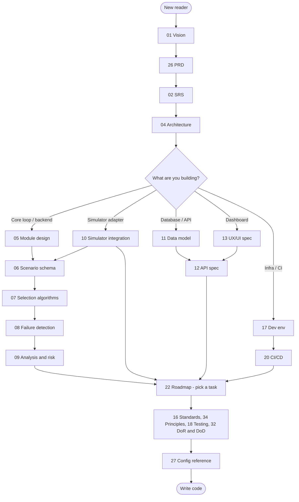

# 00 — Documentation Index & Reading Order

> **Project:** RoboProbe — Intelligent Virtual Robotics Testing & Failure Discovery Platform
> **Author / Owner:** Priyanshu Jha ([@CodewithJha](https://github.com/CodewithJha))
> **Doc set version:** 1.1.0 (Phase 0 — Specification) · **Status:** Approved for implementation
> **Audience:** AI coding agents (primary), the project owner, reviewers/evaluators

This folder is the **single source of truth** for RoboProbe. No application code exists yet; every
module, interface, table, endpoint and screen that will be built is specified here. When code and docs
disagree, the docs win until a change is recorded (see [§4 Change control](#4-change-control)).

## 1. Document map

| #  | Document | Purpose | Primary readers |
|----|----------|---------|-----------------|
| 00 | [Index & reading order](00-index.md) | This file: map, reading paths, conventions | Everyone |
| 01 | [Vision & Product Brief](01-vision-and-product-brief.md) | Why RoboProbe exists, goals, scope, success criteria | Everyone |
| 26 | [Product Requirements Document (PRD)](26-product-requirements-document.md) | What/why: KPIs, MoSCoW requirements `PR-xx`, journeys, release criteria, sign-off (read right after 01) | Owner, agents, evaluators |
| 02 | [Software Requirements Specification (SRS)](02-software-requirements-specification.md) | IEEE-830-style FR/NFR with IDs and acceptance criteria | Agents, reviewers |
| 03 | [Personas, User Stories & Use Cases](03-personas-user-stories-use-cases.md) | Who uses it and how | Agents (UI/API), owner |
| 04 | [System Architecture](04-system-architecture.md) | C4 context / container / component views, quality attributes | Agents (all) |
| 05 | [Module Detailed Design](05-module-detailed-design.md) | Module-by-module classes, interfaces, signatures | Agents (backend) |
| 06 | [Scenario Parameter Space & Schema](06-scenario-parameter-space-and-schema.md) | The 8 parameters, units, ranges, distributions, YAML/JSON schema | Agents (core, sim) |
| 07 | [Intelligent Test Selection Algorithms](07-intelligent-test-selection-algorithms.md) | Baselines, Bayesian optimisation, active learning, math + pseudocode | Agents (selector) |
| 08 | [Failure Taxonomy & Detection Rules](08-failure-taxonomy-and-detection.md) | Failure classes, oracles, thresholds, robustness semantics | Agents (oracle) |
| 09 | [Failure Analysis & Risk Mapping](09-failure-analysis-and-risk-mapping.md) | Clustering, feature importance/SHAP, rule extraction, risk maps | Agents (analysis) |
| 10 | [Simulator Integration](10-simulator-integration.md) | Gazebo Harmonic + ROS 2 Jazzy + Nav2 adapter, Kinematic2D backend, determinism | Agents (sim) |
| 11 | [Data Model & Database Schema](11-data-model-and-database.md) | ER diagram, PostgreSQL DDL, artifact storage layout | Agents (store) |
| 12 | [API Specification](12-api-specification.md) | REST + SSE endpoints, schemas, errors | Agents (API, web) |
| 13 | [Dashboard UX/UI Specification](13-dashboard-ux-ui-spec.md) | Screens, flows, wireframes, the original "Field Notebook" design language | Agents (web) |
| 14 | [Workflows & Sequence Diagrams](14-workflows-and-sequences.md) | End-to-end flows: campaign, run, analysis, replay, experiment | Agents (all) |
| 15 | [Tech Stack & ADR Summary](15-tech-stack-and-adrs.md) | Every library/tool with version policy + ADR index | Everyone |
| 16 | [Repository Structure & Coding Standards](16-repository-structure-and-coding-standards.md) | Folder tree, naming, typing, lint, commit conventions | Agents (all) |
| 17 | [Development Environment & Docker](17-dev-environment-and-docker.md) | Local setup, compose services, ROS container, laptop tips | Agents, owner |
| 18 | [Testing Strategy & QA Plan](18-testing-strategy-and-qa.md) | How RoboProbe itself is tested (unit → E2E), coverage gates | Agents (all) |
| 19 | [Evaluation & Experiment Plan](19-evaluation-and-experiment-plan.md) | Research question, metrics formulas, statistics, experiment matrix | Owner, agents (metrics) |
| 20 | [CI/CD & DevOps](20-ci-cd-and-devops.md) | GitHub Actions pipelines (free tier), release process | Agents (infra) |
| 21 | [Security, Reproducibility & Observability](21-security-reproducibility-observability.md) | Threat model, provenance, logging, metrics, tracing | Agents (all) |
| 22 | [Roadmap & Implementation Plan](22-roadmap-and-implementation-plan.md) | Milestones M0–M11, task breakdown sized for AI agents | Agents, owner |
| 23 | [Risks & Mitigations](23-risks-and-mitigations.md) | Risk register with likelihood/impact and mitigations | Owner, agents |
| 24 | [Glossary](24-glossary.md) | Every term and acronym used in the docs | Everyone |
| 25 | [References & Prior Art](25-references-and-prior-art.md) | Bibliography, related tools, what we borrow from each | Owner, agents |
| 27 | [Configuration Reference](27-configuration-reference.md) | Every setting/env var, precedence, defaults — no hard-coded values | Agents (all), operators |
| 28 | [Traceability Matrix](28-traceability-matrix.md) | PRD → SRS → design → tasks → tests | Agents, reviewers |
| 29 | [Deployment Guide](29-deployment-guide.md) | Topologies, install/upgrade, scaling, remote workers, backup, rollback | Operators |
| 30 | [Operations Runbook](30-operations-runbook.md) | Incident procedures RB-01…RB-10, maintenance | Operators |
| 31 | [Threat Model](31-threat-model.md) | Assets, trust boundaries, STRIDE table TM-01…TM-15 | Agents, reviewers |
| 32 | [Engineering Process: DoR/DoD & Code Review](32-engineering-process-code-review-dor-dod.md) | Workflow, Definition of Ready/Done, PR and review rules, RFC process | Agents (all) |
| 33 | [Versioning, Release & Changelog Policy](33-versioning-release-and-changelog-policy.md) | SemVer, API/schema/semantic versions, release checklist, migrations | Agents, owner |
| 34 | [Design Principles, Patterns & Conventions](34-design-principles-patterns-and-conventions.md) | SOLID, DI/composition roots, patterns, error handling, logging standards | Agents (all) |
| ADR | [Architecture Decision Records](adr/README.md) | One record per major decision (ADR-0001 … ADR-0016) | Everyone |
| TPL | [Templates](templates/) | ADR, RFC, task, bug report | Everyone |
| RFC | [RFCs](rfc/README.md) · [Evidence](evidence/README.md) | Proposals; spikes, experiment results, generated reports | Everyone |
| OSS | [README](../README.md) · [CONTRIBUTING](../CONTRIBUTING.md) · [CODE_OF_CONDUCT](../CODE_OF_CONDUCT.md) · [SECURITY](../SECURITY.md) · [SUPPORT](../SUPPORT.md) · [GOVERNANCE](../GOVERNANCE.md) · [CHANGELOG](../CHANGELOG.md) · [CITATION](../CITATION.cff) · [AGENTS](../AGENTS.md) | Root-level community and project files | Everyone |

Numbers are **stable document IDs**, not a reading order (26–34 were added after the core set; see §2 for reading paths).

## 2. Reading paths

**AI coding agent (mandatory minimum before any task):** `AGENTS.md` → 01 → 26 → 02 → 04 → 34 → 16 → 18 → 32 →
27 → the task's own entry in 22 → every document the task links to.

**Project owner / evaluator:** 01 → 26 → 19 → 22 → 23.

**Operator (running RoboProbe):** 17 → 29 → 27 → 30 → 21 → 31.

## 3. Conventions used across all documents

### 3.1 Identifier scheme (stable — never renumber, only append)

| Prefix | Meaning | Example | Defined in |
|--------|---------|---------|------------|
| `M1`–`M8` | The eight system modules from the concept report | `M4` Simulation Runner | 04, 05 |
| `FR-<AREA>-NNN` | Functional requirement | `FR-SEL-003` | 02 |
| `NFR-<AREA>-NNN` | Non-functional requirement | `NFR-REP-001` | 02 |
| `UC-NN` | Use case | `UC-03` | 03 |
| `US-NNN` | User story | `US-012` | 03 |
| `P1`–`P8` | Scenario parameters | `P3` illuminance | 06 |
| `S-<NAME>` | Selection strategy | `S-PROBE` | 07 |
| `F-<CODE>` | Failure class | `F-COL` collision | 08 |
| `O-<CODE>` | Oracle (detector) | `O-CLEAR` | 08 |
| `MET-NN` | Evaluation metric | `MET-03` sims-to-first-failure | 19 |
| `EXP-NN` | Experiment | `EXP-02` | 19 |
| `ADR-NNNN` | Architecture decision | `ADR-0002` | adr/ |
| `T-NNN` | Implementation task | `T-041` | 22 |
| `R-NN` | Risk | `R-05` | 23 |
| `PR-NN` | Product (PRD) requirement | `PR-03` | 26 |
| `PG-N`, `KPI-N`, `RC-N`, `OQ-N` | Product goal, KPI, release criterion, open question | `KPI-1` | 26 |
| `GT-X` | Ground-truth failure mode of kinematic2d | `GT-A` | 10 |
| `TM-NN` | Threat (STRIDE) | `TM-04` | 31 |
| `RB-NN` | Runbook procedure | `RB-03` | 30 |

Areas: `CFG` configuration, `DEP` deployability, `EXT` extensibility, `SCN` scenario, `SEL` selection, `RUN` runner, `SIM` simulator, `ORC` oracle/failure detection,
`ANA` analysis, `RSK` risk, `DSH` dashboard, `API`, `STO` storage, `EXP` experiments, `CLI`, `OPS`.

### 3.2 Module map (canonical names — use exactly these in code and docs)

| ID | Concept-report name | Python package | Notes |
|----|---------------------|----------------|-------|
| M1 | Virtual Robot & Environment | `roboprobe.backends` (+ `ros_ws/src/roboprobe_ros`) | Provided by a simulator; RoboProbe only adapts it |
| M2 | Scenario Generator | `roboprobe.scenario` | Parameter space, sampling, materialisation |
| M3 | Intelligent Test Selector | `roboprobe.selection` | Strategies `S-*` |
| M4 | Simulation Runner | `roboprobe.runner` | Orchestrator, job queue, workers |
| M5 | Failure Detector | `roboprobe.oracles` | Oracles `O-*`, verdicts, robustness |
| M6 | Failure Analysis Engine | `roboprobe.analysis` | Clustering, importance, rules |
| M7 | Risk & Robustness Analyzer | `roboprobe.risk` | Safe / uncertain / failure region maps |
| M8 | Experiment Dashboard | `web/` (+ `roboprobe.api`) | React SPA over the REST API |

Cross-cutting packages: `roboprobe.store` (persistence), `roboprobe.metrics` (evaluation metrics),
`roboprobe.experiments` (strategy comparisons), `roboprobe.reporting`, `roboprobe.cli`, `roboprobe.core`
(shared types, config, logging, errors).

### 3.3 Requirement keywords

"MUST", "MUST NOT", "SHOULD", "MAY" follow RFC 2119. Priority tags: **[MVP]** (needed for the
minimum viable product), **[V1]** (needed for the final project submission), **[FUT]** (future scope).

### 3.4 Units

SI units everywhere internally: metres, seconds, radians, m/s, lux, milliseconds only for
`comms.cmd_delay_ms` (stated in the field name). Timestamps are UTC ISO-8601 in storage; the dashboard
renders them in the viewer's local time zone.

### 3.5 Diagrams

All diagrams are Mermaid (renders natively on GitHub). Every diagram in this set was validated with
`@mermaid-js/mermaid-cli`. When editing, keep labels quoted and avoid unescaped parentheses/semicolons
inside node labels.

## 4. Change control

1. A change to behaviour starts as a docs PR that edits the relevant document(s) **and** bumps the
   "Last updated" line.
2. A change to a decision recorded in an ADR requires a **new** ADR that supersedes the old one
   (old ADR status → `Superseded by ADR-XXXX`). ADRs are never deleted.
3. Requirement IDs are never reused. A removed requirement is marked `~~FR-XXX-NNN~~ (withdrawn: reason)`.
4. The traceability matrix in 02 §7 must stay consistent with 22.

_Last updated: 2026-11-19 by Priyanshu Jha._
