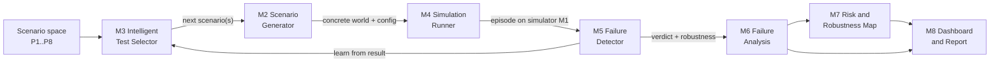

# 01 — Vision & Product Brief

> Owner: Priyanshu Jha · Status: Approved · Related: [26 PRD](26-product-requirements-document.md) · [02 SRS](02-software-requirements-specification.md), [19 Evaluation](19-evaluation-and-experiment-plan.md)

## 1. One-line pitch

**RoboProbe is a virtual testing engineer for autonomous robots:** it repeatedly runs a simulated robot,
learns from every outcome, and deliberately hunts for the rare *combinations* of conditions that make the
robot fail — then explains those failures and maps where the robot is safe, uncertain, or fragile.

## 2. Problem

| # | Problem (from the concept report) | Consequence |
|---|-----------------------------------|-------------|
| 1 | Physical robot testing is expensive, slow and potentially unsafe | Few tests are run; risky cases are avoided |
| 2 | Rare failures are hard to reproduce in the real world | Bugs are reported but cannot be fixed or regression-tested |
| 3 | Simulators give us robots, sensors and physics, but **not** a way to choose *which* tests matter | Engineers hand-pick a few "interesting" cases |
| 4 | Pure random testing wastes most simulations on ordinary, passing situations | Failure discovery per CPU-hour is low |
| 5 | A robot can pass each disturbance alone yet fail when several *moderate* disturbances co-occur | One-factor-at-a-time test plans systematically miss interaction failures |

The concept's canonical example: a warehouse robot passes with *high speed alone*, *sensor noise alone*,
and *low lighting alone*, but **high speed + low lighting + sensor noise** degrades localisation/perception
and ends in a collision. RoboProbe must find such cases automatically and then concentrate tests around them.

## 3. Solution overview

RoboProbe is **not** a simulator and **not** a robot. It is a software layer on top of an established
simulator (Gazebo Harmonic with ROS 2 Jazzy and Nav2 — see [ADR-0002](adr/ADR-0002-primary-simulator-gazebo-harmonic-ros2-jazzy.md)),
plus a lightweight built-in 2-D backend (`kinematic2d`, [ADR-0003](adr/ADR-0003-kinematic2d-fallback-backend.md))
so the whole loop can be developed and CI-tested on any laptop without ROS.

The **feedback loop** (M3 ← M5) is the intelligent core: each finished simulation updates a surrogate
model of "how close to failure is the robot in this region of conditions", and the selector picks the
next scenario where that model expects failures, is uncertain, or is near the pass/fail boundary.

## 4. Goals and non-goals

### 4.1 Goals (G)

| ID | Goal | Measured by |
|----|------|-------------|
| G1 | Fully virtual test bench for one robot task (warehouse delivery navigation) | Demo runs end-to-end headless |
| G2 | Automatic generation of scenarios across 6–8 parameters | FR-SCN-* satisfied |
| G3 | Intelligent next-scenario selection that beats random testing | MET-01, MET-03 with p < 0.05 (19 §5) |
| G4 | Automatic, rule-based failure detection with a documented taxonomy | 08; oracle unit tests |
| G5 | Explain which conditions and interactions cause failure | Cluster report + rules + SHAP plots |
| G6 | Map safe / uncertain / failure-prone regions | Risk map artefact per campaign |
| G7 | Rigorous comparison vs random, LHS/Sobol and predefined (OFAT/grid) testing | EXP-01..EXP-05 |
| G8 | Dashboard + exportable report | M8 screens, HTML/PDF report |
| G9 | Reproducibility: any failure can be re-run from its stored seed + manifest | MET-06 ≥ 0.8 on Gazebo, = 1.0 on kinematic2d |
| G10 | Zero cost: only free and open-source software; runs on a student laptop | NFR-COST-001 |

### 4.2 Non-goals (explicitly out of scope for V1)

- Building or controlling physical hardware; sim-to-real transfer (future scope).
- Writing a new physics simulator (the `kinematic2d` backend is a deliberately simple test double, not a product).
- Improving or re-tuning Nav2 itself (we *test* the robot stack, we do not fix it; robustness-improvement
  experiment EXP-05 only re-tunes a few Nav2 parameters to show the loop closes).
- Multi-robot scenarios, VLA models, world-model scenario generation, formal verification (future scope §8).
- Multi-tenant SaaS, user accounts, paid cloud services.

## 5. Target users

Detailed in [03](03-personas-user-stories-use-cases.md). In short:
1. **Robotics test engineer / student researcher** (primary — the project owner): defines a scenario space, launches campaigns, reads failure reports.
2. **Robot software developer**: receives a failure, replays it, fixes the stack, re-runs regression scenarios.
3. **Evaluator / supervisor**: reads the experiment comparison and the final report.
4. **AI coding agent**: builds RoboProbe from these docs.

## 6. MVP definition

The MVP is complete when all of the following hold (each maps to [MVP]-tagged requirements in 02):

1. One task: TurtleBot 4 delivers a package from dock A to station B in the Nav2 `warehouse.sdf` world
   while avoiding one injected obstacle (plus the same task in `kinematic2d`).
2. One simulator family (Gazebo Harmonic via ROS 2 Jazzy) plus the `kinematic2d` dev backend.
3. Six core parameters P1–P6 (speed, obstacle clearance, illuminance, lidar noise, floor friction,
   command delay), two optional P7–P8 (obstacle position along path, lidar dropout).
4. Baselines: `S-RANDOM`, `S-LHS`, `S-OFAT` (predefined).
5. Intelligent strategy: `S-PROBE` (Sobol warm-up → GP-based falsification with diversity → level-set
   boundary refinement).
6. Standardised run records in PostgreSQL + artefacts on disk.
7. Failure detection (`F-COL`, `F-TIMEOUT`, `F-STUCK`, `F-LOC`, `F-PLAN`, `F-NEAR` warning) and clustering into failure modes.
8. A failure report (HTML) listing each mode, its conditions, a minimal reproducing scenario and rules.
9. A comparison of `S-PROBE` vs baselines with the metrics MET-01..MET-06.

## 7. Success criteria (project-level acceptance)

| ID | Criterion | Threshold |
|----|-----------|-----------|
| SC-1 | Intelligent strategy finds first failure faster than random | Median sims-to-first-failure (MET-03) ≤ 50 % of `S-RANDOM`, Mann–Whitney p < 0.05 over 30 seeds (kinematic2d) |
| SC-2 | More unique failure modes within the same budget | MET-02 for `S-PROBE` ≥ `S-RANDOM`, Vargha–Delaney Â12 ≥ 0.64 ("medium") |
| SC-3 | Known interaction failure rediscovered | The seeded "speed × low light × noise" mode in kinematic2d is found in ≥ 90 % of `S-PROBE` repetitions within 200 sims |
| SC-4 | Gazebo demonstration | ≥ 1 real interaction failure found and replayed on Gazebo, documented with video/rosbag |
| SC-5 | Reproducibility | MET-06 = 1.0 on kinematic2d; ≥ 0.8 on Gazebo (failures re-occur in ≥ 4 of 5 replays) |
| SC-6 | Usability | A new user can launch a campaign from the dashboard in ≤ 5 minutes using only the README |
| SC-7 | Cost | ₹0 / $0 spend; all dependencies OSI-licensed |

## 8. Future scope (kept in mind by the architecture, not built in V1)

Adversarial scenario generation, multi-robot emergent failures, world-model-based generation,
Vision-Language-Action model testing, formal safety constraints (full STL specifications), sim-to-real
robustness estimation, automatic regression test generation from discovered failures (partially in V1
as "export failure as regression scenario"), digital-twin warehouses, human-in-the-loop approval for
high-risk configurations. The plugin points that make these possible are listed in 04 §8.

## 9. Research question

> **Can an intelligent testing system learn from simulation outcomes and efficiently discover rare
> combinations of conditions that expose hidden weaknesses in a robotic system?**

Operationalised hypotheses (tested in 19):
- **H1:** `S-PROBE` needs significantly fewer simulations to the first failure than `S-RANDOM` and `S-LHS`.
- **H2:** `S-PROBE` discovers significantly more distinct failure modes per fixed budget.
- **H3:** `S-PROBE` discovers interaction failures (≥ 2 parameters jointly necessary) that `S-OFAT` cannot.
- **H4:** The risk map produced by `S-PROBE` classifies held-out scenarios at least as accurately as one
  built from the same number of random samples (boundary accuracy, MET-08).

## 10. Constraints

- **Budget:** zero. Free/open-source only; GitHub free tier; optional free-tier cloud compute only for extra batches.
- **Hardware:** a typical student laptop (4–8 cores, 16 GB RAM, integrated GPU). Gazebo runs headless with CPU/EGL rendering.
- **Time:** single developer with AI agents; plan in [22](22-roadmap-and-implementation-plan.md).
- **Language:** English for all code, docs and UI.
