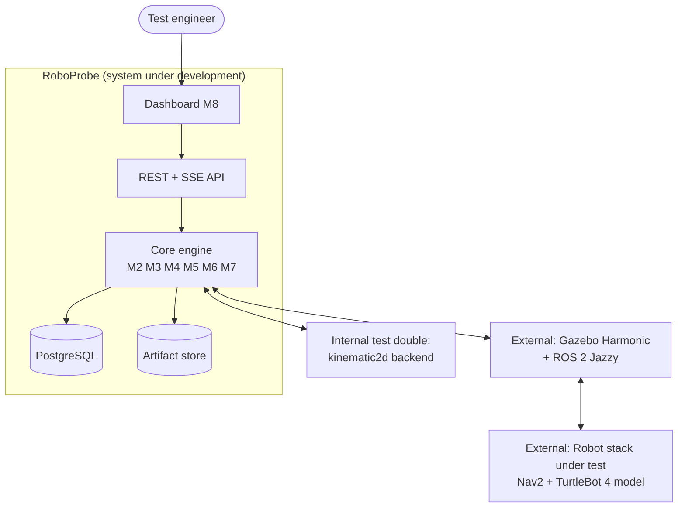

# 02 — Software Requirements Specification (SRS)

> Standard: structured after IEEE Std 830-1998 / ISO/IEC/IEEE 29148 · Version 1.0.0 · Owner: Priyanshu Jha
> Related: [01 Vision](01-vision-and-product-brief.md) · [26 PRD](26-product-requirements-document.md) (what/why; `PR-xx` → this SRS) · [27 Configuration](27-configuration-reference.md) · [28 Traceability](28-traceability-matrix.md) · [03 Use cases](03-personas-user-stories-use-cases.md) · [22 Roadmap](22-roadmap-and-implementation-plan.md)

## 1. Introduction

### 1.1 Purpose
This SRS specifies all functional and non-functional requirements of RoboProbe V1. It is written so that
an AI coding agent can implement each requirement and verify it via its acceptance criterion (AC) without
further clarification.

### 1.2 Scope
RoboProbe generates, selects, executes, judges and analyses simulated test scenarios for an autonomous
mobile robot. Product boundaries: RoboProbe owns everything from the scenario space definition to the
report; the simulator (Gazebo/ROS 2/Nav2) and the robot software stack are **external systems**.

### 1.3 Definitions
See [24 Glossary](24-glossary.md). Key terms: *scenario space*, *scenario*, *run* (one episode),
*campaign* (budgeted search with one strategy), *experiment* (comparison of campaigns), *oracle*,
*verdict*, *robustness ρ*, *failure mode*, *risk map*.

### 1.4 References
IEEE 830-1998; RFC 2119; documents 04–21 of this set; [25 References](25-references-and-prior-art.md).

### 1.5 Relationship to the PRD and to configuration
The PRD ([26](26-product-requirements-document.md)) defines product requirements `PR-01…PR-24` with MoSCoW
priority; each maps to one or more SRS requirements below (26 §6, 28 §1). **Every numeric value in this
SRS (timeouts, thresholds, limits, rates) is a documented default of a configuration key** in
[27](27-configuration-reference.md) unless it is a quality target (e.g. a performance budget); code
must read the key, never the literal.

### 1.6 Overview
§2 overall description, §3 functional requirements, §4 external interfaces, §5 non-functional
requirements, §6 constraints & assumptions, §7 traceability.

## 2. Overall description

### 2.1 Product perspective

### 2.2 Product functions (summary)
1. Define a scenario space (parameters, ranges, distributions, constraints).
2. Create and run campaigns with a chosen selection strategy and budget.
3. Execute runs on a backend (Gazebo or kinematic2d), headless, in parallel workers.
4. Detect failures with oracles, compute robustness, produce verdicts.
5. Cluster failures into modes; explain them with importance scores and rules.
6. Estimate risk maps (safe/uncertain/failure regions).
7. Compare strategies in experiments with statistics.
8. Visualise everything in a dashboard; export reports and regression scenarios.
9. Replay any run deterministically from its manifest.

### 2.3 User classes
| Class | Technical level | Uses |
|-------|-----------------|------|
| Test engineer (primary) | High | Dashboard, CLI, YAML configs |
| Robot developer | High | Failure detail, replay, regression export |
| Evaluator | Medium | Experiment comparison, report |
| AI coding agent | n/a | This document + API/CLI for automated tests |

### 2.4 Operating environment
- Host OS: Ubuntu 24.04 (native or WSL2 on Windows 11); macOS for core + kinematic2d only.
- Docker Engine ≥ 24 with Compose v2.
- Python 3.12; Node.js 24 LTS; PostgreSQL 17; ROS 2 Jazzy + Gazebo Harmonic inside a container.
- Browser: latest Chrome/Firefox/Edge.

### 2.5 Design & implementation constraints
- Free/open-source dependencies only (MIT/BSD/Apache/OFL/LGPL-compatible).
- Single-node deployment by Docker Compose; no Kubernetes.
- Local single-user tool; no authentication in V1 beyond a local API token (NFR-SEC-001).

### 2.6 Assumptions & dependencies
- A1: Nav2 `tb4_simulation_launch.py` and `nav2_minimal_tb4_sim` warehouse world are available as Jazzy binaries.
- A2: Gazebo can run headless at real-time factor ≥ 1.0 on the target laptop for one TurtleBot 4 (validated in T-090).
- A3: Lidar and depth sensors in Gazebo are geometric and are not affected by scene lighting; therefore
  illuminance (P3) is applied through RoboProbe's documented perception-degradation model (06 §3.3, 10 §5.3).
- A4: Episodes are ≤ 120 s simulated time.

## 3. Functional requirements

Format: **ID [priority] — statement.** *AC:* acceptance criterion.

### 3.1 Scenario space & generation (M2) — `SCN`
- **FR-SCN-001 [MVP]** — The system MUST load a scenario space from a YAML file validated against the JSON Schema in 06 §5.
  *AC:* `roboprobe space validate configs/scenario_spaces/warehouse_v1.yaml` exits 0; an invalid file exits 2 with a path-to-error message.
- **FR-SCN-002 [MVP]** — Each parameter MUST declare id, name, type (`float`/`int`/`categorical`), unit, bounds or choices, nominal value and prior distribution.
  *AC:* schema rejects a parameter missing any of those fields.
- **FR-SCN-003 [MVP]** — The system MUST normalise scenarios to the unit hypercube `[0,1]^d` and back, losslessly for floats (|error| < 1e-9) and exactly for ints/categoricals.
  *AC:* property-based test (Hypothesis) round-trip passes 10 000 examples.
- **FR-SCN-004 [V1]** — The system MUST support linear inequality and simple boolean constraints between parameters (e.g. `obstacle.clearance >= 0.0`), rejecting invalid samples via rejection sampling (max 1 000 attempts, then error).
  *AC:* unit test with constraint `P1 * P6 <= 0.1` never yields a violating scenario.
- **FR-SCN-005 [MVP]** — The system MUST materialise a scenario into backend-specific inputs (kinematic2d world dict; Gazebo world SDF + Nav2 param overrides + perturbation node params) deterministically.
  *AC:* materialising the same scenario twice yields byte-identical files (SHA-256 equal).
- **FR-SCN-006 [MVP]** — Every scenario MUST have a content hash `scenario_hash = sha256(canonical_json(values, space_version))[:16]`.
  *AC:* identical values produce identical hashes; any change produces a different hash.
- **FR-SCN-007 [V1]** — Users MAY pin parameters (fixed values) to search a sub-space.
  *AC:* pinned parameters never vary in a campaign's runs.
- **FR-SCN-008 [V1]** — The system MUST export any scenario as a standalone regression YAML (06 §6).
  *AC:* `roboprobe scenario export <run_id>` produces a file that `roboprobe run --scenario file.yaml` executes.

### 3.2 Test selection (M3) — `SEL`
- **FR-SEL-001 [MVP]** — The system MUST provide strategies `S-RANDOM`, `S-LHS`, `S-SOBOL`, `S-OFAT`, `S-GRID`, all implementing the `Strategy` interface (05 §4).
  *AC:* each strategy passes the shared strategy contract test suite.
- **FR-SEL-002 [MVP]** — The system MUST provide `S-BO`: Gaussian-process surrogate over robustness ρ with LogEI acquisition (minimisation of ρ).
  *AC:* on the analytic benchmark `branin_falsify` (07 §9) finds ρ < 0 in median ≤ 25 evaluations over 20 seeds.
- **FR-SEL-003 [MVP]** — The system MUST provide `S-PROBE`, the default strategy: Sobol warm-up → diversity-penalised falsification → level-set boundary refinement → failure-neighbourhood refinement (07 §6).
  *AC:* on kinematic2d meets SC-1 and SC-3 (01 §7).
- **FR-SEL-004 [V1]** — The system MUST provide `S-LSE` (straddle level-set active learning) as a stand-alone strategy.
- **FR-SEL-005 [MVP]** — Strategies MUST be deterministic given `(strategy_seed, history)`.
  *AC:* two campaigns with the same seed on kinematic2d produce identical scenario sequences.
- **FR-SEL-006 [MVP]** — Strategies MUST support batch proposals (`q ≥ 1`) for parallel workers.
  *AC:* `propose(q=4)` returns 4 distinct scenarios (pairwise normalised distance > 1e-3).
- **FR-SEL-007 [MVP]** — The selector MUST treat runs with verdict `INVALID` (infrastructure error) as missing data, not as passes or failures.
- **FR-SEL-008 [V1]** — Each proposal MUST record a rationale (`acquisition_value`, `phase`, `predicted_mean`, `predicted_std`) shown in the dashboard.
- **FR-SEL-009 [FUT]** — `S-CEM` (cross-entropy) and `S-AST` (adaptive stress testing with RL) MAY be added via the plugin registry.

### 3.3 Simulation running (M4) & backends (M1) — `RUN`, `SIM`
- **FR-RUN-001 [MVP]** — The orchestrator MUST enqueue runs in PostgreSQL and workers MUST claim them atomically (`SELECT … FOR UPDATE SKIP LOCKED`).
  *AC:* with 4 workers and 100 runs, every run executes exactly once (no duplicates, no losses) in an integration test.
- **FR-RUN-002 [MVP]** — Workers MUST send heartbeats every `worker.heartbeat_interval_s` (default 5 s); a run whose worker misses heartbeats for `runner.heartbeat_timeout_s` (default 30 s) MUST be re-queued up to `runner.max_attempts` (default 3 attempts total) then marked `ERROR` with verdict `INVALID`.
  *AC:* fake-clock test reproduces the transitions for both default and overridden values.
- **FR-RUN-003 [MVP]** — Each run MUST enforce a wall-clock timeout (`worker.default_wall_timeout_s`, default 300 s) and a simulated-time budget (`worker.default_sim_time_budget_s`, default 120 s), overridable per campaign.
- **FR-RUN-004 [MVP]** — Runs MUST record a time-series trace at ≥ 10 Hz: robot ground-truth pose, estimated pose, velocity command, measured velocity, min obstacle distance, Nav2 status.
  *AC:* trace Parquet file contains the columns in 11 §6.2 with no gaps > 0.2 s.
- **FR-RUN-005 [MVP]** — The system MUST support repeated runs of one scenario (`repeats ≥ 1`) with distinct derived seeds.
- **FR-RUN-006 [MVP]** — Workers MUST be backend-agnostic via the `SimulatorBackend` interface; MVP backends: `kinematic2d`, `gazebo_nav2`.
- **FR-SIM-001 [MVP]** — The `kinematic2d` backend MUST simulate a unicycle robot, 2-D lidar ray casting, the perception-degradation model, friction-induced slip, command delay, and a simple pure-pursuit + obstacle-reactive controller, at ≥ 50× real time on one CPU core.
- **FR-SIM-002 [MVP]** — The `kinematic2d` backend MUST contain seeded "ground-truth" failure regions documented in 10 §7 for evaluating recall.
- **FR-SIM-003 [MVP]** — The `gazebo_nav2` backend MUST launch Gazebo Harmonic headless with TurtleBot 4 + Nav2 in a container, apply all P1–P8, send a `NavigateToPose` goal and collect the trace.
- **FR-SIM-004 [V1]** — Multiple Gazebo workers MUST run in parallel isolated by `ROS_DOMAIN_ID` and `GZ_PARTITION`.
- **FR-SIM-005 [V1]** — The Gazebo backend SHOULD record a rosbag2 (MCAP) per failing run and MAY record one for passing runs (config flag).

### 3.4 Failure detection (M5) — `ORC`
- **FR-ORC-001 [MVP]** — The system MUST implement the oracles in 08 §3: `O-CLEAR` (collision/near-miss), `O-GOAL` (goal reached in time), `O-PROG` (stuck), `O-LOC` (localisation error), `O-NAV` (Nav2 abort), `O-STAB` (instability), `O-OSC` (oscillation).
- **FR-ORC-002 [MVP]** — Each oracle MUST output a robustness value `r ∈ [-1, 1]` (negative ⇔ violated) plus first-violation time.
- **FR-ORC-003 [MVP]** — The run verdict MUST be `FAIL` if any *failure* oracle is violated, `PASS` otherwise; `INVALID` if the run had an infrastructure error. Overall robustness `ρ = min_k r_k` over failure oracles.
- **FR-ORC-004 [MVP]** — The primary failure class MUST be the earliest violated failure oracle; secondary violations are also stored.
- **FR-ORC-005 [V1]** — Thresholds MUST be configurable per campaign; defaults in 08 §4.
- **FR-ORC-006 [MVP]** — Oracles MUST be pure functions of the trace (no simulator access) so they can be re-evaluated offline.
  *AC:* `roboprobe oracle reevaluate <run_id>` reproduces stored verdicts.

### 3.5 Failure analysis (M6) — `ANA`
- **FR-ANA-001 [MVP]** — The system MUST cluster failing runs into failure modes with HDBSCAN on a feature vector of normalised parameters + failure class one-hot + trajectory features (09 §3).
- **FR-ANA-002 [MVP]** — Each failure mode MUST have: id, label (auto-generated, editable), size, primary class, centroid scenario, medoid run, parameter ranges, and a "minimal reproducing scenario" (closest-to-nominal failing scenario).
- **FR-ANA-003 [MVP]** — The system MUST compute per-parameter importance for failure via SHAP on a gradient-boosted classifier, plus pairwise interaction strength (SHAP interaction values).
- **FR-ANA-004 [V1]** — The system MUST extract human-readable rules (depth-limited decision tree, ≤ 4 conditions per rule) with support and precision.
- **FR-ANA-005 [V1]** — The system MUST flag *interaction failures*: failure modes where no single parameter at its value alone (others nominal) fails (verified with confirmatory runs, 09 §6).
- **FR-ANA-006 [MVP]** — Analysis MUST be re-runnable on demand and automatically after a campaign completes.

### 3.6 Risk mapping (M7) — `RSK`
- **FR-RSK-001 [MVP]** — The system MUST estimate `p_fail(x)` over the space using the GP posterior on ρ: `p_fail = Φ(−μ(x)/σ(x))`.
- **FR-RSK-002 [MVP]** — Regions MUST be classified: SAFE (`p_fail < 0.05`), FAILURE (`p_fail > 0.95`), UNCERTAIN otherwise; thresholds configurable.
- **FR-RSK-003 [MVP]** — The system MUST produce 2-D slice maps for every parameter pair (others at nominal or at a chosen failure mode's medoid) on a 50×50 grid.
- **FR-RSK-004 [V1]** — The system MUST report volume fractions of SAFE/UNCERTAIN/FAILURE via quasi-Monte-Carlo (8 192 Sobol points).
- **FR-RSK-005 [V1]** — The system MUST compute a robustness score per robot configuration (`1 − failure volume fraction`) to compare stack versions.

### 3.7 Experiments & metrics — `EXP`
- **FR-EXP-001 [MVP]** — The system MUST run an experiment = set of strategies × N seeds × budget on one backend, and compute MET-01..MET-08 (19 §3).
- **FR-EXP-002 [MVP]** — The system MUST compute statistical comparisons: Mann–Whitney U, Vargha–Delaney Â12, bootstrap 95 % CIs, Holm correction.
- **FR-EXP-003 [V1]** — The system MUST plot discovery curves (cumulative unique modes vs. #sims) with CI bands.

### 3.8 Dashboard (M8) — `DSH`
- **FR-DSH-001 [MVP]** — Campaign list and creation wizard (space, backend, strategy, budget, workers, seed).
- **FR-DSH-002 [MVP]** — Live campaign view: progress, discovery curve, scenario stream, worker status (SSE, ≤ 2 s latency).
- **FR-DSH-003 [MVP]** — Failure modes view: cards, parameter ranges, rules, importance chart, medoid replay.
- **FR-DSH-004 [MVP]** — Risk map view: pairwise slice heatmaps with SAFE/UNCERTAIN/FAILURE overlay and evaluated points.
- **FR-DSH-005 [MVP]** — Run detail: parameters, verdict, oracle table, trajectory plot (top-down), time-series charts, artefact links.
- **FR-DSH-006 [V1]** — Experiment comparison view with metric tables, box plots and discovery curves.
- **FR-DSH-007 [V1]** — Report export (HTML; PDF via browser print stylesheet).
- **FR-DSH-008 [V1]** — Accessible: keyboard navigable, WCAG 2.2 AA contrast, colour-blind-safe risk palette.

### 3.9 API & CLI — `API`, `CLI`
- **FR-API-001 [MVP]** — REST API per 12, versioned under `/api/v1`, OpenAPI 3.1 auto-generated.
- **FR-API-002 [MVP]** — SSE stream `/api/v1/events` for campaign/run events.
- **FR-API-003 [MVP]** — Consistent error envelope (RFC 9457 problem+json).
- **FR-CLI-001 [MVP]** — CLI `roboprobe` with commands in 05 §11; every dashboard action is also possible from the CLI.

### 3.10 Storage — `STO`
- **FR-STO-001 [MVP]** — All entities in 11 persisted in PostgreSQL with Alembic migrations.
- **FR-STO-002 [MVP]** — Artefacts stored under `ARTIFACT_ROOT` with content-addressed paths and SHA-256 recorded.
- **FR-STO-003 [V1]** — Campaign export/import as a single `.tar.zst` bundle (DB rows as JSON Lines + artefacts).

### 3.11 Replay & reproducibility — `REP`
- **FR-REP-001 [MVP]** — `roboprobe replay <run_id> [--repeats N]` re-executes a run from its manifest and reports verdict agreement.
- **FR-REP-002 [MVP]** — Each run stores a provenance manifest (21 §4): code git SHA, package versions, backend image digest, seeds, scenario values, materialised file hashes.

## 4. External interface requirements

### 4.1 User interfaces
Dashboard per [13](13-dashboard-ux-ui-spec.md); CLI per 05 §11; YAML configs per 06.

### 4.2 Software interfaces
| Interface | Protocol | Spec |
|-----------|----------|------|
| Gazebo Harmonic | `gz sim` CLI, gz-transport services (`/world/<w>/set_physics`, entity create) via `ros_gz` | 10 §4 |
| ROS 2 Jazzy | rclpy topics/actions: `/navigate_to_pose`, `/scan`, `/cmd_vel`, `/amcl_pose`, `/odom`, `/tf` | 10 §3 |
| PostgreSQL 17 | SQLAlchemy 2 / psycopg 3 | 11 |
| Browser ↔ API | HTTPS/HTTP JSON + SSE | 12 |

### 4.3 Hardware interfaces
None (fully virtual).

### 4.4 Communication interfaces
Localhost HTTP (port 8000 API, 5173 dev web / 8080 prod web), PostgreSQL 5432 (internal network only),
DDS within the Gazebo worker container only.

## 5. Non-functional requirements

| ID | Category | Requirement | Acceptance |
|----|----------|-------------|-----------|
| NFR-PERF-001 [MVP] | Performance | kinematic2d episode (120 s sim) completes in ≤ 2 s wall on one core | benchmark test in CI |
| NFR-PERF-002 [MVP] | Performance | Selector `propose()` ≤ 2 s for n ≤ 500 observations, d = 8 (CPU) | pytest-benchmark |
| NFR-PERF-003 [V1] | Performance | Gazebo episode overhead (launch + teardown) ≤ 40 s; RTF ≥ 1.0 | T-090 report |
| NFR-PERF-004 [MVP] | Performance | API p95 latency ≤ 200 ms for list endpoints with 10 000 runs | locust/pytest |
| NFR-SCAL-001 [V1] | Scalability | Up to 8 parallel workers; 10 000 runs per campaign | load test |
| NFR-REL-001 [MVP] | Reliability | Worker crash never loses a run (re-queue) | chaos test kills worker |
| NFR-REL-002 [MVP] | Reliability | Orchestrator restart resumes running campaigns from DB state | integration test |
| NFR-REP-001 [MVP] | Reproducibility | kinematic2d: identical seed ⇒ bit-identical trace | test |
| NFR-REP-002 [V1] | Reproducibility | Gazebo: replay verdict agreement ≥ 80 % for failures | EXP-06 |
| NFR-MNT-001 [MVP] | Maintainability | Line coverage ≥ 85 % core, ≥ 70 % web; mypy strict passes | CI gates |
| NFR-MNT-002 [MVP] | Maintainability | Every public function has type hints + docstring (Google style) | ruff `D` rules |
| NFR-USE-001 [MVP] | Usability | Campaign launch ≤ 5 min for a new user | SC-6 hallway test |
| NFR-ACC-001 [V1] | Accessibility | WCAG 2.2 AA | axe-core in Playwright |
| NFR-SEC-001 [MVP] | Security | API binds to 127.0.0.1 by default; optional static bearer token | test |
| NFR-SEC-002 [MVP] | Security | No secrets in repo; `.env` git-ignored; dependency scanning in CI | CI |
| NFR-PORT-001 [MVP] | Portability | Core + kinematic2d run on Linux/macOS/Windows (WSL2) without Docker | CI matrix |
| NFR-COST-001 [MVP] | Cost | No paid services/APIs; all deps OSI-licensed | license check in CI |
| NFR-OBS-001 [MVP] | Observability | Structured JSON logs with `campaign_id`/`run_id`; Prometheus `/metrics` | test |
| NFR-OBS-002 [V1] | Observability | Optional Prometheus + Grafana compose profile and OpenTelemetry tracing, off by default | profile smoke test |
| NFR-SCAL-002 [V1] | Scalability | Workers on additional hosts join by configuration only (same `DATABASE_URL`), no code change; throughput scales ~linearly up to 8 Gazebo workers | remote-worker test (29 §6) |
| NFR-SEC-003 [MVP] | Security | Untrusted inputs (YAML, constraint expressions, bundles, paths) handled safely: `safe_load`, restricted AST, path confinement, safe tar extraction | security unit tests (31) |
| NFR-CFG-001 [MVP] | Configurability | No hard-coded tunables: all thresholds, timeouts, paths, URLs, ports, hyper-parameters and secrets are typed settings with defaults (ruff `PLR2004` on) | lint + review |
| NFR-CFG-002 [MVP] | Configurability | Layered sources with documented precedence (CLI > env > .env > TOML > defaults); invalid config fails fast at start-up with all errors listed | settings tests |
| NFR-CFG-003 [MVP] | Configurability | The configuration reference (27) is generated from the settings models and checked for drift in CI; resolved domain config is snapshotted per campaign/run | CI drift check |
| NFR-DEP-001 [MVP] | Deployability | One command brings up the full core stack (`make up`), with automatic migrations and health checks | compose smoke test |
| NFR-DEP-002 [MVP] | Deployability | All services containerised, non-root, configured only via env/secret files; same image for every environment | image tests |
| NFR-DEP-003 [V1] | Deployability | Tagged releases publish versioned images; rollback = previous tag (expand/contract migrations) | release workflow |
| NFR-EXT-001 [MVP] | Extensibility | New simulators, strategies, oracles, analyzers and stores are added as plugins (entry points) without modifying core packages | contract suites |
| NFR-EXT-002 [MVP] | Modularity | Layer and dependency rules enforced by import-linter (domain independent of infrastructure) | CI |
| NFR-EXT-003 [V1] | Extensibility | Public plugin interfaces are versioned (`PLUGIN_API_VERSION`) and documented with pre/post-conditions | review |

### 5.1 Quality attribute priorities
When attributes conflict, priority is: **correctness of verdicts & reproducibility > maintainability/modularity >
sample efficiency > performance > UI polish.** Quality attribute scenarios are in 04 §9.

## 6. Other requirements, constraints, assumptions
- Licence: MIT for RoboProbe code and docs.
- Data retention: user controls deletion; `roboprobe gc` removes artefacts of deleted campaigns.
- Internationalisation: English only in V1.

## 7. Traceability matrix (requirements → modules → tasks → tests)

Summary below; the complete PRD → SRS → design → tasks → tests matrix is in [28](28-traceability-matrix.md).

| Requirement group | Module | Tasks (22) | Test suites (18) |
|-------------------|--------|-----------|------------------|
| FR-SCN-* | M2 | T-020…T-026 | `tests/unit/scenario`, property tests |
| FR-SEL-* | M3 | T-050…T-062 | `tests/unit/selection`, strategy contract, benchmark suite |
| FR-RUN-*, FR-REP-* | M4 | T-040…T-047 | `tests/integration/runner` |
| FR-SIM-001/002 | M1 (kinematic2d) | T-030…T-035 | `tests/unit/backends/kinematic2d` |
| FR-SIM-003…005 | M1 (gazebo) | T-090…T-098 | `tests/sim/gazebo` (nightly) |
| FR-ORC-* | M5 | T-036…T-039 | `tests/unit/oracles` golden traces |
| FR-ANA-* | M6 | T-070…T-075 | `tests/unit/analysis` |
| FR-RSK-* | M7 | T-076…T-079 | `tests/unit/risk` |
| FR-EXP-* | metrics/experiments | T-100…T-105 | `tests/unit/metrics` |
| FR-API-*, FR-STO-* | api/store | T-010…T-014, T-080…T-084 | `tests/api`, migration tests |
| FR-DSH-* | M8 | T-085…T-089, T-110…T-114 | Vitest + Playwright |
| NFR-CFG-* | core.settings | T-003 | settings tests, drift check |
| NFR-DEP-*, NFR-EXT-* | bootstrap, docker | T-005, T-006, T-035, T-046, T-047, T-095 | compose smoke, contract suites, import-linter |
| NFR-* (others) | all | T-001…T-006, T-120… | CI gates |
