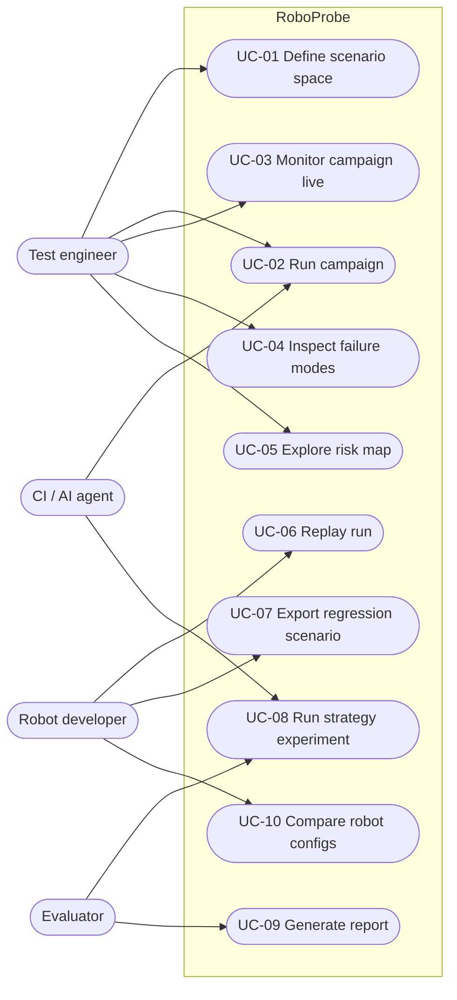

# 03 — Personas, User Stories & Use Cases

> Related: [02 SRS](02-software-requirements-specification.md) · [13 UX/UI](13-dashboard-ux-ui-spec.md) · [14 Workflows](14-workflows-and-sequences.md)

## 1. Personas

### P-A · Aarav — Robotics test engineer (primary)
- **Context:** final-year student / junior engineer responsible for validating a warehouse AMR navigation stack before a demo.
- **Goals:** find the conditions that break the robot *before* the supervisor does; produce evidence (plots, replays) for each failure.
- **Frustrations:** hand-written test lists miss combined effects; Gazebo runs are slow, so wasting runs on boring cases hurts.
- **Skills:** Python, ROS 2 basics, YAML; little Bayesian-optimisation theory.
- **Success for Aarav:** "In one night of simulation I get a ranked list of failure modes with a replay button."

### P-B · Meera — Robot software developer
- **Context:** owns Nav2 parameter tuning and the controller plugin.
- **Goals:** reproduce a failure deterministically, change a parameter, confirm the fix, prevent regressions.
- **Needs:** exact scenario export, rosbag, the minimal reproducing scenario, before/after robustness comparison.

### P-C · Dr. Rao — Supervisor / evaluator
- **Context:** grades the project; skeptical of "AI" claims.
- **Goals:** see a fair comparison (same budget, many seeds, statistics) of intelligent vs random/predefined testing.
- **Needs:** experiment report with discovery curves, p-values, effect sizes, threats to validity.

### P-D · Agent — AI coding agent
- **Context:** implements RoboProbe from these docs in small tasks.
- **Needs:** unambiguous interfaces, acceptance criteria, test fixtures, a strict definition of done (see `AGENTS.md`).

## 2. User stories (INVEST, with acceptance criteria)

| ID | As a… | I want… | So that… | Acceptance criteria | Req |
|----|-------|---------|----------|---------------------|-----|
| US-001 | test engineer | to describe my scenario space in one YAML file | I control what is varied | Validation errors show the YAML path and reason | FR-SCN-001 |
| US-002 | test engineer | to pick a strategy, budget and number of workers in a wizard | I can start without the CLI | Wizard has ≤ 4 steps, defaults pre-filled, "Start" creates & queues campaign | FR-DSH-001 |
| US-003 | test engineer | to watch failures appear live | I can stop early if enough was found | New run tiles appear ≤ 2 s after completion | FR-DSH-002 |
| US-004 | test engineer | to see failures grouped into modes | I don't read 80 near-identical failures | Each mode card shows size, class, top-3 conditions, rule | FR-ANA-001/002 |
| US-005 | test engineer | to know which parameters (and pairs) matter most | I can explain the failure | Importance bar chart + interaction heatmap per campaign | FR-ANA-003 |
| US-006 | test engineer | a map of safe / uncertain / failure regions | I can state the robot's operating envelope | Pairwise heatmaps with legend and evaluated points | FR-RSK-* |
| US-007 | developer | to replay a failing run 5× | I know whether it is flaky | Replay shows k/5 reproduced, per-replay ρ | FR-REP-001 |
| US-008 | developer | to export a failure as a regression scenario | CI can check my fix | Exported YAML runs with `roboprobe run --scenario` | FR-SCN-008 |
| US-009 | developer | to compare robustness of two stack configs on the same space | I can prove a fix helped | Robustness score delta with CI | FR-RSK-005 |
| US-010 | evaluator | a comparison of strategies over 30 seeds | the claim is statistically sound | Table: median, IQR, p (Holm), Â12 per metric | FR-EXP-002 |
| US-011 | evaluator | a single exportable report | I can grade offline | HTML report with all figures, printable to PDF | FR-DSH-007 |
| US-012 | test engineer | to pause/resume/cancel campaigns | I can free my laptop | State transitions per 14 §3; no run lost | FR-RUN-002 |
| US-013 | test engineer | to see why the selector chose a scenario | I trust the AI | Rationale panel: phase, μ, σ, acquisition | FR-SEL-008 |
| US-014 | test engineer | to run everything from the CLI | I can script nightly jobs | All wizard options available as flags | FR-CLI-001 |
| US-015 | agent | a fast backend without ROS | I can run tests in CI in seconds | kinematic2d episode ≤ 2 s | FR-SIM-001 |
| US-016 | test engineer | to pin some parameters | I can investigate a sub-space | Pinned params constant across runs | FR-SCN-007 |
| US-017 | developer | to see the trajectory and sensor timeline of a run | I see *how* it failed | Top-down path plot + synced time-series with failure marker | FR-DSH-005 |
| US-018 | evaluator | to know whether failures are interaction failures | I can verify the core research claim | Badge "interaction (P1×P3×P4)" with confirmatory evidence | FR-ANA-005 |

## 3. Use-case diagram

## 4. Use-case specifications

### UC-01 Define scenario space
- **Actor:** Test engineer · **Pre:** RoboProbe installed.
- **Main flow:** 1) copy `configs/scenario_spaces/warehouse_v1.yaml`; 2) edit ranges/priors; 3) run `roboprobe space validate`; 4) `roboprobe space register` (or upload in dashboard *Spaces* screen); 5) system stores it with `space_version` = SHA-256 of canonical content.
- **Alternate:** 3a validation fails → errors listed with JSON-pointer paths; user fixes and repeats.
- **Post:** space visible in campaign wizard. Re-registering identical content is idempotent.

### UC-02 Run campaign
- **Actor:** Test engineer / CI · **Pre:** registered space; ≥ 1 worker online for the chosen backend.
- **Main flow:** 1) choose space, backend, strategy (default `S-PROBE`), budget (default 200 runs), repeats (default 1), parallel workers (default = online workers), seed; 2) start; 3) orchestrator asks strategy for `q` proposals; 4) runs enqueued; 5) workers execute; 6) oracles judge; 7) strategy updated; loop until budget exhausted or stop rule (e.g. "stop after 10 modes"); 8) analysis + risk map auto-run; 9) campaign `COMPLETED`.
- **Exceptions:** worker lost → run re-queued (FR-RUN-002); > 20 % runs `INVALID` → campaign auto-paused with alert "infrastructure unhealthy".
- **Post:** runs, verdicts, modes, risk map stored.

### UC-03 Monitor campaign live
Dashboard subscribes to SSE; shows progress ring, discovery curve, latest runs, worker health; user may pause/resume/cancel.

### UC-04 Inspect failure modes
User opens *Failure Modes*; each mode shows class, size, parameter ranges (box-and-whisker per parameter vs. whole space), rule, SHAP top features, medoid run; user can rename the mode, mark as "known/accepted", or trigger confirmatory runs (interaction test).

### UC-05 Explore risk map
User picks parameter pair (x, y) and an anchor (nominal or a mode medoid); sees heatmap of `p_fail` and region classification, evaluated points overlaid (○ pass, ✕ fail); can click a cell → "Run this scenario now" (adds a manual run to campaign, tagged `manual`).

### UC-06 Replay run
`Replay ×N` → N runs with the original scenario and **original** seed (exact replay) or **fresh** seeds (robustness check); result: k/N reproduced, ρ distribution.

### UC-07 Export regression scenario
Produces YAML (06 §6) + optional pytest file template that asserts `verdict == PASS` once fixed.

### UC-08 Run strategy experiment
Choose strategies, seeds (default 30), budget, backend → experiment runs campaigns (possibly sequentially) → metrics + statistics → comparison view.

### UC-09 Generate report
From a campaign or experiment → HTML report (Jinja2 template) with figures as inline SVG; print stylesheet for PDF.

### UC-10 Compare robot configs
Same space + strategy against two `sut_profile`s (e.g. Nav2 params A vs B) → robustness score delta, mode-by-mode comparison (fixed / persisting / new).
