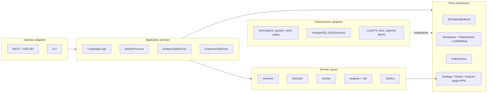
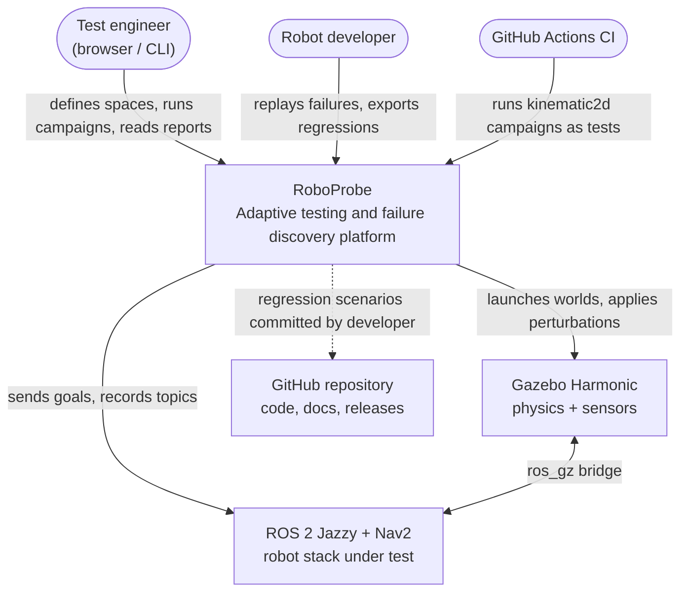
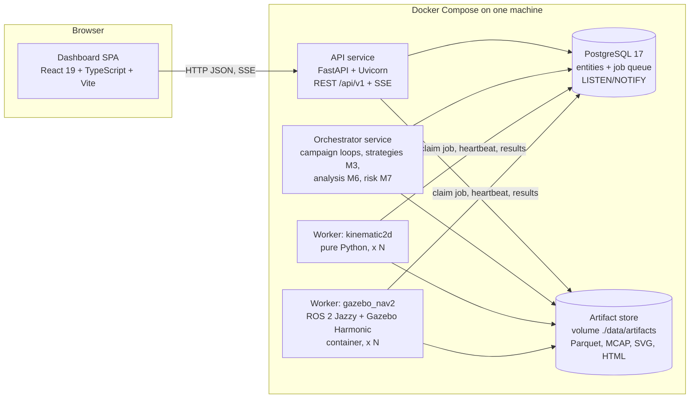
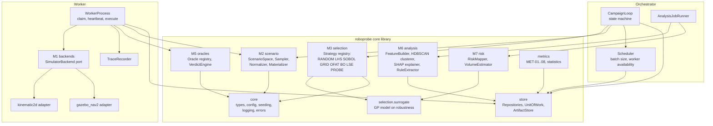
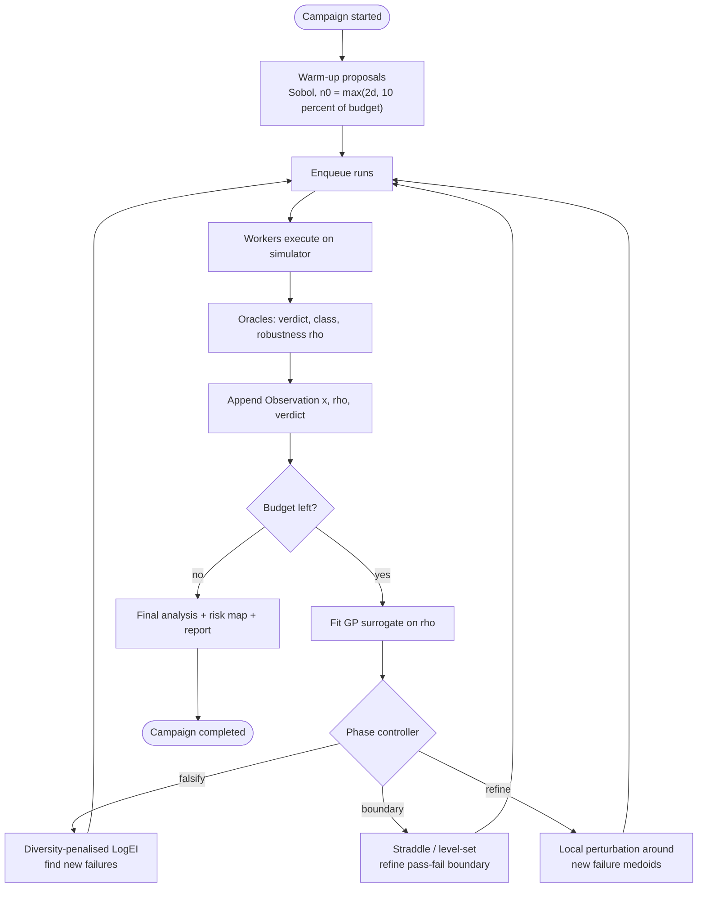
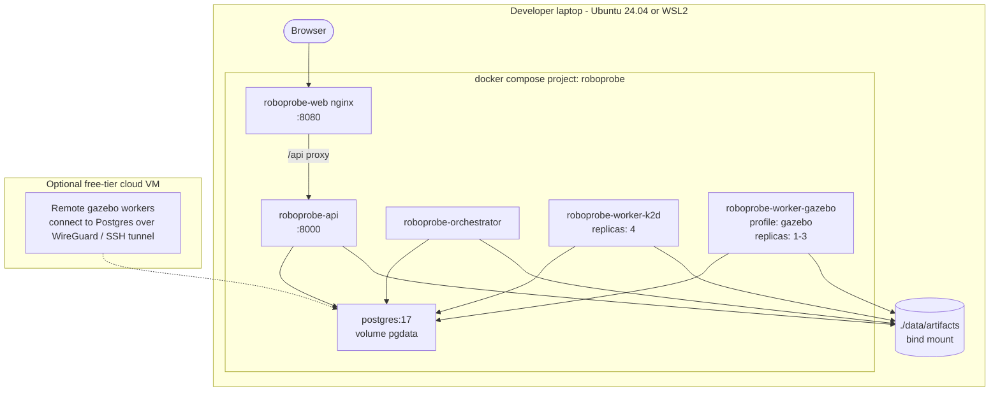

# 04 — System Architecture

> Style: C4 model (context → container → component) rendered as Mermaid flowcharts.
> Related: [34 Principles & patterns](34-design-principles-patterns-and-conventions.md) · [27 Configuration](27-configuration-reference.md) · [29 Deployment](29-deployment-guide.md) · [05 Module design](05-module-detailed-design.md) · [10 Simulator](10-simulator-integration.md) · [15 ADRs](15-tech-stack-and-adrs.md)

## 1. Architectural drivers

| Driver | Source | Architectural response |
|--------|--------|------------------------|
| Simulations are expensive (Gazebo ≈ 60–150 s each) | 01 §2 | Sample-efficient selector (GP-BO), batch proposals, parallel workers |
| Must develop/test without ROS or GPU | Constraint | `SimulatorBackend` port + `kinematic2d` adapter (hexagonal architecture) |
| Reproducibility of rare failures | G9 | Seed derivation tree, provenance manifest, pure-function oracles |
| Zero cost, single laptop | G10 | One PostgreSQL for data **and** job queue; Docker Compose; no message broker |
| Research comparability | G7 | Strategy plugin interface; experiments are first-class |
| Explainability | G5 | Analysis engine separated from selection; artefacts stored for re-analysis |
| Maintainability & modularity | PR-19, NFR-EXT-002 | Layered hexagonal core, import-linter contracts, one module per responsibility (M1–M8) |
| Extensibility | PR-19, NFR-EXT-001 | Ports + entry-point plugins for simulators, strategies, oracles, analyzers, stores ([ADR-0016](adr/ADR-0016-plugin-architecture-entry-points.md)) |
| Scalability | PR-16, NFR-SCAL-* | Stateless pull-based workers, batch proposals, horizontal scale across hosts without code change |
| Deployability | PR-13, NFR-DEP-* | Containers, env-based typed config, one-command up, automated migrations, CI-built images |
| No hard-coded values | PR-12, NFR-CFG-* | Typed layered settings injected at composition roots ([ADR-0015](adr/ADR-0015-typed-layered-configuration.md)) |

## 2. Architectural style

- **Hexagonal (ports & adapters)** in the core: domain logic (`scenario`, `selection`, `oracles`,
  `analysis`, `risk`) depends only on interfaces; adapters implement simulators, persistence and the API.
- **Orchestrator–worker** for execution: one orchestrator per campaign loop; N stateless workers pull jobs.
- **Database-as-queue** (PostgreSQL `SKIP LOCKED`) — [ADR-0007](adr/ADR-0007-postgresql-store-and-job-queue.md).
- **Event notification** via PostgreSQL `LISTEN/NOTIFY` → API → browser SSE — [ADR-0011](adr/ADR-0011-server-sent-events-for-live-updates.md).

### 2.1 Layers and ports at a glance

Swapping any adapter (simulator, database/queue, artefact store) or adding a plugin touches only the
`INFRA` box and the composition root; domain and application code are unchanged.

## 3. C4 Level 1 — System context

## 4. C4 Level 2 — Containers

| Container | Tech | Responsibility | Scales |
|-----------|------|----------------|--------|
| Dashboard | React, TanStack Query, Plotly.js | M8 UI | static files |
| API | FastAPI, Pydantic v2, SQLAlchemy 2 | CRUD, commands, SSE fan-out, report download | 1 |
| Orchestrator | Python, BoTorch, scikit-learn | campaign state machine, proposals, analysis jobs | 1 (leader lock) |
| Worker (kinematic2d) | Python, NumPy | executes runs in-process | 1…cores |
| Worker (gazebo_nav2) | Python + rclpy inside ROS image | launches Gazebo/Nav2 per run, records trace | 1…3 on a laptop |
| PostgreSQL | postgres:17 | system of record, queue, notifications | 1 |
| Artifact store | local filesystem volume | large binary/columnar artefacts | 1 |

The **CLI** (`roboprobe`) is the same Python package; `roboprobe campaign run --inline` runs the
orchestrator and N kinematic2d workers as threads/processes of one command against the same PostgreSQL
(useful for scripting and CI). Automated tests use a throw-away PostgreSQL from Testcontainers or the
CI service container — never SQLite, so SQL (e.g. `SKIP LOCKED`, `JSONB`) is identical everywhere.

## 5. C4 Level 3 — Components (orchestrator + core library)

**Dependency rule:** arrows point *inwards*. `scenario`, `selection`, `oracles`, `analysis`, `risk`,
`metrics` MUST NOT import `store`, `api`, `backends`, `rclpy` or `fastapi`. They receive plain data
(`Scenario`, `Observation`, `Trace`) defined in `roboprobe.core.types`. Enforced by `import-linter`
contracts in CI (16 §6).

## 6. The intelligent loop (runtime view)

## 7. Deployment view

Ports: web 8080, API 8000 (bound to 127.0.0.1), Postgres 5432 (compose network only; exposed to host
only in `dev` profile). Remote workers are optional and need no code change: a worker is just a process
with a `DATABASE_URL` and an artefact sink (rsync/S3-compatible MinIO optional, ADR-0008).

## 8. Extension points (for future scope)

| Extension | Mechanism | Future feature |
|-----------|-----------|----------------|
| New simulator | implement `SimulatorBackend`, register entry point `roboprobe.backends` | Webots, MuJoCo, Isaac Sim |
| New strategy | implement `Strategy`, entry point `roboprobe.strategies` | CEM, AST (RL), adversarial generators |
| New oracle | implement `Oracle`, entry point `roboprobe.oracles` | Formal STL specs, VLA task success |
| New task | `TaskSpec` (start/goal/obstacle layout) in space YAML | multi-robot, manipulation |
| New analysis | `Analyzer` plugin | causal analysis, counterfactuals |
| Approval gate | campaign hook `before_enqueue` | human-in-the-loop high-risk approval |

## 9. Quality attribute scenarios

| QA | Stimulus | Response | Measure |
|----|----------|----------|---------|
| Availability | Gazebo worker segfaults mid-run | Heartbeat expires; run re-queued on another worker | No lost run; ≤ 35 s detection |
| Performance | 4 kinematic2d workers, budget 1 000 | Campaign completes | ≤ 15 min incl. GP fitting |
| Modifiability | Add Webots backend | Only new adapter package + config | 0 lines changed in core |
| Reproducibility | Replay failing kinematic2d run | Same trace | bit-identical |
| Usability | First-time user | Campaign started from wizard | ≤ 5 min |
| Testability | CI on every PR | Full loop with kinematic2d | ≤ 10 min pipeline |

## 10. Scalability path

| Stage | Throughput lever | Change required |
|-------|------------------|-----------------|
| S0 laptop, 1 Gazebo worker | sample-efficient selection | none |
| S1 laptop, N k2d / 2 Gazebo workers | `--scale`, `worker.concurrency`, `batch_size` | config only |
| S2 extra hosts (lab PCs, free-tier VM) | remote workers on same DB | config + network tunnel (29 §6) |
| S3 shared artefacts | `storage.backend=s3` (MinIO adapter) | new adapter (plugin), no core change |
| S4 cluster | same images on Kubernetes; Postgres managed/operator | deployment manifests only (future RFC) |
| S5 very large n | sparse/variational GP or local GPs in a new `Strategy` | new strategy plugin |
Queue semantics (SKIP LOCKED) and stateless workers make S1–S4 linear in worker count until the
database becomes the bottleneck (far beyond 100 workers at ~1 run/min each).

## 11. Cross-cutting concepts

- **Configuration:** typed `pydantic-settings` tree (27); precedence CLI flag > env var `ROBOPROBE_*` > `.env` > `roboprobe.toml` > defaults; validated at start-up; injected via composition roots — no module reads env vars or contains tunable literals.
- **Dependency injection:** constructor injection, one composition root per process (`roboprobe.bootstrap`, 34 §3).
- **Versioning:** API, schemas, oracle/strategy semantics and plugin API are versioned independently (33).
- **Seeding:** `numpy.random.SeedSequence(campaign_seed).spawn()` tree (21 §3).
- **Time:** all durations in seconds (float), timestamps `datetime` UTC aware.
- **Errors:** typed hierarchy `RoboProbeError` → `ConfigError`, `BackendError`, `OracleError`, `StoreError`; API maps to problem+json.
- **Logging:** `structlog` JSON with bound `campaign_id`, `run_id`, `worker_id`; event catalogue in 34 §6.
