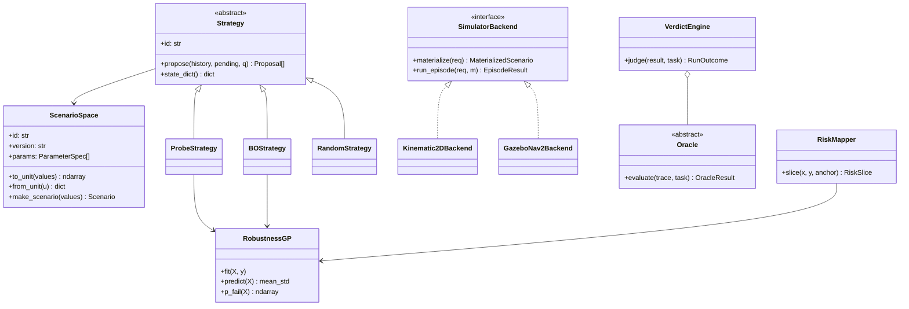

# 05 — Module-by-Module Detailed Design

> Related: [04 Architecture](04-system-architecture.md) · [06 Scenario schema](06-scenario-parameter-space-and-schema.md) · [07 Algorithms](07-intelligent-test-selection-algorithms.md) · [08 Oracles](08-failure-taxonomy-and-detection.md)
>
> Signatures below are **normative**: implement them with exactly these names, argument orders and
> return types (Python 3.12, `from __future__ import annotations` not needed). Private helpers are free.

## 0. Conventions for every module

- **Configuration injection:** constructors take typed settings/params objects (27); default values shown
  in signatures below (e.g. `resolution: int = 50`) are *illustrative of the configured default* — the real
  default comes from the settings model and is passed in by the caller/composition root. No module reads
  environment variables or files for configuration on its own (NFR-CFG-001).
- **Dependency injection:** collaborators (UoW factory, artefact store, backend, clock, RNG, logger) are
  constructor arguments, wired in `roboprobe.bootstrap` (34 §3).
- **Errors:** raise `RoboProbeError` subclasses with stable codes (34 §5).
- **Plugin API version:** every plugin base class declares `PLUGIN_API_VERSION: ClassVar[int] = 1`.
- **Logging:** module logger via `structlog.get_logger(__name__)`; events from the catalogue (34 §6).

## 1. Shared core types — `roboprobe.core.types`

All are frozen `pydantic.BaseModel` (v2) unless noted; NumPy arrays are carried as `npt.NDArray[np.float64]`
inside `@dataclass(frozen=True, slots=True)` classes where Pydantic overhead matters (traces).

```python
from enum import StrEnum
from uuid import UUID
from datetime import datetime
import numpy as np, numpy.typing as npt
from pydantic import BaseModel, Field

class ParamType(StrEnum):
    FLOAT = "float"; INT = "int"; CATEGORICAL = "categorical"

class Verdict(StrEnum):
    PASS = "PASS"; FAIL = "FAIL"; INVALID = "INVALID"

class FailureClass(StrEnum):
    COL = "F-COL"; NEAR = "F-NEAR"; TIMEOUT = "F-TIMEOUT"; STUCK = "F-STUCK"
    LOC = "F-LOC"; PLAN = "F-PLAN"; INST = "F-INST"; OSC = "F-OSC"; INFRA = "F-INFRA"

class RunStatus(StrEnum):
    PENDING = "PENDING"; CLAIMED = "CLAIMED"; RUNNING = "RUNNING"
    EVALUATING = "EVALUATING"; DONE = "DONE"; ERROR = "ERROR"; CANCELLED = "CANCELLED"

class CampaignStatus(StrEnum):
    CREATED = "CREATED"; RUNNING = "RUNNING"; PAUSED = "PAUSED"; ANALYZING = "ANALYZING"
    COMPLETED = "COMPLETED"; FAILED = "FAILED"; CANCELLED = "CANCELLED"

class Scenario(BaseModel, frozen=True):
    space_id: str                       # e.g. "warehouse_v1"
    space_version: str                  # sha256 prefix of canonical space YAML
    values: dict[str, float | int | str]   # keyed by parameter id ("robot.max_speed")
    scenario_hash: str                  # FR-SCN-006

class Proposal(BaseModel, frozen=True):
    scenario: Scenario
    strategy: str                       # "S-PROBE"
    phase: str                          # "warmup" | "falsify" | "boundary" | "refine" | "baseline"
    acquisition_value: float | None = None
    predicted_mean: float | None = None # GP mean of rho
    predicted_std: float | None = None
    tags: tuple[str, ...] = ()

class Observation(BaseModel, frozen=True):
    x_unit: tuple[float, ...]           # normalised scenario in [0,1]^d
    robustness: float | None            # rho in [-1,1]; None if INVALID
    verdict: Verdict
    failure_class: FailureClass | None
    run_id: UUID

@dataclass(frozen=True, slots=True)
class Trace:                            # columnar, one row per sample (>= 10 Hz)
    t: npt.NDArray[np.float64]          # sim time [s]
    gt_x: ...; gt_y: ...; gt_yaw: ...   # ground truth pose
    est_x: ...; est_y: ...; est_yaw: ...# localisation estimate (AMCL / k2d estimator)
    cmd_v: ...; cmd_w: ...              # commanded velocity (after delay)
    meas_v: ...; meas_w: ...            # measured velocity (odometry)
    min_obstacle_dist: ...              # true min distance robot footprint -> any obstacle [m]
    contact: npt.NDArray[np.bool_]      # physics contact flag
    roll: ...; pitch: ...               # for instability
    nav_status: npt.NDArray[np.int8]    # 0 idle 1 active 2 succeeded 3 aborted 4 canceled
    goal_x: float; goal_y: float
    meta: Mapping[str, Any]             # backend-specific extras

class OracleResult(BaseModel, frozen=True):
    oracle_id: str                      # "O-CLEAR"
    failure_class: FailureClass
    severity: Literal["failure", "warning"]
    robustness: float                   # [-1,1]
    violated: bool
    first_violation_t: float | None
    details: dict[str, float | str]

class RunOutcome(BaseModel, frozen=True):
    verdict: Verdict
    robustness: float | None
    primary_failure: FailureClass | None
    oracle_results: tuple[OracleResult, ...]
    metrics: dict[str, float]           # path_length, duration, mean_speed, max_loc_error, ...
```

## 2. M1 — Simulator backends — `roboprobe.backends`

### 2.1 Port

```python
class BackendCapabilities(BaseModel, frozen=True):
    name: str                           # "kinematic2d" | "gazebo_nav2"
    supported_params: frozenset[str]
    deterministic: bool                 # bitwise reproducible given seed
    typical_episode_wall_s: float
    max_parallel_per_host: int

class EpisodeRequest(BaseModel, frozen=True):
    run_id: UUID
    scenario: Scenario
    task: TaskSpec                      # start pose, goal pose, obstacle layout template, time limit
    sut_profile: SutProfile             # robot stack config (Nav2 params file / k2d controller gains)
    seed: int                           # derived run seed (21 §3)
    sim_time_budget_s: float = 120.0
    wall_timeout_s: float = 300.0
    record_bag: bool = False
    workdir: Path                       # per-run scratch directory

class EpisodeResult(BaseModel, frozen=True):
    trace: Trace
    artifacts: dict[str, Path]          # {"trace": .parquet, "bag": .mcap, "log": .txt, "world": .sdf}
    backend_meta: dict[str, str]        # image digest, gz version, rtf_mean, ...
    infra_error: str | None = None      # set => verdict INVALID

class SimulatorBackend(Protocol):
    capabilities: BackendCapabilities
    def prepare(self) -> None: ...                       # one-time per worker (pull images, warm caches)
    def materialize(self, req: EpisodeRequest) -> MaterializedScenario: ...   # pure; FR-SCN-005
    def run_episode(self, req: EpisodeRequest, m: MaterializedScenario,
                    on_progress: Callable[[float], None] | None = None) -> EpisodeResult: ...
    def cancel(self) -> None: ...                        # best-effort async cancel
    def shutdown(self) -> None: ...
```

### 2.2 Adapters
| Class | Package | Notes |
|-------|---------|-------|
| `Kinematic2DBackend` | `roboprobe.backends.kinematic2d` | in-process; see 10 §7 |
| `GazeboNav2Backend` | `roboprobe.backends.gazebo_nav2` | runs *inside* the ROS image; spawns `ros2 launch roboprobe_ros episode.launch.py` subprocess, talks via rclpy; see 10 §3–6 |
| `ReplayBackend` | `roboprobe.backends.replay` | returns a stored trace (for oracle re-evaluation and tests) |

Registry: `roboprobe.backends.registry.get_backend(name: str, settings: BackendSettings) -> SimulatorBackend`
using `importlib.metadata.entry_points(group="roboprobe.backends")`.

## 3. M2 — Scenario Generator — `roboprobe.scenario`

```python
class ParameterSpec(BaseModel, frozen=True):
    id: str; name: str; type: ParamType; unit: str
    low: float | None = None; high: float | None = None       # float/int
    choices: tuple[str, ...] | None = None                    # categorical
    nominal: float | int | str
    prior: PriorSpec                    # uniform | loguniform | normal(trunc) | beta | discrete
    scale: Literal["linear", "log"] = "linear"
    group: Literal["robot", "environment", "sensor", "comms", "task"]
    description: str

class ScenarioSpace:
    id: str; version: str; params: tuple[ParameterSpec, ...]; constraints: tuple[Constraint, ...]
    task: TaskSpec
    @classmethod
    def from_yaml(cls, path: Path) -> "ScenarioSpace": ...
    @property
    def dim(self) -> int: ...
    def to_unit(self, values: Mapping[str, Any]) -> npt.NDArray[np.float64]: ...      # shape (d,)
    def from_unit(self, u: npt.ArrayLike) -> dict[str, float | int | str]: ...
    def make_scenario(self, values: Mapping[str, Any]) -> Scenario: ...               # validates + hashes
    def nominal(self) -> Scenario: ...
    def is_feasible(self, values: Mapping[str, Any]) -> bool: ...
    def with_pins(self, pins: Mapping[str, Any]) -> "ScenarioSpace": ...              # FR-SCN-007

class Sampler(Protocol):
    def sample(self, n: int, rng: np.random.Generator) -> npt.NDArray[np.float64]: ...  # (n,d) unit cube

# implementations: UniformSampler, PriorSampler (inverse-CDF of priors), LatinHypercubeSampler(scipy.stats.qmc.LatinHypercube, optimization="random-cd"),
# SobolSampler(scramble=True, power-of-two warning suppressed), GridSampler(levels: int)

def canonical_json(obj: Any) -> bytes: ...          # sorted keys, floats repr with 12 significant digits
def scenario_hash(space_version: str, values: Mapping[str, Any]) -> str: ...
```

Materialisation is the backend's job (`SimulatorBackend.materialize`) but uses shared helpers in
`roboprobe.scenario.materialize`: `render_template(template: str, ctx: dict) -> str` (Jinja2,
`StrictUndefined`) and `place_obstacle(path: Polyline, along: float, clearance: float, side: Literal[-1,1]) -> Pose2D`.

## 4. M3 — Intelligent Test Selector — `roboprobe.selection`

```python
class StrategyContext(BaseModel):
    space: ScenarioSpace; budget: int; seed: int; batch_size: int
    params: dict[str, Any]             # strategy hyper-parameters (07 §10)

class Strategy(ABC):
    id: ClassVar[str]                  # "S-PROBE"
    def __init__(self, ctx: StrategyContext) -> None: ...
    @abstractmethod
    def propose(self, history: Sequence[Observation], pending: Sequence[npt.NDArray], q: int) -> list[Proposal]: ...
    def observe(self, obs: Observation) -> None: ...   # optional incremental update; default no-op
    def state_dict(self) -> dict[str, Any]: ...        # JSON-serialisable checkpoint
    def load_state_dict(self, state: dict[str, Any]) -> None: ...
    def is_exhausted(self) -> bool: return False       # GRID/OFAT finite designs
```

Rules every strategy MUST obey (strategy contract test suite, 18 §4.3):
1. Proposals lie inside the (pinned) space and satisfy constraints.
2. No duplicate of a pending or already observed point (normalised L∞ distance > 1e-6) unless `allow_repeats`.
3. Determinism: same `seed`, same history ⇒ same proposals (use `torch.manual_seed` + `np.random.Generator` derived from `(seed, len(history))`).
4. `INVALID` observations are ignored (FR-SEL-007).
5. Never block > `NFR-PERF-002` limits; fall back to Sobol and log a warning if model fitting fails.

Sub-modules: `baselines.py` (RANDOM, LHS, SOBOL, GRID, OFAT), `surrogate.py` (`RobustnessGP`),
`acquisition.py` (LogEI wrapper, straddle, diversity penalty), `bo.py` (`BOStrategy`), `lse.py`
(`LevelSetStrategy`), `probe.py` (`ProbeStrategy` + `PhaseController`), `registry.py`.

```python
class RobustnessGP:
    def __init__(self, d: int, *, noise: Literal["learned", "fixed"] = "learned", seed: int = 0) -> None: ...
    def fit(self, X: npt.NDArray, y: npt.NDArray) -> None: ...          # X (n,d) unit cube, y rho
    def predict(self, X: npt.NDArray) -> tuple[npt.NDArray, npt.NDArray]: ...  # mean, std (n,)
    def p_fail(self, X: npt.NDArray) -> npt.NDArray: ...                # Phi(-mu/sigma)
    @property
    def lengthscales(self) -> npt.NDArray: ...                          # ARD, for diagnostics
    def botorch_model(self) -> "botorch.models.SingleTaskGP": ...
```

## 5. M4 — Simulation Runner — `roboprobe.runner`

### 5.1 Orchestrator
```python
class CampaignLoop:
    def __init__(self, campaign_id: UUID, uow_factory: Callable[[], UnitOfWork], settings: RunnerSettings): ...
    def run(self, stop: threading.Event) -> CampaignStatus: ...  # blocks until terminal/paused
    def step(self) -> int: ...                                    # one scheduling tick; returns #enqueued

class Scheduler:
    def target_inflight(self, online_workers: int, batch_size: int) -> int: ...   # = ceil(min(batch_size, workers) * runner.inflight_factor)
```
Tick (every `runner.tick_interval_s`, default 1.0 s): read campaign → if not RUNNING return; count `inflight = PENDING+CLAIMED+RUNNING`;
`free = target_inflight − inflight`; if free > 0 and budget remaining: load history, `strategy.propose(q=free)`,
insert runs in one transaction with `seed = derive_seed(campaign_seed, "run", ordinal)`; persist
`strategy.state_dict()` every tick (resumability, NFR-REL-002). Leader election: `pg_try_advisory_lock(hashtext(campaign_id))`.

### 5.2 Worker
```python
class WorkerProcess:
    def __init__(self, backend: SimulatorBackend, uow_factory, artifact_store: ArtifactStore, settings: WorkerSettings): ...
    def serve_forever(self, stop: threading.Event) -> None: ...
    def claim(self) -> ClaimedRun | None: ...           # SKIP LOCKED, filtered by backend name
    def execute(self, run: ClaimedRun) -> None: ...     # materialize -> run_episode -> oracles -> persist
    def heartbeat(self) -> None: ...                    # every worker.heartbeat_interval_s, background thread
```
Worker states: `IDLE → CLAIMING → PREPARING → RUNNING → EVALUATING → UPLOADING → IDLE`; `DRAINING` on SIGTERM
(finish current run, claim no more).

### 5.3 Reaper
`Reaper.reap(now) -> int` runs inside the orchestrator every `runner.reaper_interval_s`: runs in CLAIMED/RUNNING whose
`worker.last_heartbeat < now − runner.heartbeat_timeout_s` → back to PENDING while `attempt < runner.max_attempts`, else ERROR + verdict INVALID.

## 6. M5 — Failure Detector — `roboprobe.oracles`

```python
class Oracle(ABC):
    id: ClassVar[str]; failure_class: ClassVar[FailureClass]; severity: ClassVar[Literal["failure","warning"]]
    def __init__(self, thresholds: OracleThresholds) -> None: ...
    @abstractmethod
    def evaluate(self, trace: Trace, task: TaskSpec) -> OracleResult: ...

class VerdictEngine:
    def __init__(self, oracles: Sequence[Oracle]) -> None: ...
    def judge(self, result: EpisodeResult, task: TaskSpec) -> RunOutcome: ...
def compute_run_metrics(trace: Trace, task: TaskSpec) -> dict[str, float]: ...
```
Oracle classes: `ClearanceOracle (O-CLEAR)`, `GoalOracle (O-GOAL)`, `ProgressOracle (O-PROG)`,
`LocalizationOracle (O-LOC)`, `NavStatusOracle (O-NAV)`, `StabilityOracle (O-STAB)`, `OscillationOracle (O-OSC)`.
Exact math in 08 §3.

## 7. M6 — Failure Analysis Engine — `roboprobe.analysis`

```python
class FailureFeatureBuilder:
    def build(self, runs: Sequence[RunRecord], space: ScenarioSpace) -> FeatureMatrix: ...  # 09 §3.1
class FailureClusterer:
    def __init__(self, min_cluster_size: int = 3, min_samples: int | None = None): ...
    def fit(self, F: FeatureMatrix) -> ClusteringResult: ...    # labels, probabilities, outlier scores
class ModeSummarizer:
    def summarize(self, result: ClusteringResult, runs, space) -> list[FailureModeSummary]: ...
class ImportanceExplainer:
    def explain(self, X: npt.NDArray, y_fail: npt.NDArray, names: list[str]) -> ImportanceReport: ...  # SHAP
class RuleExtractor:
    def extract(self, X, y_fail, names, max_depth: int = 4) -> list[Rule]: ...
class InteractionTester:
    def plan(self, mode: FailureModeSummary, space) -> list[Scenario]: ...      # confirmatory scenarios
    def conclude(self, mode, confirm_runs) -> InteractionVerdict: ...
def analyze_campaign(campaign_id: UUID, uow: UnitOfWork, artifact_store: ArtifactStore) -> AnalysisReport: ...
```
Mode identity across re-analysis: new clusters matched to previous modes by Hungarian assignment on
Jaccard similarity of member runs (≥ 0.5 ⇒ same `mode_id`, keeps user labels).

## 8. M7 — Risk & Robustness Analyzer — `roboprobe.risk`

```python
class RiskMapper:
    def __init__(self, gp: RobustnessGP, space: ScenarioSpace, thresholds: RiskThresholds): ...
    def slice(self, x_param: str, y_param: str, anchor: Mapping[str, Any], resolution: int = 50) -> RiskSlice: ...
    def all_pair_slices(self, anchor, resolution: int = 50) -> list[RiskSlice]: ...
    def classify(self, X_unit: npt.NDArray) -> npt.NDArray[np.int8]: ...   # 0 SAFE 1 UNCERTAIN 2 FAILURE
class VolumeEstimator:
    def estimate(self, mapper: RiskMapper, n: int = 8192, seed: int = 0) -> RegionVolumes: ...
def robustness_score(vol: RegionVolumes) -> float: ...   # 1 - failure_fraction - 0.5 * uncertain_fraction
```

## 9. Storage — `roboprobe.store`

Repository pattern + Unit of Work over SQLAlchemy 2 ORM. One repository per aggregate:
`SpaceRepo`, `CampaignRepo`, `RunRepo`, `FailureModeRepo`, `RiskMapRepo`, `ExperimentRepo`, `WorkerRepo`, `ArtifactRepo`.

```python
class UnitOfWork(AbstractContextManager["UnitOfWork"]):
    spaces: SpaceRepo; campaigns: CampaignRepo; runs: RunRepo; modes: FailureModeRepo
    risk_maps: RiskMapRepo; experiments: ExperimentRepo; workers: WorkerRepo; artifacts: ArtifactRepo
    def commit(self) -> None: ...; def rollback(self) -> None: ...
    def notify(self, channel: str, payload: dict) -> None: ...   # pg_notify on commit

class ArtifactStore:
    def __init__(self, root: Path): ...
    def put(self, src: Path, kind: ArtifactKind, run_id: UUID | None) -> ArtifactRef: ...  # sha256, move, record
    def open(self, ref: ArtifactRef) -> BinaryIO: ...
    def path(self, ref: ArtifactRef) -> Path: ...
```

## 10. API — `roboprobe.api`
FastAPI app factory `create_app(settings: ApiSettings) -> FastAPI`; routers per resource in
`roboprobe/api/routers/{spaces,campaigns,runs,modes,risk,experiments,workers,reports,events,health}.py`;
DTOs in `roboprobe/api/schemas/` (never expose ORM objects). Spec in 12.

## 11. CLI — `roboprobe.cli` (Typer)

| Command | Purpose |
|---------|---------|
| `roboprobe db upgrade` | Alembic upgrade head |
| `roboprobe space validate <yaml>` / `space register <yaml>` / `space list` | UC-01 |
| `roboprobe campaign create --space ID --backend B --strategy S --budget N --seed K [--repeats R] [--batch Q] [--pin k=v]` | UC-02 |
| `roboprobe campaign start\|pause\|resume\|cancel <id>` | lifecycle |
| `roboprobe campaign run <config.yaml> [--inline --workers 4]` | create+start+wait (CI) |
| `roboprobe campaign status <id> [--watch]` | progress |
| `roboprobe orchestrator` | run orchestrator service |
| `roboprobe worker --backend kinematic2d\|gazebo_nav2 [--concurrency N]` | run worker(s) |
| `roboprobe run --scenario file.yaml --backend B [--seed S]` | single ad-hoc run |
| `roboprobe replay <run_id> [--repeats N] [--fresh-seeds]` | UC-06 |
| `roboprobe scenario export <run_id> [-o file.yaml]` | UC-07 |
| `roboprobe analyze <campaign_id>` | re-run M6 + M7 |
| `roboprobe oracle reevaluate <run_id>` | FR-ORC-006 |
| `roboprobe experiment run <experiment.yaml>` / `experiment report <id>` | UC-08 |
| `roboprobe report <campaign_id\|experiment_id> -o report.html` | UC-09 |
| `roboprobe export <campaign_id> -o bundle.tar.zst` / `import <bundle>` | FR-STO-003 |
| `roboprobe api [--host --port]` | run API |
| `roboprobe gc [--dry-run]` / `artifacts verify` | delete orphaned artefacts / verify hashes |
| `roboprobe config show [--sources]` | print resolved configuration (secrets masked) |
| `roboprobe queue stats` / `runs requeue --stuck` | queue depth per backend / requeue stuck runs (runbook RB-05) |
| `roboprobe runs diff-manifest <a> <b>` | compare provenance of two runs (RB-10) |
| `roboprobe campaign pause --all` | pause every running campaign |
| `roboprobe space upgrade <yaml>` | migrate a space file to the current `schema_version` (33) |

Exit codes: 0 ok, 1 runtime error, 2 validation/usage error, 3 campaign finished with failures found
(only with `--fail-on-failure`, for regression CI).

## 12. Reporting — `roboprobe.reporting`
`render_campaign_report(campaign_id, uow, store) -> Path` and `render_experiment_report(...)`; Jinja2
templates in `roboprobe/reporting/templates/`; figures produced with Matplotlib (SVG) for the static
report so it works offline; the dashboard uses Plotly.js for interactive versions of the same figures.

## 13. Port summary (swap points)

| Port | Package | Default adapter(s) | Plugin group |
|------|---------|--------------------|--------------|
| `SimulatorBackend` | `backends.base` | `kinematic2d`, `gazebo_nav2`, `replay` | `roboprobe.backends` |
| `Strategy` | `selection.base` | `S-RANDOM` … `S-PROBE` | `roboprobe.strategies` |
| `Oracle` | `oracles.base` | `O-CLEAR` … `O-OSC` | `roboprobe.oracles` |
| `Analyzer` | `analysis.base` | clustering, importance, rules, interaction | `roboprobe.analyzers` |
| `RunQueue` | `runner.queue` | `PostgresRunQueue` | `roboprobe.stores` |
| `UnitOfWork` / repositories | `store` | SQLAlchemy/PostgreSQL | `roboprobe.stores` |
| `ArtifactStore` | `store.artifacts` | `LocalArtifactStore` (MinIO later) | `roboprobe.stores` |
| `Clock` | `core.clock` | `SystemClock`, `FakeClock` (tests) | – |

## 14. Class diagram (core domain)


