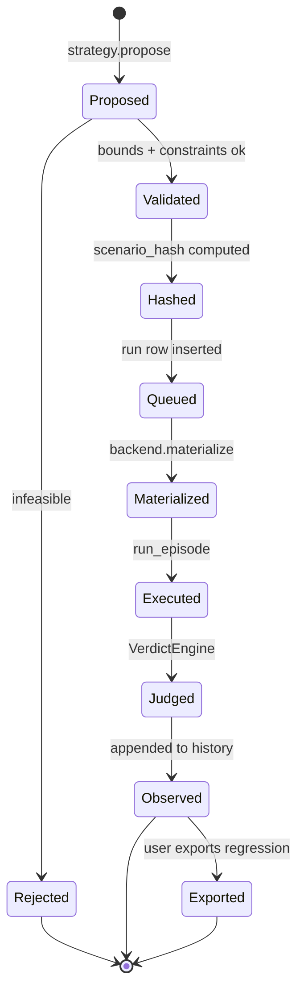

# 06 — Scenario Parameter Space & Scenario Schema Specification

> Related: [05 §3](05-module-detailed-design.md#3-m2--scenario-generator--roboprobescenario) · [10 Simulator](10-simulator-integration.md) · [07 Algorithms](07-intelligent-test-selection-algorithms.md)

## 1. The task under test (TaskSpec `warehouse_delivery_v1`)

| Item | Value |
|------|-------|
| Robot | TurtleBot 4 (standard) model from `nav2_minimal_tb4_description`; in kinematic2d a 0.17 m-radius differential-drive disc with the same footprint |
| World | Nav2 `nav2_minimal_tb4_sim/worlds/warehouse.sdf` (Gazebo); `warehouse_k2d.json` 2-D occupancy clone (kinematic2d) |
| Map | Pre-built occupancy map of the warehouse shipped in `ros_ws/src/roboprobe_ros/maps/warehouse.yaml` (generated once with `slam_toolbox`, T-092) |
| Start ("Dock A") | spawn pose from the Nav2 warehouse example: `x = 2.12, y = −21.3, yaw = 1.57` (verified in T-091) |
| Goal ("Station B") | defined in `tasks/warehouse_delivery_v1.yaml` ~12–15 m away through one aisle (exact coordinates fixed in T-092 after map inspection) |
| Nominal path | Polyline computed once from Nav2 planner on the empty map; stored with the task; used to place injected obstacles |
| Injected obstacle | "Dropped pallet": 0.8 × 0.6 m box whose **top is below the 2-D lidar scan plane** (height derived from TB4 URDF in T-091) so it is detectable only by the depth camera ⇒ perception and lighting matter |
| Success | reach goal within 0.25 m position / 0.5 rad yaw tolerance before time limit, without any oracle failure |
| Time limit | `T_max = 2.5 × (nominal_path_length / max_speed) + 10 s`, capped at 120 s |
| Localisation | AMCL with initial pose published at start (Gazebo); dead-reckoning + scan-matching EKF-lite (kinematic2d) |

> **Why a sub-lidar obstacle?** In Gazebo, lidar and depth sensors are geometric and unaffected by scene
> lighting (assumption A3, 02 §2.6). The TurtleBot 4's depth camera is a stereo camera (OAK-D), and real
> stereo depth degrades in low light. Making the injected obstacle visible only to the depth camera, and
> modelling illumination-dependent depth degradation explicitly, gives P3 (illuminance) a physically
> motivated, documented effect instead of an arbitrary one.

## 2. Parameter catalogue (space `warehouse_v1`)

| ID | Parameter id | Group | Type | Unit | Range | Nominal | Prior | Scale | Applied via (Gazebo / kinematic2d) |
|----|--------------|-------|------|------|-------|---------|-------|-------|-------------------------------------|
| P1 | `robot.max_speed` | robot | float | m/s | [0.10, 0.50] | 0.26 | uniform | linear | Nav2 controller max linear velocity + velocity smoother limit (param override YAML) / controller `v_max` |
| P2 | `obstacle.clearance` | task | float | m | [0.00, 1.20] | 0.80 | uniform | linear | lateral offset of pallet centre from nominal path (world SDF include pose) / same |
| P3 | `env.illuminance` | environment | float | lux | [5, 1000] | 300 | log-uniform | log | scene light intensity in SDF + `perception_degrader` node depth model / depth model |
| P4 | `sensor.lidar_noise_std` | sensor | float | m | [0.00, 0.10] | 0.01 | uniform | linear | `sensor_perturber` node Gaussian noise on `/scan` ranges / same |
| P5 | `env.floor_friction` | environment | float | – (μ) | [0.10, 1.00] | 0.80 | uniform | linear | `<surface><friction><ode><mu>` of ground plane in SDF / slip model |
| P6 | `comms.cmd_delay_ms` | comms | float | ms | [0, 400] | 20 | uniform | linear | `cmd_delay` relay node buffering `/cmd_vel` / FIFO delay buffer |
| P7 | `obstacle.along_path` *(optional)* | task | float | – | [0.20, 0.80] | 0.50 | uniform | linear | fraction of nominal path length where pallet is placed / same |
| P8 | `sensor.lidar_dropout` *(optional)* | sensor | float | probability | [0.00, 0.30] | 0.00 | uniform | linear | `sensor_perturber` sets random beams to `inf` / same |

Notes:
- MVP campaigns use P1–P6 (`d = 6`); "full" campaigns use P1–P8 (`d = 8`). Both are described by the same YAML with an `enabled` flag.
- P1 upper bound exceeds the physical TB4 maximum (~0.31 m/s): intentional stress range; documented as such in reports.
- Side of the obstacle (left/right of path) is derived deterministically: `side = +1` (fixed) in V1 to keep the space continuous.
- All parameters are **episode-constant** (static disturbances). Time-varying disturbances (e.g. a light flicker at t = 20 s) are future scope (FR-SEL-009 AST).

## 3. Physical models of each disturbance

### 3.1 Speed (P1)
Directly limits commanded linear velocity. Stopping distance ≈ `v²/(2·a_max) + v·(t_perception + t_delay)`.

### 3.2 Obstacle geometry (P2, P7)
Obstacle centre `c = path(s) + n(s) · (P2)` where `s = P7 · L_path`, `n(s)` the left unit normal. With
`P2 < footprint_radius + 0.4 = 0.57 m` the pallet intrudes into the robot's swept corridor and must be avoided.

### 3.3 Illumination-dependent depth degradation (P3)
Let `L` = illuminance, `L_ref = 300 lux`, `L_min = 5 lux`, `η = clip( log10(L_ref/L) / log10(L_ref/L_min), 0, 1 )`
(η = 0 bright, 1 darkest). The `perception_degrader` applies to each depth point / k2d depth ray:
- valid-return probability `p_valid = 1 − 0.85 · η²`
- range noise `σ_d = 0.005 + 0.01·r² · (1 + 4·η)` (stereo error grows ∝ r²)
- max effective range `r_max = 3.0 · (1 − 0.6·η)` m
Constants live in `configs/perception/oakd_lowlight_v1.yaml` so they can be changed and are versioned in the manifest.

### 3.4 Lidar noise and dropout (P4, P8)
`r' = r + N(0, P4²)` clipped to `[range_min, range_max]`; with probability P8 a beam becomes `+inf`
(no return). Noise is drawn from the run's `sensor` RNG stream (21 §3) so replays are identical.

### 3.5 Floor friction (P5)
Gazebo: ground-plane `mu`, `mu2` set to P5 (wheel surfaces keep defaults). kinematic2d: effective
traction `τ = min(1, P5 / μ_req)` where `μ_req = |a|/g + 0.15`; realised velocity `v_real = v_cmd·τ` with
yaw-rate slip `ω_real = ω_cmd · τ^1.5`; odometry still reports commanded wheel motion ⇒ odometry drift.

### 3.6 Command delay (P6)
FIFO buffer on velocity commands: a command published at `t` is applied at `t + P6/1000`.
Implemented as a ROS 2 relay node (`/cmd_vel_nav` → buffer → `/cmd_vel`) and as a deque in kinematic2d.

## 4. Space YAML (canonical example — `configs/scenario_spaces/warehouse_v1.yaml`)

```yaml
schema_version: 1
id: warehouse_v1
name: Warehouse delivery - single injected pallet
description: >
  TurtleBot 4 delivers from Dock A to Station B; a low pallet is injected near the nominal path.
task: tasks/warehouse_delivery_v1.yaml
parameters:
  - id: robot.max_speed
    name: Max linear speed
    group: robot
    type: float
    unit: m/s
    low: 0.10
    high: 0.50
    nominal: 0.26
    prior: {kind: uniform}
    enabled: true
  - id: obstacle.clearance
    name: Obstacle lateral clearance
    group: task
    type: float
    unit: m
    low: 0.0
    high: 1.2
    nominal: 0.8
    prior: {kind: uniform}
    enabled: true
  - id: env.illuminance
    name: Ambient illuminance
    group: environment
    type: float
    unit: lux
    low: 5
    high: 1000
    nominal: 300
    scale: log
    prior: {kind: loguniform}
    enabled: true
  - id: sensor.lidar_noise_std
    name: Lidar range noise (std)
    group: sensor
    type: float
    unit: m
    low: 0.0
    high: 0.10
    nominal: 0.01
    prior: {kind: uniform}
    enabled: true
  - id: env.floor_friction
    name: Floor friction coefficient
    group: environment
    type: float
    unit: "-"
    low: 0.10
    high: 1.00
    nominal: 0.80
    prior: {kind: uniform}
    enabled: true
  - id: comms.cmd_delay_ms
    name: Command delay
    group: comms
    type: float
    unit: ms
    low: 0
    high: 400
    nominal: 20
    prior: {kind: uniform}
    enabled: true
  - id: obstacle.along_path
    name: Obstacle position along path
    group: task
    type: float
    unit: "-"
    low: 0.2
    high: 0.8
    nominal: 0.5
    prior: {kind: uniform}
    enabled: false
  - id: sensor.lidar_dropout
    name: Lidar beam dropout probability
    group: sensor
    type: float
    unit: probability
    low: 0.0
    high: 0.30
    nominal: 0.0
    prior: {kind: uniform}
    enabled: false
constraints: []          # e.g. - expr: "robot.max_speed * comms.cmd_delay_ms <= 150"
oracle_thresholds: default   # or inline overrides, see 08 §4
```

Disabled parameters are held at `nominal`. `space_version = sha256(canonical_json(parsed_yaml_with_task_inlined))[:12]`.

### 4.1 Normalisation
- linear: `u = (x − low)/(high − low)`
- log: `u = (ln x − ln low)/(ln high − ln low)`
- int: `u = (x − low + 0.5)/(high − low + 1)`; inverse `x = low + floor(u·(high − low + 1))` clipped
- categorical (k choices): `u = (i + 0.5)/k`; inverse `i = min(k−1, floor(u·k))`. For GP models categoricals are one-hot encoded instead (07 §5.5).

## 5. JSON Schema (Draft 2020-12) — `schemas/scenario_space.schema.json`

```json
{
  "$schema": "https://json-schema.org/draft/2020-12/schema",
  "$id": "https://github.com/CodewithJha/RoboProbe/schemas/scenario_space.schema.json",
  "title": "RoboProbe scenario space",
  "type": "object",
  "required": ["schema_version", "id", "name", "task", "parameters"],
  "additionalProperties": false,
  "properties": {
    "schema_version": {"const": 1},
    "id": {"type": "string", "pattern": "^[a-z][a-z0-9_]{2,40}$"},
    "name": {"type": "string", "maxLength": 120},
    "description": {"type": "string"},
    "task": {"type": "string"},
    "parameters": {
      "type": "array", "minItems": 1, "maxItems": 16,
      "items": {"$ref": "#/$defs/parameter"}
    },
    "constraints": {
      "type": "array",
      "items": {"type": "object", "required": ["expr"],
                "properties": {"expr": {"type": "string"}, "note": {"type": "string"}},
                "additionalProperties": false}
    },
    "oracle_thresholds": {"oneOf": [{"const": "default"}, {"type": "object"}]}
  },
  "$defs": {
    "parameter": {
      "type": "object",
      "required": ["id", "name", "group", "type", "unit", "nominal", "prior"],
      "additionalProperties": false,
      "properties": {
        "id": {"type": "string", "pattern": "^[a-z]+\\.[a-z0-9_]+$"},
        "name": {"type": "string"},
        "group": {"enum": ["robot", "environment", "sensor", "comms", "task"]},
        "type": {"enum": ["float", "int", "categorical"]},
        "unit": {"type": "string"},
        "low": {"type": "number"},
        "high": {"type": "number"},
        "choices": {"type": "array", "items": {"type": "string"}, "minItems": 2},
        "nominal": {"type": ["number", "string"]},
        "scale": {"enum": ["linear", "log"], "default": "linear"},
        "prior": {
          "type": "object", "required": ["kind"],
          "properties": {
            "kind": {"enum": ["uniform", "loguniform", "truncnormal", "beta", "discrete"]},
            "mean": {"type": "number"}, "std": {"type": "number"},
            "a": {"type": "number"}, "b": {"type": "number"},
            "weights": {"type": "array", "items": {"type": "number"}}
          }
        },
        "enabled": {"type": "boolean", "default": true},
        "description": {"type": "string"}
      },
      "allOf": [
        {"if": {"properties": {"type": {"enum": ["float", "int"]}}},
         "then": {"required": ["low", "high"]}},
        {"if": {"properties": {"type": {"const": "categorical"}}},
         "then": {"required": ["choices"]}}
      ]
    }
  }
}
```

Semantic checks beyond JSON Schema (done in Python): `low < high`; `low ≤ nominal ≤ high`; `scale: log`
requires `low > 0`; unique ids; constraint expressions parse with the restricted evaluator
(`ast`-based: numbers, parameter ids, `+ - * / ** < <= > >= == and or not`, `abs min max`; no attribute
access or calls otherwise).

The committed file `schemas/scenario_space.schema.json` is authoritative. It matches the listing above and
additionally rejects unknown keys inside `prior` (typos such as `mena`) and puts `required: [type]` in the `if`
clauses, so a missing `type` is reported once. Sibling schemas: `scenario`, `task`,
`campaign` (also validates `CampaignCreate`, 12 §3.1) and `experiment` (19 §4).

## 6. Scenario & regression-scenario file (`schemas/scenario.schema.json`)

```yaml
schema_version: 1
kind: scenario
space: {id: warehouse_v1, version: 3f9a1c2b7d10}
values:
  robot.max_speed: 0.44
  obstacle.clearance: 0.31
  env.illuminance: 12.5
  sensor.lidar_noise_std: 0.062
  env.floor_friction: 0.72
  comms.cmd_delay_ms: 140
seed: 1849302231          # optional; omitted => fresh seed
expect:                   # used by regression CI
  verdict: PASS           # the fix target; originally FAIL (F-COL)
provenance:
  source_run: 7c1e7e0e-3b0f-4b77-9a54-1f0e4f5d2b11
  failure_mode: FM-03 "dark-fast-noisy collision"
  exported_at: 2026-11-19T18:30:00Z
```

## 7. Task file (`tasks/warehouse_delivery_v1.yaml`)

```yaml
schema_version: 1
id: warehouse_delivery_v1
world: {gazebo: nav2_minimal_tb4_sim/worlds/warehouse.sdf, kinematic2d: worlds/warehouse_k2d.json}
map: maps/warehouse.yaml
start: {x: 2.12, y: -21.3, yaw: 1.57}
goal:  {x: TBD_T092, y: TBD_T092, yaw: 1.57}   # filled by T-092; CI fails if TBD remains
goal_tolerance: {xy: 0.25, yaw: 0.5}
nominal_path: paths/warehouse_delivery_v1.csv
injected_obstacles:
  - {model: dropped_pallet, size: [0.8, 0.6, TBD_T091], placement: {along: obstacle.along_path, lateral: obstacle.clearance, side: left}}
time_limit: {factor: 2.5, offset_s: 10, cap_s: 120}
```

## 8. Scenario lifecycle


