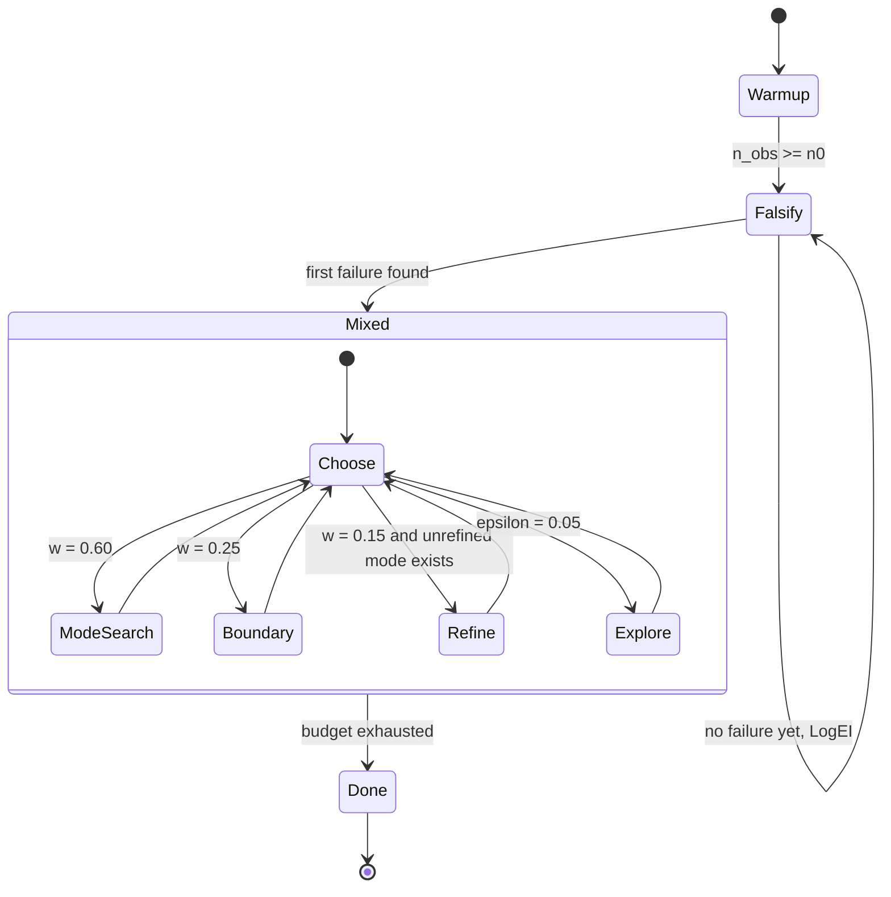

# 07 — Intelligent Test Selection Algorithms (M3)

> Related: [05 §4](05-module-detailed-design.md#4-m3--intelligent-test-selector--roboprobeselection) · [08 Robustness](08-failure-taxonomy-and-detection.md) · [ADR-0005](adr/ADR-0005-selection-gp-bayesian-optimisation-botorch.md) · [19 Evaluation](19-evaluation-and-experiment-plan.md)

## 1. Problem formulation

- Scenario space `X = [0,1]^d` (normalised, 06 §4.1), `d ∈ {6, 8}`.
- Black-box, expensive, noisy simulator: `ρ(x) = f(x) + ε`, where `ρ ∈ [−1, 1]` is the **robustness**
  of the run (08 §2): `ρ < 0 ⇔ FAIL`. Noise `ε` comes from simulator non-determinism and seeded sensor noise.
- Budget `B` simulations (typ. 100–500 on Gazebo, 200–2 000 on kinematic2d), batch size `q` = number of free workers.

The selector pursues three goals, in this order of priority:
1. **Falsification** — find any `x` with `ρ(x) < 0` quickly (MET-03).
2. **Diversity** — find *distinct* failure regions (modes), not 50 copies of one (MET-02).
3. **Boundary characterisation** — estimate the level set `{x : E[ρ(x)] = 0}` to build the risk map (MET-08).

Using a *continuous* robustness rather than a pass/fail bit is the key enabler: a passing run that
came within 3 cm of the pallet carries far more information than "PASS" (ADR-0006).

## 2. Strategy catalogue

| ID | Name | Family | Uses history? | Role |
|----|------|--------|---------------|------|
| `S-RANDOM` | Uniform / prior random | Monte Carlo | no | primary baseline |
| `S-LHS` | Latin hypercube (centred-discrepancy optimised) | space-filling | no | baseline |
| `S-SOBOL` | Scrambled Sobol sequence | quasi-random | no | baseline + warm-up |
| `S-GRID` | Full factorial grid | predefined | no | baseline (small d) |
| `S-OFAT` | One-factor-at-a-time sweeps | predefined | no | "manual test plan" baseline; cannot find interactions by design |
| `S-BO` | GP + LogEI falsification only | Bayesian optimisation | yes | ablation |
| `S-LSE` | GP + straddle level-set estimation | active learning | yes | ablation |
| `S-PROBE` | Phased hybrid (default) | BO + active learning + local search | yes | **RoboProbe's intelligent strategy** |
| `S-CEM` | Cross-entropy adaptive importance sampling | rare-event sampling | yes | [V1-optional] comparison |
| `S-AST` | Adaptive stress testing (RL/MCTS over time-varying disturbances) | RL | yes | [FUT] |

## 3. Baselines (precise definitions)

**S-RANDOM.** `u ~ U[0,1]^d`, mapped through each parameter's prior inverse-CDF (`loguniform` for P3).
Generator: `np.random.default_rng(seed)`.

**S-LHS.** `scipy.stats.qmc.LatinHypercube(d, optimization="random-cd", seed=seed).random(B)`,
generated once at campaign start and consumed in order (stored in strategy state).

**S-SOBOL.** `scipy.stats.qmc.Sobol(d, scramble=True, seed=seed)`; draws in blocks of `2^m` and
consumes in order (balance properties hold for prefixes of size `2^m`).

**S-GRID.** Levels `k = floor(B^(1/d))` (min 2) per dimension at `u ∈ {0, 1/(k−1), …, 1}`;
if `k^d > B`, a seeded random permutation of grid points is consumed until the budget is exhausted.

**S-OFAT.** For each enabled parameter `i` and levels `L = {0, 0.25, 0.5, 0.75, 1.0}` (unit scale):
`x = nominal` with `x_i = ℓ`. Total `d·|L|` distinct scenarios (30 for d = 6); the design is cycled with
fresh seeds if `B` is larger (measures noise). Represents a conscientious human test plan.

## 4. Gaussian-process surrogate (`RobustnessGP`)

- Model: `botorch.models.SingleTaskGP` with `Standardize(m=1)` outcome transform; inputs already in `[0,1]^d`.
- Kernel: `ScaleKernel(MaternKernel(nu=2.5, ard_num_dims=d))` with BoTorch default priors
  (dimension-scaled log-normal lengthscale prior). ARD lengthscales double as a coarse importance signal.
- Likelihood: Gaussian, learned homoscedastic noise, lower bound `1e-4` (kinematic2d is nearly noiseless,
  Gazebo is not).
- Fitting: `fit_gpytorch_mll(ExactMarginalLogLikelihood)`; L-BFGS-B; on failure retry once with
  re-initialised hyperparameters, then fall back to the previous model.
- Data: all non-INVALID observations. Repeated scenarios are kept as separate rows (the GP averages them).
- Scale limit: exact GP for `n ≤ 1500`. Above that, train on the 1 500 most informative points
  (all failures, all points with `|ρ| < 0.2`, then most recent), logged as `gp.subsampled=true`.
- Torch settings: `torch.float64`, CPU only, `torch.set_num_threads(min(4, os.cpu_count()))`.

Posterior at `x`: mean `μ(x)`, std `σ(x)` (latent, i.e. excluding observation noise).

Probability of failure: **`p_fail(x) = Φ(−μ(x)/σ(x))`**, used by the risk map (09 §5).

## 5. Acquisition functions

Let `φ, Φ` be the standard normal pdf/cdf, `z(x) = −μ(x)/σ(x)`.

### 5.1 LogEI for falsification (minimise ρ)
Improvement below incumbent `ρ* = min_i ρ_i`: `EI(x) = (ρ* − μ)Φ(γ) + σφ(γ)`, `γ = (ρ* − μ)/σ`.
We use BoTorch's numerically stable `qLogNoisyExpectedImprovement` on `−ρ` (maximisation form), which
handles noise and batches with pending points (`X_pending`). Used **until the first failure is found**.

### 5.2 Expected violation (EV) — failure-mode search after the first failure
After a failure exists, `ρ*` is very negative and EI collapses around it. We switch to the expected
amount by which a new point *violates* the specification, independent of the incumbent:

```
EV(x) = E[max(0, −ρ(x))] = (−μ(x)) · Φ(z(x)) + σ(x) · φ(z(x))
```

### 5.3 Diversity penalty (local penalisation of known modes)
Let `{m_1 … m_K}` be the medoids of currently known failure clusters (09 §3; recomputed every 10
observations with a cheap HDBSCAN on failing points). With per-dimension radius
`r_j = κ · ℓ_j` (`ℓ_j` GP lengthscale, `κ = 0.5`):

```
penalty(x) = Π_k ( 1 − exp( −½ · Σ_j ((x_j − m_kj) / r_j)² ) )
α_falsify(x) = log EV(x) + λ · log(penalty(x) + 1e−12)       (λ = 1.0)
```
This pushes proposals away from already-explained failure regions, so the budget buys *new* modes.

### 5.4 Straddle for boundary refinement (level-set estimation)
`α_boundary(x) = β · σ(x) − |μ(x)|`, with `β = 1.96` (Bryan et al., 2005). High where the model is
uncertain **and** near the `ρ = 0` contour.

### 5.5 Categorical / integer parameters
None in `warehouse_v1`. If present: integers are relaxed to continuous during optimisation and rounded
(with de-duplication); categoricals use `MixedSingleTaskGP` and `optimize_acqf_mixed`.

### 5.6 Batch proposals (`q > 1`)
- LogEI: native `q` batch with `X_pending`.
- EV, straddle: **Kriging Believer** — select greedily; after each pick, condition the GP on the
  pseudo-observation `(x_pick, μ(x_pick))` via `model.condition_on_observations` (no refit), re-optimise.
- Batches must be pairwise distinct (normalised L∞ > 1e-3).

### 5.7 Acquisition optimisation
`botorch.optim.optimize_acqf(bounds=[0,1]^d, num_restarts=10, raw_samples=512)`, `options={"maxiter": 200}`;
seeds fixed by `torch.Generator` derived from `(strategy_seed, n_obs)`. Infeasible results (constraints)
are projected by rejection: re-optimise with the offending point added to a tabu list (max 3 tries),
else fall back to the best feasible raw sample.

## 6. `S-PROBE` — the default intelligent strategy

### 6.1 Phases



| Phase | Acquisition / rule | Purpose |
|-------|--------------------|---------|
| Warm-up | Scrambled Sobol, `n0 = max(2d, ceil(0.1·B))` (12 for d=6, B=100) | unbiased initial design for GP |
| Falsify | qLogNEI on `−ρ` | reach first failure fast |
| ModeSearch | `α_falsify` = log EV + diversity penalty | discover new failure modes |
| Boundary | straddle `α_boundary` | sharpen pass/fail boundary → risk map |
| Refine | (a) **nominal-ward bisection**: on segment from nominal `x₀` to new mode medoid `m`, 4 bisection steps to find the failing point closest to nominal ("minimal reproducing scenario"); (b) 4 Gaussian perturbations `N(m, (0.05)²I)` | characterise each new mode; supports interaction test (09 §6) |
| Explore | one Sobol point | robustness to GP mis-specification |

Phase choice per proposal slot uses `rng.choice` with the weights above (renormalised if Refine is
unavailable). **Adaptive rule:** if the last `W = 20` ModeSearch proposals produced no new mode, move
0.2 weight from ModeSearch to Boundary (floor ModeSearch at 0.2). Every choice is stored in `Proposal.phase`.

### 6.2 Pseudocode

```text
function PROBE_PROPOSE(history H, pending P, q):
    X, y ← non-INVALID observations of H (unit cube, ρ)
    if |X| < n0: return next q Sobol points (skipping duplicates of P)
    gp ← RobustnessGP.fit(X, y)                       # refit every call (n ≤ 1500 ⇒ < 1 s)
    if no y_i < 0:
        return optimize_acqf(qLogNEI(gp, X_baseline=X, X_pending=P), q)  [phase=falsify]
    modes ← cheap_cluster(failing X)                  # cached, refreshed every 10 obs
    out ← []
    for slot in 1..q:
        phase ← choose_phase(rng, weights, modes)
        switch phase:
          ModeSearch: x ← argmax_x  log EV_gp(x) + λ log penalty_modes(x)
          Boundary:   x ← argmax_x  β σ_gp(x) − |μ_gp(x)|
          Refine:     x ← next point of refine plan for the oldest unrefined mode
          Explore:    x ← next Sobol point
        x ← dedupe(x, X ∪ P ∪ out)
        gp ← gp.condition_on_observations(x, μ_gp(x))  # Kriging Believer for next slot
        out.append(Proposal(x, phase, α(x), μ, σ))
    update adaptive weights
    return out
```

### 6.3 Hyper-parameters (defaults; overridable in campaign `strategy_params`)

| Name | Default | Notes |
|------|---------|-------|
| `n0` | `max(2d, ceil(0.1·B))` | warm-up size |
| `weights` | ModeSearch 0.60, Boundary 0.25, Refine 0.15 | renormalised |
| `epsilon` | 0.05 | Explore probability |
| `lambda_div` | 1.0 | diversity strength |
| `kappa_radius` | 0.5 | penalty radius in lengthscales |
| `beta_straddle` | 1.96 | |
| `refine_bisect_steps` | 4 | |
| `refine_perturb_n`, `refine_perturb_std` | 4, 0.05 | |
| `adapt_window` | 20 | |
| `num_restarts`, `raw_samples` | 10, 512 | acquisition optimiser |
| `max_gp_points` | 1500 | |

### 6.4 Complexity
GP fit `O(n³)` → n = 500 ≈ 0.3 s, n = 1500 ≈ 3 s on a laptop CPU (float64). Acquisition optimisation
≈ 0.2–0.8 s per slot. Total `propose(q=4)` ≤ 2 s for n ≤ 500 (NFR-PERF-002). Negligible versus a
60–150 s Gazebo episode, and acceptable versus a 1–2 s kinematic2d episode.

## 7. `S-BO` and `S-LSE` (ablations)
`S-BO`: warm-up then qLogNEI for the whole budget (no diversity, no boundary). `S-LSE`: warm-up then
straddle only. Together with `S-PROBE` they answer "which ingredient matters?" in EXP-03.

## 8. Optional strategies
- **`S-CEM`** [V1-optional]: maintain a truncated-Gaussian mixture proposal; each round sample 20,
  keep the elite 20 % lowest ρ, refit; standard rare-event baseline used in AV falsification literature.
- **`S-AST`** [FUT]: when disturbances become *time-varying* (e.g. lighting flicker schedule, delay
  bursts), the problem becomes sequential and an MDP; Adaptive Stress Testing with MCTS/RL is then the
  right tool. Not used in V1 because static episode-level parameters make the problem a (noisy)
  black-box optimisation where BO is far more sample-efficient (ADR-0005).

## 9. Analytic benchmark functions (for fast tests — `roboprobe.selection.benchmarks`)

These let the selector be unit-tested in milliseconds, with *known* failure modes.

- `branin_falsify(u)`: `ρ = clip((branin(15u₁−5, 15u₂) − 1.5)/50, −1, 1)` on `d = 2`; failures near the 3 Branin minima.
- `multi_mode_6d(u, noise=0.02)` — mirror of the kinematic2d ground truth (10 §7). With `s(z) = 1/(1+e^{−z/0.03})`:
  - Mode A (3-way interaction, "dark-fast-noisy"): `a = s(u₁−0.70)·s(0.25−u₃)·s(u₄−0.55)`
  - Mode B (2-way, "slippery-laggy"): `b = s(0.20−u₅)·s(u₆−0.60)`
  - Mode C (2-way, "blocked aisle"): `c = s(0.08−u₂)·s(u₁−0.55)`
  - Mode D (single factor, control): `e = s(u₄−0.95)`
  - `ρ = min(0.3 − 0.6a, 0.3 − 0.6b, 0.3 − 0.6c, 0.3 − 0.6e) + N(0, noise²)`
  - Failure volume ≈ 0.7 % of the cube (rare), mostly interactions — exactly the concept report's premise.

Acceptance tests (18 §4.4): over 20 seeds, budget 150, `S-PROBE` finds ≥ 3 of 4 modes in ≥ 80 % of
seeds and median first failure ≤ 40; `S-RANDOM` is expected to find ≤ 2 modes.

## 10. Strategy configuration in a campaign

```yaml
strategy:
  id: S-PROBE
  seed: 42
  params:
    weights: {mode_search: 0.6, boundary: 0.25, refine: 0.15}
    epsilon: 0.05
    lambda_div: 1.0
```

## 11. Failure modes of the selector itself (and guards)

| Risk | Guard |
|------|-------|
| GP overconfident (tiny lengthscales) | lengthscale prior; Explore slots; warm-up |
| Saturated ρ (all collisions = −1) gives flat regions | robustness defined with continuous penetration/time components (08 §2.3) |
| Noisy Gazebo outcomes mislead EI | noisy EI; learned noise; replay confirmation for modes |
| Proposal stuck on one mode | diversity penalty; adaptive weights |
| Infeasible proposals | rejection + tabu; fallback raw sample |
| Model fit exception | fallback to Sobol for that tick, warning event `selector.fallback` |
