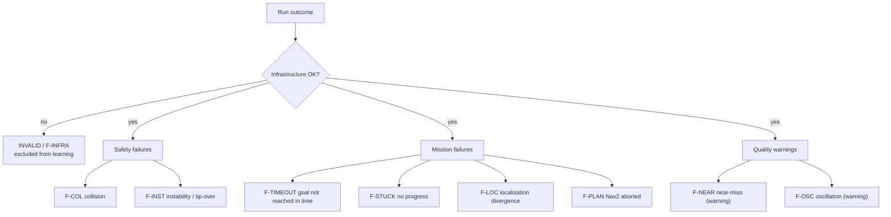
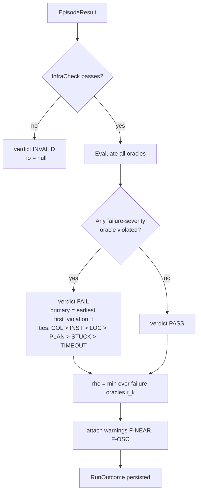

# 08 — Failure Taxonomy & Detection Rules (M5)

> Related: [05 §6](05-module-detailed-design.md#6-m5--failure-detector--roboprobeoracles) · [ADR-0006](adr/ADR-0006-robustness-valued-oracles.md) · [27 Configuration](27-configuration-reference.md) (all thresholds are config keys `oracles.*`)

## 1. Principles

1. **Oracles are pure functions of the recorded trace** (+ task spec + thresholds). No simulator calls ⇒
   offline re-evaluation, golden-trace unit tests, identical logic for every backend (FR-ORC-006).
2. **Every oracle yields a continuous robustness `r ∈ [−1, 1]`**, negative iff violated — inspired by
   Signal Temporal Logic (STL) quantitative semantics. The selector learns from *how close* a run came to failing.
3. **Ground truth for safety, estimates for the stack.** Collision/clearance use *simulator ground-truth*
   geometry; localisation compares ground truth vs. the robot's own estimate.
4. **Infrastructure problems are not robot failures.** They produce verdict `INVALID` and are excluded from learning.
5. **No hard-coded numbers.** Every threshold below is a default of a typed config key (`oracles.<oracle>.<key>`), overridable per campaign and stored in the run manifest.

## 2. Taxonomy

| Class | Severity | Oracle | Meaning | Typical root causes |
|-------|----------|--------|---------|---------------------|
| `F-COL` | failure | `O-CLEAR` | Robot footprint contacts any obstacle/wall | perception miss (dark, noise), late braking (speed, delay) |
| `F-INST` | failure | `O-STAB` | Excessive roll/pitch or yaw rate | low friction + aggressive turns |
| `F-TIMEOUT` | failure | `O-GOAL` | Goal not reached within `T_max` | detours, recoveries, slow progress |
| `F-STUCK` | failure | `O-PROG` | No meaningful progress over a window while navigation active | blocked aisle, costmap ghost obstacles |
| `F-LOC` | failure | `O-LOC` | Sustained localisation error above threshold | slip (friction), lidar noise/dropout |
| `F-PLAN` | failure | `O-NAV` | Nav2 `NavigateToPose` returned ABORTED | no valid path, controller failure |
| `F-NEAR` | warning | `O-CLEAR` | Clearance below safety margin without contact | marginal perception |
| `F-OSC` | warning | `O-OSC` | Rapid oscillation of angular command | delay + controller gains |
| `F-INFRA` | invalid | `InfraCheck` | Simulator crash, RTF collapse, data gaps, Nav2 not active | environment, not robot |

Warnings never flip the verdict to FAIL but are stored and shown (they make good "near failure" evidence).

## 3. Oracle definitions

Notation: trace sampled at times `t_0 … t_N`; `d(t)` true minimum distance footprint→obstacles (m);
`e(t) = ‖p_gt(t) − p_est(t)‖` (m); `T_max` from the task (06 §1); `clip(z) = max(−1, min(1, z))`.
STL-style formulas given for clarity; implementation is vectorised NumPy.

### 3.1 `O-CLEAR` — collision & near-miss

- Violation (F-COL): `∃t: contact(t) ∨ d(t) ≤ 0` — STL `G (d > 0)`.
- Robustness:
  - no contact: `r = clip( min_t d(t) / d_norm )` (`d_norm = 0.5 m`)
  - contact: `r = −clip( r_c0 + (1 − r_c0) · v_impact / v_ref )` with `r_c0 = 0.1`, `v_ref = 0.5 m/s`,
    `v_impact` = |measured speed| at first contact. Harder impacts ⇒ more negative ⇒ continuous signal inside the failure region.
- Warning F-NEAR: no contact and `min_t d(t) < d_safe` (`d_safe = 0.10 m`).
- `first_violation_t` = first contact time.

### 3.2 `O-GOAL` — timeout

- Success time `t_goal` = first `t` with `‖p_gt − goal‖ ≤ tol_xy ∧ |yaw error| ≤ tol_yaw` (from task).
- Violation (F-TIMEOUT): `t_goal` undefined or `t_goal > T_max` — STL `F_[0,T_max] at_goal`.
- Robustness: reached: `r = clip((T_max − t_goal)/T_max)`; not reached: `r = −clip(max(r_min, d_remaining / L_path))` with `r_min = 0.01`, `d_remaining` = remaining path length from closest point on nominal path.

### 3.3 `O-PROG` — stuck

- Window `W = 10 s`; `Δ(t) = ‖p_gt(t) − p_gt(t−W)‖`.
- Violation (F-STUCK): `∃t ≥ W: nav_active(t) ∧ ¬at_goal(t) ∧ Δ(t) < δ_min` (`δ_min = 0.05 m`).
- Robustness: `r = clip( (min_t Δ(t) − δ_min) / δ_norm )`, `δ_norm = 0.5 m`, minimum taken over active, not-at-goal times.

### 3.4 `O-LOC` — localisation divergence (temporal)

- Sustained error `e_s(t) = min_{τ∈[t, t+H]} e(τ)` with hold time `H = 2 s` (error must persist, not spike).
- Violation (F-LOC): `max_t e_s(t) > e_max` (`e_max = 0.5 m`) — STL `G ¬(G_[0,H] e > e_max)`.
- Robustness: `r = clip( (e_max − max_t e_s(t)) / e_max )`.

### 3.5 `O-NAV` — planner/controller abort

- Violation (F-PLAN): final Nav2 action status = ABORTED (`nav_status == 3`) before goal reached.
- Robustness: `r = r_abort` (`−0.5`) if violated else `+1.0`. (Discrete by nature; never the minimum unless violated.)
- kinematic2d emits ABORTED when its planner finds no path on the inflated grid.

### 3.6 `O-STAB` — instability

- Violation (F-INST): `max_t max(|roll|, |pitch|) > θ_max` (`0.35 rad`) **or** `max_t |ω_meas| > ω_max` (`3.0 rad/s`).
- Robustness: `r = clip( min( 1 − max|roll,pitch| / θ_max, 1 − max|ω| / ω_max ) )`.

### 3.7 `O-OSC` — oscillation (warning)

- In any window of `W_osc = 5 s`: number of sign changes of `ω_cmd` with `|ω_cmd| > ω_osc = 0.3 rad/s` exceeds `n_osc = 6`.
- Robustness: `r = clip( (n_osc − max_window_count) / n_osc )`.

### 3.8 `InfraCheck` — validity (runs first)

Run is `INVALID` (class F-INFRA) if any:
`infra_error` set by backend · trace duration < `min(5 s, T_max)` while not at goal · sampling gap > `max_gap_s = 1.0` ·
mean real-time factor < `min_rtf = 0.2` (Gazebo) · Nav2 lifecycle not ACTIVE within `startup_timeout_s = 60` ·
robot spawn pose error > 0.2 m at `t = 0`.

## 4. Default thresholds (config `oracles.*`, see 27 §4.6)

| Key | Default | Unit |
|-----|---------|------|
| `oracles.clear.d_norm` | 0.5 | m |
| `oracles.clear.d_safe` | 0.10 | m |
| `oracles.clear.r_contact_base` | 0.1 | – |
| `oracles.clear.v_ref` | 0.5 | m/s |
| `oracles.goal.r_min` | 0.01 | – |
| `oracles.prog.window_s` | 10.0 | s |
| `oracles.prog.delta_min` | 0.05 | m |
| `oracles.prog.delta_norm` | 0.5 | m |
| `oracles.loc.e_max` | 0.5 | m |
| `oracles.loc.hold_s` | 2.0 | s |
| `oracles.nav.r_abort` | −0.5 | – |
| `oracles.stab.theta_max` | 0.35 | rad |
| `oracles.stab.omega_max` | 3.0 | rad/s |
| `oracles.osc.window_s`, `omega_min`, `n_max` | 5.0, 0.3, 6 | s, rad/s, – |
| `oracles.infra.max_gap_s`, `min_rtf`, `startup_timeout_s` | 1.0, 0.2, 60 | s, –, s |

## 5. Verdict engine

`ρ = min_k r_k` over failure-severity oracles (STL conjunction). Consistency invariant (unit-tested):
`verdict == FAIL ⇔ ρ < 0` for valid runs.

## 6. Run metrics (stored with every run; `compute_run_metrics`)

`duration_s`, `path_length_m`, `mean_speed`, `max_speed`, `min_clearance_m`, `time_below_d_safe_s`,
`max_loc_error_m`, `mean_loc_error_m`, `n_recoveries` (Gazebo: Nav2 behaviour-tree recovery count from
`/behavior_tree_log`), `n_replans`, `goal_reached` (0/1), `t_goal_s`, `energy_proxy = Σ v²·dt`, `rtf_mean`.

## 7. Testing the oracles

- **Golden traces:** `tests/fixtures/traces/*.parquet` hand-crafted (straight run, head-on collision,
  graze near-miss, stuck in corner, AMCL jump, abort, spin) with expected verdict/class/ρ (±1e-9).
- **Property tests:** shifting a trace in time doesn't change verdicts; scaling clearance up never decreases `r_clear`.
- **Cross-backend parity:** the same scripted trajectory recorded from kinematic2d and Gazebo yields the same class.
