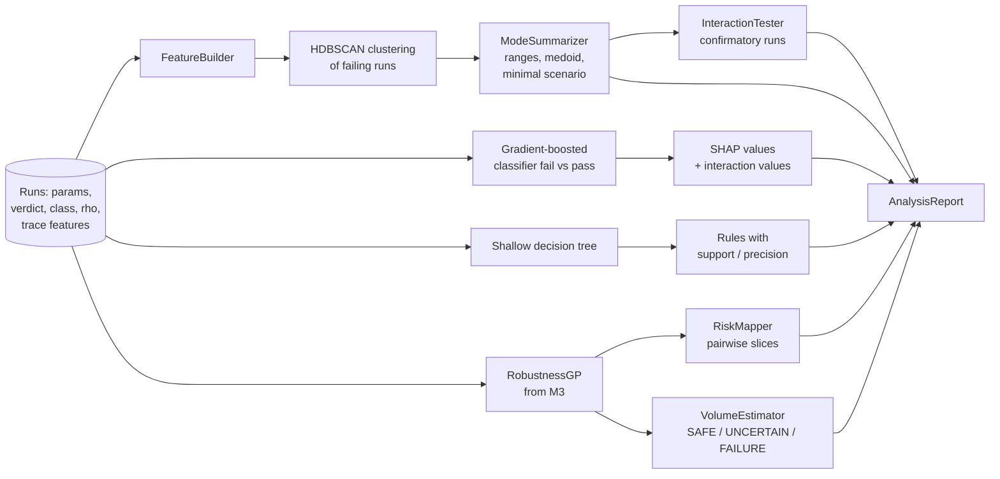
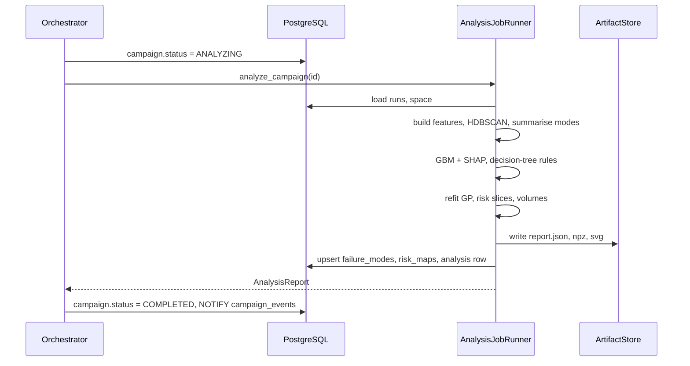

# 09 — Failure Analysis (M6) & Risk Mapping (M7)

> Related: [05 §7–8](05-module-detailed-design.md) · [07 §4](07-intelligent-test-selection-algorithms.md#4-gaussian-process-surrogate-robustnessgp) · [ADR-0012](adr/ADR-0012-failure-analysis-hdbscan-shap-rules.md) · config keys `analysis.*`, `risk.*` in [27](27-configuration-reference.md)

## 1. Goals

Turn hundreds of raw runs into a handful of **explained failure modes** and a **map of the operating
envelope**, answering: *which conditions, and which combinations of conditions, make the robot fail?*

## 2. Pipeline

Triggered: (a) automatically when a campaign enters `ANALYZING`; (b) incrementally every
`analysis.incremental_every_n` (default 25) completed runs for the live dashboard (clustering + volumes only);
(c) on demand (`roboprobe analyze`, `POST /campaigns/{id}/analyze`).

## 3. Clustering failures into modes

### 3.1 Feature vector per failing run

| Block | Features | Scaling | Weight |
|-------|----------|---------|--------|
| Scenario | `u ∈ [0,1]^d` (normalised params) | as is | `w_param = 1.0` |
| Failure class | one-hot over the 6 failure classes | ×`w_class` | `w_class = 0.75` (classes separate strongly but not absolutely) |
| Trajectory | normalised failure location along path `s_fail/L`, normalised `t_fail/T_max`, `min_clearance/d_norm`, `max_loc_error/e_max` | [0,1] | `w_traj = 0.5` |

Weights are config (`analysis.feature_weights.*`); the weighting means "same conditions + same kind of
failure at the same place" ⇒ same mode.

### 3.2 Algorithm

`sklearn.cluster.HDBSCAN(min_cluster_size=max(3, ⌈0.03·n_fail⌉), min_samples=None, metric="euclidean",
cluster_selection_method="eom")`. Rationale: unknown number of modes, arbitrary shapes, explicit noise
label (singleton failures are kept as "unclustered" and shown separately). Fallback for `n_fail < 6`:
each failure is its own provisional mode grouped only by failure class.

### 3.3 Mode summary (`FailureModeSummary`)

- `mode_id` (`FM-01`…; stable across re-analysis via Hungarian matching on Jaccard ≥ 0.5, 05 §7)
- `label`: auto = `"<class> | " + top-3 parameter conditions` (e.g. `F-COL | speed high · light low · noise high`), user-editable
- `size`, `primary_class`, `class_mix`
- `param_ranges`: per parameter `[q05, q95]` of members vs. whole-space range; "**characteristic**" if
  the member range covers < 50 % of the space range (`analysis.characteristic_coverage`)
- `medoid_run_id` (member minimising sum of distances)
- `minimal_scenario`: failing member with minimum weighted distance to nominal (refined by S-PROBE bisection)
- `reproducibility`: fraction of replays failing (filled after replays)
- `interaction`: result of §6

## 4. Explaining *why*: importance, interactions, rules

### 4.1 Classifier

`sklearn.ensemble.HistGradientBoostingClassifier(max_depth=4, learning_rate=0.1, max_iter=200,
class_weight="balanced", random_state=seed)` on `X = u` (scenario only), `y = verdict==FAIL`.
Reported quality: 5-fold stratified CV ROC-AUC and balanced accuracy (if `n_fail < 10`, explanation
is marked "low confidence"). For SHAP compatibility, an equivalent `xgboost`-free path is used:
`shap.TreeExplainer` supports sklearn tree ensembles; if a version mismatch blocks HistGB, fall back to
`GradientBoostingClassifier` (same params).

### 4.2 Global importance

- Mean |SHAP| per parameter (bar chart), and SHAP beeswarm.
- **Pairwise interaction strength** `I_ij = mean_n |Φ_ij(n)|` from `TreeExplainer.shap_interaction_values` → heatmap.
- Cross-check: GP ARD inverse lengthscales `1/ℓ_j` (reported next to SHAP; disagreement flagged).
- Per-mode importance: SHAP restricted to mode members vs. passing neighbours.

### 4.3 Rules

`DecisionTreeClassifier(max_depth=4, min_samples_leaf=max(3, 0.02·n), class_weight="balanced")`;
each leaf with failure precision ≥ 0.6 becomes a rule, translated back to physical units:
`IF robot.max_speed > 0.38 m/s AND env.illuminance < 32 lux AND sensor.lidar_noise_std > 0.041 m THEN FAIL (precision 0.83, support 41 runs, class F-COL)`.
Rules are attached to the mode with the largest member overlap.

## 5. Risk mapping

### 5.1 Probability of failure

From the M3 surrogate refitted on all valid runs: `p_fail(x) = Φ(−μ(x)/σ_tot(x))`, where
`σ_tot² = σ_latent² + σ_noise²` (predictive — accounts for run-to-run variability).

### 5.2 Regions

| Region | Rule (defaults, config `risk.thresholds.*`) | Colour token |
|--------|------|------|
| SAFE | `p_fail < 0.05` | `--risk-safe` |
| UNCERTAIN | `0.05 ≤ p_fail ≤ 0.95` | `--risk-uncertain` |
| FAILURE | `p_fail > 0.95` | `--risk-failure` |

### 5.3 Slices

For each pair `(i, j)`: grid `resolution × resolution` (default 50) over `(u_i, u_j)`, all other
dimensions fixed at an **anchor**: nominal (default) or a mode's medoid. Output `RiskSlice{x_param,
y_param, anchor, grid_u, p_fail[50,50], mean[50,50], std[50,50], region[50,50]}` stored as `.npz`
artefact + summary row. For `d = 6` there are 15 pairs → 15 × 2 500 = 37 500 GP predictions (< 1 s).

### 5.4 Volumes & robustness score

Sobol QMC with `n = risk.volume_samples` (8 192) over the space (respecting pins), classify, report
fractions with binomial 95 % Wilson intervals. `robustness_score = 1 − f_FAILURE − 0.5·f_UNCERTAIN`.

### 5.5 Boundary accuracy (evaluation only, MET-08)

On kinematic2d, compare the predicted region (SAFE+UNCERTAIN→pass if `p_fail<0.5`) against a dense
reference set (20 000 Sobol runs, cached artefact `reference/warehouse_v1_k2d.parquet`): report
balanced accuracy, failure-recall, and F1.

## 6. Interaction-failure test (core research claim)

For a mode with minimal scenario `x_min` and characteristic parameter set `C` (§3.3):

1. **Singles:** for each `c ∈ C`, run `nominal` with only `x_c := x_min,c` (others nominal) — `|C|` scenarios.
2. **Pairs:** for each pair in `C` (if `|C| ≥ 3`), run with only that pair set.
3. **Full:** run `x_min` itself.
Each confirmatory scenario is run `analysis.interaction.repeats` (default 3) times.
Verdict: **interaction failure** if `x_min` fails in ≥ 2/3 repeats **and** no single fails in ≥ 2/3;
order = smallest subset size that fails. Shown as badge `interaction ×3 (P1, P3, P4)`.
Confirmatory runs are tagged `confirm` and are excluded from strategy comparison metrics.

## 7. Analysis outputs (artefacts)

`analysis/<campaign>/report.json` (machine-readable), `modes.parquet`, `shap_values.npz`,
`risk_slices/*.npz`, `figures/*.svg` (for the static report). Schema of `report.json` is versioned
(`analysis_schema_version: 1`).

## 8. Sequence (automatic post-campaign analysis)

