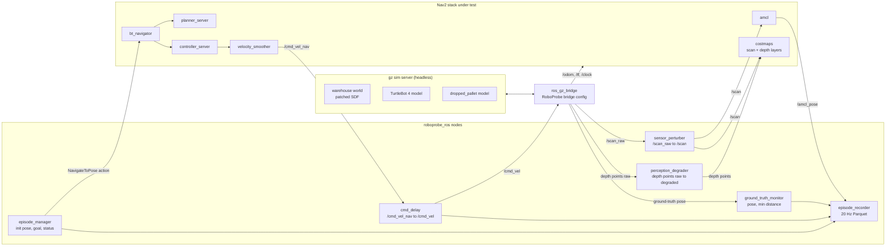
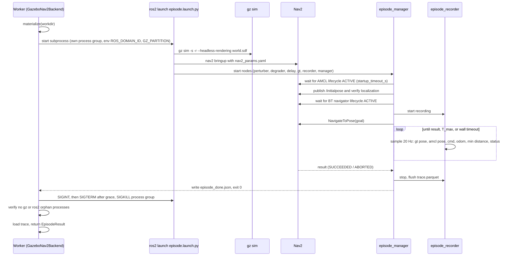

# 10 — Simulator Integration (M1)

> Related: [ADR-0002](adr/ADR-0002-primary-simulator-gazebo-harmonic-ros2-jazzy.md) · [ADR-0003](adr/ADR-0003-kinematic2d-fallback-backend.md) · [05 §2](05-module-detailed-design.md#2-m1--simulator-backends--roboprobebackends) · [06](06-scenario-parameter-space-and-schema.md) · config `backends.*` in [27](27-configuration-reference.md)

## 1. Backends overview

| Backend | Fidelity | Episode wall time | Deterministic | Needs | Use |
|---------|----------|-------------------|---------------|-------|-----|
| `kinematic2d` | low (2-D kinematics, ray-cast sensors, simple planner/controller) | 0.2–2 s | bit-exact | Python + NumPy | development, CI, large statistical experiments, ground-truth evaluation |
| `gazebo_nav2` | high (3-D physics, real Nav2 stack, TB4 model) | 60–150 s incl. ~25–40 s launch | no (timing) | Docker image with ROS 2 Jazzy + Gazebo Harmonic | demonstration, real failure discovery, final evaluation |
| `replay` | n/a | ms | yes | stored trace | oracle re-evaluation, tests |

Both real backends implement the same `SimulatorBackend` port; the orchestrator, selector, oracles and
analysis are unaware of which one is in use (Liskov substitution; enforced by the backend contract tests in 18 §4.3).

## 2. Version matrix (pinned in `docker/gazebo/Dockerfile` and recorded in every manifest)

| Component | Version | Why |
|-----------|---------|-----|
| Ubuntu | 24.04 Noble | Tier-1 for Jazzy |
| ROS 2 | Jazzy Jalisco (LTS, EOL May 2029) | mature Nav2 binaries (1.3.x), most tutorials |
| Gazebo | Harmonic (LTS, EOL May 2029) | official pairing for Jazzy via `ros-jazzy-ros-gz` |
| Nav2 | `ros-jazzy-navigation2`, `ros-jazzy-nav2-bringup` (1.3.x) | navigation stack under test |
| Robot sim | `ros-jazzy-nav2-minimal-tb4-sim` (+ description) | TB4 model and `warehouse.sdf` world |
| DDS | `rmw_cyclonedds_cpp` (configurable `backends.gazebo_nav2.rmw`) | stable in containers |
| Forward path | ROS 2 Lyrical + Gazebo Jetty on Ubuntu 26.04 | migration = new image + verification only (R-04) |

## 3. Gazebo/ROS 2 runtime graph (one episode)

Exact topic names, message types (Jazzy Nav2 publishes `geometry_msgs/TwistStamped` when
`enable_stamped_cmd_vel` is true), bridge entries and the TB4 lidar/camera frames MUST be verified
recorded in `ros_ws/src/roboprobe_ros/config/topics.yaml` (validated by `schemas/ros_topics.schema.json`,
T-091 evidence in `docs/evidence/T-091`) — the code reads topic names from that file, never from literals.

## 4. Applying each parameter (materialisation, `GazeboMaterializer`)

Materialisation writes into `workdir/<run_id>/`:

| File | Produced by | Contents |
|------|-------------|----------|
| `world.sdf` | `SdfPatcher` (lxml XPath edits of the pinned upstream `warehouse.sdf`) | lighting, ground friction, pallet `<include>` with pose |
| `nav2_params.yaml` | `Nav2ParamOverlay` (deep-merge of base params + overrides) | speed limits, costmap depth layer enabled |
| `perturb_params.yaml` | `PerturbationConfig` | P3 model constants, P4, P8, P6, per-node seeds |
| `bridge.yaml` | template | lidar to `/scan_raw`, depth to `…/points_raw`, ground-truth pose topic |
| `episode.yaml` | `EpisodeConfig` | start, goal, time limit, sample rate, record_bag |
| `manifest.json` | `ManifestBuilder` | all hashes and versions (21 §4) |

| Param | Mechanism | Detail |
|-------|-----------|--------|
| P1 speed | `nav2_params.yaml` | controller max forward velocity (MPPI `vx_max` or DWB `max_vel_x`, depending on base profile) and `velocity_smoother.max_velocity[0]`; keys listed in `sut_profiles/<name>.yaml` (`speed_param_paths`) |
| P2/P7 obstacle | `world.sdf` | pallet pose = `place_obstacle(nominal_path, along=P7, clearance=P2, side=left)`; z = half height |
| P3 illuminance | `world.sdf` + `perturb_params.yaml` | directional/point lights `diffuse` scaled by `min(1, L/L_ref)`, scene `<ambient>` scaled; depth degradation model 06 §3.3 in `perception_degrader` |
| P4 noise | `perturb_params.yaml` | Gaussian σ on `/scan` ranges |
| P5 friction | `world.sdf` | ground plane `<surface><friction><ode><mu>` and `<mu2>` |
| P6 delay | `perturb_params.yaml` | FIFO latency in `cmd_delay` |
| P8 dropout | `perturb_params.yaml` | Bernoulli beam drop in `sensor_perturber` |

Give the sensor-data topics `scan_raw` and `scan` separate resolved names to prevent feedback.
The node publishes cumulative `count` (processed beams) and `dropped` (new `+inf` returns)
as JSON in `std_msgs/msg/String` once per second on `/roboprobe/perturber_stats`.

The `cmd_delay` node reads `cmd_delay_ms` and the Nav2 controller's `rate_hz` from
`perturb_params.yaml`. It keeps messages in order on the simulation clock and publishes the
observed latency in **seconds** as `std_msgs/msg/Float64` on `/roboprobe/cmd_delay_actual`.
The `stamped_cmd_vel` flag in `topics.yaml` selects the ROS message type. Zero delay forwards
the message in its subscription callback with a reported latency of zero.

Friction and lighting are world properties ⇒ a fresh world load per run (no warm reset in MVP; see §8).

**SUT profiles** (`configs/sut_profiles/<id>.yaml`, schema `schemas/sut_profile.schema.json`, loader
`roboprobe.scenario.sut_profile.load_sut_profile`, T-016) select the robot stack: for `gazebo_nav2` the base
`base_nav2_params`, the `speed_param_paths` that receive P1 and a nested `nav2_overrides` overlay; for `kinematic2d` the
`model_file` and per-constant `gain_overrides`. `config_hash` = sha256 of the canonical JSON of backend + validated
config, so only behaviour-relevant edits change it (docs/33 comparability rule). Values awaiting verification are
listed under `provisional` and rejected by strict loading.

## 5. Episode lifecycle (Gazebo)

Communication worker ↔ episode: **files + exit code** (`episode_done.json`, `trace.parquet`, `episode.log`),
not a live ROS connection — keeps the worker free of rclpy state and makes crashes easy to classify as F-INFRA.
The [shared exit-code table](../ros_ws/src/roboprobe_ros/config/episode_exit_codes.yaml) defines
`0` for completed episodes, `10` for startup timeouts, `11` for failed spawn validation, and `12`
for internal errors. A navigation timeout is a completed episode with status `TIMEOUT`.
The manager writes `episode_done.json` beside `episode.yaml` after the recorder flushes.

## 6. Ground truth & recording

- Ground-truth pose: Gazebo pose publisher plugin bridged to ROS (`ground_truth_pose_topic` in `topics.yaml`).
- Minimum distance `d(t)`: computed geometrically by `ground_truth_monitor` from the TB4 footprint
  polygon at the ground-truth pose against (a) the ground-truth occupancy map distance transform and
  (b) the analytic pallet rectangle from `episode.yaml`. Same algorithm as kinematic2d (shared pure
  Python module `roboprobe.geometry`, vendored into the ROS package) ⇒ backend-independent oracles.
  As built (T-030a): `min_obstacle_distance(footprint, poses, grid, rects)` is vectorised over `(n, 3)` poses;
  rectangle distances are exact, grid distances use the SciPy EDT minus half a cell (within one cell); points off
  the map count as distance 0; the package imports only NumPy/SciPy (enforced by a unit test).
- Roll/pitch from ground-truth orientation; `nav_status` from the action feedback/result; recoveries from `/behavior_tree_log`.
- Optional rosbag2 (MCAP storage) of `/scan`, `/cmd_vel`, `/amcl_pose`, `/tf`, ground truth when `record_bag` (default: failures only — the worker re-records on confirmatory replays, since a run's verdict is unknown in advance; option `record_bag: always`).

## 7. kinematic2d backend (development & evaluation test double)

### 7.1 Model

| Element | Implementation |
|---------|---------------|
| World | occupancy grid (0.05 m) exported from the warehouse map + analytic pallet rectangle |
| Time | fixed step `dt = backends.kinematic2d.dt` (0.05 s) |
| Robot | unicycle, footprint radius 0.17 m, accel limits `a_max = 0.5 m/s²`, `α_max = 2 rad/s²` |
| Lidar | 2-D, 180 beams, 360°, range 0.15–12 m, ray-marching on grid (vectorised NumPy); **does not see the pallet** (below scan plane) |
| Depth camera | 60 beams over 70° FOV, range per 06 §3.3, sees pallet and walls |
| Perturbations | identical formulas to Gazebo nodes (shared module `roboprobe.perturbation`) |
| Friction | traction/slip model 06 §3.5 |
| Localisation | odometry + scan-matching correction with gain `k = k0·(1 − P4/0.1)·(1 − P8)` |
| Costmap | rolling local grid marked from lidar + depth hits, inflation 0.35 m, clearing by ray tracing |
| Planner | A* on inflated global grid, replanning at 1 Hz; "no path" ⇒ `nav_status = ABORTED` |
| Controller | regulated pure pursuit: lookahead 0.6 m, speed scaled by curvature and obstacle proximity (< 1 m), max speed P1 |
| Output | the same `Trace` schema as Gazebo |

Ray casting (T-030b, `roboprobe.geometry.raycast`): `GridRayCaster(grid).cast(pose, BeamSpec(angles, r_min, r_max),
rects, include_rects=...)` marches at half a cell (vectorised, chunked) and refines to the exact cell entry;
rectangles are analytic and the lidar passes `include_rects=False`. A 180-beam cast takes ≈ 0.3 ms median (gate
0.5 ms in `tests/benchmark/thresholds.yaml`).

### 7.2 Designed ground-truth failure mechanisms (for recall evaluation)

The model parameters are calibrated (task T-034) so that these mechanisms exist; the dense reference set
(20 000 Sobol runs) then defines the actual ground-truth modes used by MET-02/MET-08.

| GT mode | Mechanism | Parameters | Expected class |
|---------|-----------|-----------|----------------|
| GT-A "dark-fast-noisy" | low light shortens depth range → pallet seen late; high speed lengthens stopping distance; lidar noise corrupts localisation so avoidance path is offset | P1 high × P3 low × P4 high | F-COL |
| GT-B "slippery-laggy" | low friction → slip & odometry drift; command delay → overshoot and oscillation | P5 low × P6 high | F-LOC / F-OSC→F-TIMEOUT |
| GT-C "blocked aisle" | pallet on path leaves a narrow gap; at high speed pure pursuit cuts the corner | P2 low × P1 high | F-COL / F-PLAN |
| GT-D "phantom wall" (single-factor control) | extreme lidar noise marks phantom obstacles → no path | P4 very high | F-STUCK / F-PLAN |

`multi_mode_6d` (07 §9) is the analytic mirror of this table.

### 7.3 Determinism

Single `np.random.Generator(PCG64)` per stream (sensor, localisation, perception), derived from the run
seed; no wall-clock dependence; float64 everywhere ⇒ identical trace hash across runs on the same platform (NFR-REP-001).

## 8. Performance & laptop guidance

- Headless server only (`headless:=True`, no RViz), `--headless-rendering` (EGL) for camera/GPU-lidar sensors; on machines without a usable GPU set `LIBGL_ALWAYS_SOFTWARE=1` (Mesa llvmpipe) — slower but works.
- Target RTF configurable (`backends.gazebo_nav2.physics.real_time_factor`, default 1.0; try 2.0 when CPU allows; Nav2 uses `/clock`).
- On the Apple Silicon Docker Desktop VM measured in [T-090](evidence/T-090-gazebo-spike.md), use `max_parallel_per_host = 1` and `startup_timeout_s = 150` s for cold headless starts. Validate higher concurrency on the deployment host.
- [V1] Optimisation: **warm reset** for parameters that don't require world reload (P1, P2/P7 via entity set_pose, P4, P6, P8) — group proposals by world-level params (P3, P5) is future work; MVP always cold-starts.

## 9. Isolation & cleanup

Each Gazebo episode runs with unique `ROS_DOMAIN_ID` (`backends.gazebo_nav2.domain_id_base + slot`),
`GZ_PARTITION=rp_<worker>_<slot>`, `ROS_AUTOMATIC_DISCOVERY_RANGE=LOCALHOST`, its own process group and
`workdir`. On teardown: SIGINT → wait `teardown_grace_s` (10) → SIGTERM → wait 5 → SIGKILL group; then
`pgrep` check; leftover processes ⇒ worker marks itself unhealthy and restarts its container (Docker `restart: unless-stopped`).

## 10. Adding another simulator (Webots, MuJoCo, Isaac Sim)

1. Create package `roboprobe_backend_<name>` implementing `SimulatorBackend`, producing the standard `Trace`.
2. Map each scenario parameter it supports (`capabilities.supported_params`); unsupported enabled params ⇒ campaign creation fails with a clear error.
3. Register entry point `roboprobe.backends = <name> = pkg.module:Backend`.
4. Pass the backend contract test suite (`pytest -m backend_contract --backend <name>`).
No change in core packages is needed (Open/Closed principle).
