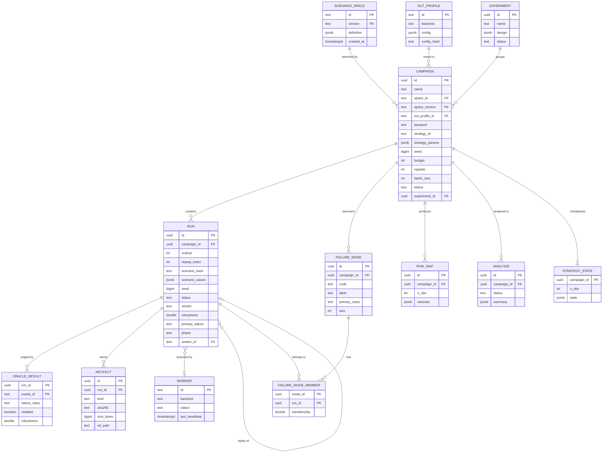
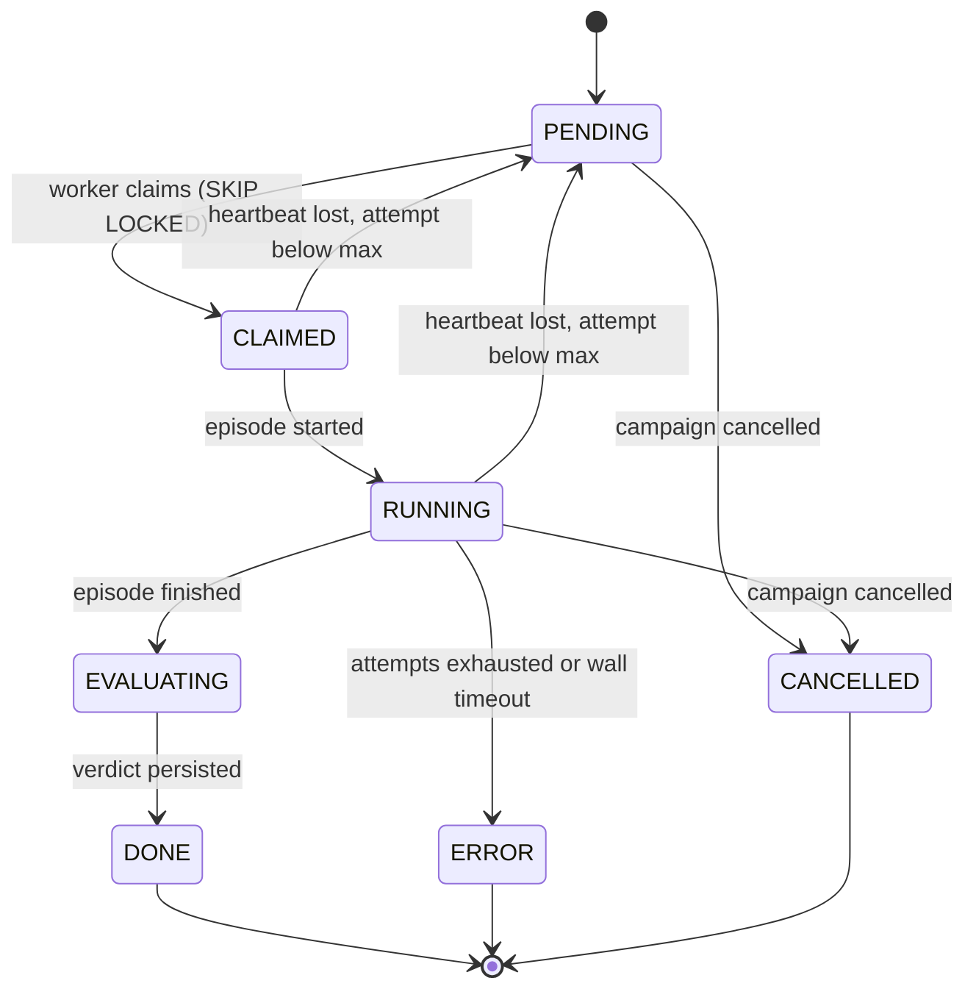

# 11 — Data Model & Database Schema

> Related: [ADR-0007](adr/ADR-0007-postgresql-store-and-job-queue.md) · [ADR-0008](adr/ADR-0008-artifact-storage-local-content-addressed.md) · [05 §9](05-module-detailed-design.md#9-storage--roboprobestore) · [12 API](12-api-specification.md)

## 1. Principles

- PostgreSQL 17 is the **system of record** and the **job queue**; large data (traces, bags, figures) lives in the artefact store, referenced by SHA-256.
- UUIDv7 primary keys (time-ordered; generated in Python with `uuid6`/`uuid_utils`, column type `uuid`).
- `timestamptz` everywhere (UTC). Soft enums via `CHECK` constraints (easier migrations than PG enums).
- Flexible, versioned payloads in `jsonb` (scenario values, strategy state, oracle details) with a `*_schema_version` column.
- Schema changes **only** through Alembic migrations (`backend/migrations/`), forward-only in production, each with a downgrade for development.
- The persistence layer is behind repository interfaces (05 §9) so the store can be swapped (e.g. a managed Postgres, or a different queue) without touching domain code.

## 2. ER diagram



## 3. DDL (initial migration `0001_initial`)

```sql
CREATE TABLE scenario_spaces (
    id              text        NOT NULL,
    version         text        NOT NULL,             -- sha256 prefix (12)
    name            text        NOT NULL,
    definition      jsonb       NOT NULL,             -- parsed YAML incl. task
    schema_version  int         NOT NULL DEFAULT 1,
    created_at      timestamptz NOT NULL DEFAULT now(),
    PRIMARY KEY (id, version)
);

CREATE TABLE sut_profiles (
    id           text PRIMARY KEY,                    -- e.g. 'tb4_nav2_default'
    backend      text NOT NULL,
    config       jsonb NOT NULL,
    config_hash  text NOT NULL,
    created_at   timestamptz NOT NULL DEFAULT now()
);

CREATE TABLE experiments (
    id          uuid PRIMARY KEY,
    name        text NOT NULL,
    design      jsonb NOT NULL,                       -- strategies, seeds, budget, backend
    status      text NOT NULL CHECK (status IN ('CREATED','RUNNING','COMPLETED','FAILED','CANCELLED')),
    results     jsonb,                                -- metrics + statistics (19)
    created_at  timestamptz NOT NULL DEFAULT now(),
    finished_at timestamptz
);

CREATE TABLE campaigns (
    id               uuid PRIMARY KEY,
    name             text NOT NULL,
    space_id         text NOT NULL,
    space_version    text NOT NULL,
    sut_profile_id   text NOT NULL REFERENCES sut_profiles(id),
    backend          text NOT NULL,
    strategy_id      text NOT NULL,
    strategy_params  jsonb NOT NULL DEFAULT '{}',
    seed             bigint NOT NULL,
    budget           int NOT NULL CHECK (budget > 0),
    repeats          int NOT NULL DEFAULT 1 CHECK (repeats >= 1),
    batch_size       int NOT NULL DEFAULT 1 CHECK (batch_size >= 1),
    pins             jsonb NOT NULL DEFAULT '{}',
    oracle_config    jsonb NOT NULL,                  -- resolved thresholds snapshot
    stop_rules       jsonb NOT NULL DEFAULT '{}',
    status           text NOT NULL CHECK (status IN ('CREATED','RUNNING','PAUSED','ANALYZING','COMPLETED','FAILED','CANCELLED')),
    status_reason    text,
    experiment_id    uuid REFERENCES experiments(id) ON DELETE SET NULL,
    experiment_rep   int,                             -- seed index within experiment
    tags             text[] NOT NULL DEFAULT '{}',
    created_at       timestamptz NOT NULL DEFAULT now(),
    started_at       timestamptz,
    finished_at      timestamptz,
    FOREIGN KEY (space_id, space_version) REFERENCES scenario_spaces(id, version)
);
CREATE INDEX ix_campaigns_status ON campaigns(status);
CREATE INDEX ix_campaigns_experiment ON campaigns(experiment_id);

CREATE TABLE workers (
    id              text PRIMARY KEY,                 -- '<hostname>:<pid>:<slot>'
    backend         text NOT NULL,
    status          text NOT NULL CHECK (status IN ('IDLE','BUSY','DRAINING','OFFLINE','UNHEALTHY')),
    capabilities    jsonb NOT NULL,
    version         text NOT NULL,
    current_run_id  uuid,
    started_at      timestamptz NOT NULL DEFAULT now(),
    last_heartbeat  timestamptz NOT NULL DEFAULT now()
);

CREATE TABLE runs (
    id               uuid PRIMARY KEY,
    campaign_id      uuid NOT NULL REFERENCES campaigns(id) ON DELETE CASCADE,
    ordinal          int  NOT NULL,                   -- proposal order in campaign
    repeat_index     int  NOT NULL DEFAULT 0,
    backend          text NOT NULL,                   -- denormalised for queue filtering
    scenario_hash    text NOT NULL,
    scenario_values  jsonb NOT NULL,
    x_unit           double precision[] NOT NULL,
    seed             bigint NOT NULL,
    phase            text NOT NULL,                   -- warmup|falsify|mode_search|boundary|refine|explore|baseline|manual|confirm|replay
    proposal         jsonb NOT NULL DEFAULT '{}',     -- acquisition_value, predicted mean/std
    tags             text[] NOT NULL DEFAULT '{}',
    replay_of        uuid REFERENCES runs(id),
    status           text NOT NULL CHECK (status IN ('PENDING','CLAIMED','RUNNING','EVALUATING','DONE','ERROR','CANCELLED')),
    priority         int  NOT NULL DEFAULT 100,       -- lower = sooner (manual/confirm runs get 10)
    attempt          int  NOT NULL DEFAULT 0,
    worker_id        text REFERENCES workers(id) ON DELETE SET NULL,
    verdict          text CHECK (verdict IN ('PASS','FAIL','INVALID')),
    robustness       double precision CHECK (robustness BETWEEN -1 AND 1),
    primary_failure  text,
    warnings         text[] NOT NULL DEFAULT '{}',
    metrics          jsonb NOT NULL DEFAULT '{}',
    infra_error      text,
    manifest         jsonb,                           -- provenance (21 §4)
    enqueued_at      timestamptz NOT NULL DEFAULT now(),
    claimed_at       timestamptz,
    started_at       timestamptz,
    finished_at      timestamptz,
    UNIQUE (campaign_id, ordinal, repeat_index)
);
CREATE INDEX ix_runs_queue ON runs(backend, priority, enqueued_at) WHERE status = 'PENDING';
CREATE INDEX ix_runs_campaign_status ON runs(campaign_id, status);
CREATE INDEX ix_runs_campaign_verdict ON runs(campaign_id, verdict);
CREATE INDEX ix_runs_scenario_hash ON runs(scenario_hash);

CREATE TABLE oracle_results (
    run_id             uuid NOT NULL REFERENCES runs(id) ON DELETE CASCADE,
    oracle_id          text NOT NULL,
    failure_class      text NOT NULL,
    severity           text NOT NULL CHECK (severity IN ('failure','warning')),
    violated           boolean NOT NULL,
    robustness         double precision NOT NULL,
    first_violation_t  double precision,
    details            jsonb NOT NULL DEFAULT '{}',
    PRIMARY KEY (run_id, oracle_id)
);

CREATE TABLE strategy_states (
    campaign_id  uuid PRIMARY KEY REFERENCES campaigns(id) ON DELETE CASCADE,
    n_obs        int NOT NULL,
    state        jsonb NOT NULL,
    updated_at   timestamptz NOT NULL DEFAULT now()
);

CREATE TABLE analyses (
    id            uuid PRIMARY KEY,
    campaign_id   uuid NOT NULL REFERENCES campaigns(id) ON DELETE CASCADE,
    kind          text NOT NULL CHECK (kind IN ('incremental','final','manual')),
    status        text NOT NULL CHECK (status IN ('PENDING','RUNNING','DONE','ERROR')),
    n_runs        int NOT NULL,
    summary       jsonb,                              -- importance, rules, cv scores
    report_sha256 text,
    analysis_schema_version int NOT NULL DEFAULT 1,
    created_at    timestamptz NOT NULL DEFAULT now(),
    finished_at   timestamptz
);

CREATE TABLE failure_modes (
    id               uuid PRIMARY KEY,
    campaign_id      uuid NOT NULL REFERENCES campaigns(id) ON DELETE CASCADE,
    code             text NOT NULL,                   -- FM-01
    label            text NOT NULL,
    label_is_user    boolean NOT NULL DEFAULT false,
    primary_class    text NOT NULL,
    class_mix        jsonb NOT NULL,
    size             int NOT NULL,
    param_ranges     jsonb NOT NULL,
    characteristic   text[] NOT NULL,
    medoid_run_id    uuid REFERENCES runs(id),
    minimal_run_id   uuid REFERENCES runs(id),
    rules            jsonb NOT NULL DEFAULT '[]',
    interaction      jsonb,                           -- {status, order, params, evidence_run_ids}
    reproducibility  double precision,
    status           text NOT NULL DEFAULT 'open' CHECK (status IN ('open','accepted','fixed','duplicate')),
    duplicate_of     text,                            -- target mode code in the same campaign
    first_seen_run   uuid REFERENCES runs(id),
    analysis_id      uuid REFERENCES analyses(id),
    updated_at       timestamptz NOT NULL DEFAULT now(),
    etag_version     int NOT NULL DEFAULT 1,
    UNIQUE (campaign_id, code)
);

CREATE TABLE failure_mode_members (
    mode_id     uuid NOT NULL REFERENCES failure_modes(id) ON DELETE CASCADE,
    run_id      uuid NOT NULL REFERENCES runs(id) ON DELETE CASCADE,
    membership  double precision NOT NULL,            -- HDBSCAN probability
    PRIMARY KEY (mode_id, run_id)
);

CREATE TABLE risk_maps (
    id           uuid PRIMARY KEY,
    campaign_id  uuid NOT NULL REFERENCES campaigns(id) ON DELETE CASCADE,
    analysis_id  uuid REFERENCES analyses(id),
    n_obs        int NOT NULL,
    thresholds   jsonb NOT NULL,
    volumes      jsonb NOT NULL,                      -- {safe:{f,lo,hi}, uncertain:…, failure:…}
    robustness_score double precision NOT NULL,
    slices_artifact uuid,                             -- npz bundle
    created_at   timestamptz NOT NULL DEFAULT now()
);

CREATE TABLE artifacts (
    id          uuid PRIMARY KEY,
    run_id      uuid REFERENCES runs(id) ON DELETE CASCADE,
    campaign_id uuid REFERENCES campaigns(id) ON DELETE CASCADE,
    kind        text NOT NULL CHECK (kind IN ('trace','bag','log','world','params','manifest','figure','report','risk_slices','analysis','video','bundle')),
    sha256      text NOT NULL,
    size_bytes  bigint NOT NULL,
    rel_path    text NOT NULL,                        -- relative to ARTIFACT_ROOT
    media_type  text NOT NULL,
    created_at  timestamptz NOT NULL DEFAULT now()
);
CREATE INDEX ix_artifacts_run ON artifacts(run_id);
CREATE INDEX ix_artifacts_sha ON artifacts(sha256);

CREATE TABLE events (                                  -- transactional outbox for SSE + audit
    id          bigserial PRIMARY KEY,
    topic       text NOT NULL,                        -- campaign.updated, run.finished, mode.discovered, ...
    campaign_id uuid,
    payload     jsonb NOT NULL,
    created_at  timestamptz NOT NULL DEFAULT now()
);
CREATE INDEX ix_events_campaign ON events(campaign_id, id);
```

## 4. Queue operations

```sql
-- claim (worker, in one transaction)
UPDATE runs SET status='CLAIMED', worker_id=:worker, claimed_at=now(), attempt=attempt+1
WHERE id = (
  SELECT r.id FROM runs r JOIN campaigns c ON c.id = r.campaign_id
  WHERE r.status='PENDING' AND r.backend=:backend AND c.status='RUNNING'
  ORDER BY r.priority, r.enqueued_at
  FOR UPDATE OF r SKIP LOCKED
  LIMIT 1)
RETURNING *;

-- reap (orchestrator)
UPDATE runs r SET status = CASE WHEN r.attempt < :max_attempts THEN 'PENDING' ELSE 'ERROR' END,
                  verdict = CASE WHEN r.attempt < :max_attempts THEN NULL ELSE 'INVALID' END,
                  worker_id = NULL
FROM workers w
WHERE r.worker_id = w.id AND r.status IN ('CLAIMED','RUNNING')
  AND w.last_heartbeat < now() - make_interval(secs => :heartbeat_timeout_s);
```

After each state-changing transaction: `INSERT INTO events …; NOTIFY roboprobe_events, '<event id>'`
(outbox pattern: the API's listener reads new rows by id, so a missed NOTIFY is recovered by polling `id > last_id`).

## 5. Run state machine



## 6. Artefact store

### 6.1 Layout (`ARTIFACT_ROOT`, default `./data/artifacts`)

```text
artifacts/
  sha256/ab/cd/abcdef…(full hash).<ext>        # content-addressed blobs (immutable)
  runs/<campaign_id>/<run_id>/                  # human-browsable symlinks to blobs
      trace.parquet  manifest.json  episode.log  world.sdf  nav2_params.yaml  bag.mcap
  analysis/<campaign_id>/<analysis_id>/report.json  modes.parquet  risk_slices.npz  figures/*.svg
  reports/<campaign_id|experiment_id>/report.html
  reference/warehouse_v1_k2d.parquet            # dense ground-truth set (evaluation)
```

Gazebo MCAP bags share this content-addressed storage. Their SHA-256 and compressed byte size
are registered with the run and count toward artifact garbage collection.

### 6.2 Trace Parquet schema (`trace_schema_version = 1`, zstd compression)

| Column | Type | Unit |
|--------|------|------|
| `t` | float64 | s |
| `gt_x`, `gt_y`, `gt_yaw` | float64 | m, m, rad |
| `est_x`, `est_y`, `est_yaw` | float64 | m, m, rad |
| `cmd_v`, `cmd_w` | float64 | m/s, rad/s |
| `meas_v`, `meas_w` | float64 | m/s, rad/s |
| `min_obstacle_dist` | float64 | m |
| `contact` | bool | – |
| `roll`, `pitch` | float64 | rad |
| `nav_status` | int8 | enum (05 §1) |
| `rtf` | float32 | – |

File-level metadata: `run_id`, `backend`, `trace_schema_version`, `goal_x`, `goal_y`, `sample_hz`.

Implementation (`roboprobe.backends.trace_io`, T-018): each field carries its unit as Arrow field metadata
(`unit`). File-level values are JSON-encoded strings. `meta` holds the whole `Trace.meta`, and `run_id`,
`backend` and `sample_hz` are copied from it when present. `rtf` is the only nullable column: an all-null
column means the backend records no RTF (`Trace.rtf is None`). `read_trace` rejects other schema versions,
missing or mistyped columns, nulls and invariant violations with one `ValidationError`.
`validate_trace(trace, *, min_hz, max_gap_s)` returns the FR-RUN-004 sampling problems (rate, gaps); the caller
supplies the thresholds from settings.

### 6.3 Campaign bundle (`.tar.zst`, T-014 / FR-STO-003)

Portable campaign archive produced by `roboprobe export <campaign_id> -o bundle.tar.zst` and
restored with `roboprobe import <bundle>` (`roboprobe.store.bundle`).

```text
bundle.tar.zst
  bundle.json                 # format_version, campaign_id, row_counts, files→sha256
  rows/<table>.jsonl          # one JSON object per row; each line carries schema_version
  blobs/<sha256>              # raw artefact bytes (content-addressed)
```

Tables exported: `spaces`, `sut_profiles`, `campaigns`, `runs`, `oracle_results`, `artifacts`,
`strategy_states`, `analyses`, `risk_maps`. Each JSONL line is a repository record dump plus
`schema_version` (currently `1`). `bundle.json.files` lists the sha256 of every member except
itself; import verifies every listed hash **before** any database write.

Safe extraction (TM-14): reject absolute paths, `..`, symlinks/hardlinks and non-regular members;
enforce `storage.bundle.max_member_bytes` and `storage.bundle.max_uncompressed_bytes`. Hostnames
inside run manifests are replaced with `hostname_hash` on export (TM-15). `--on-conflict skip|fail`
controls behaviour when the campaign id already exists (`fail` is the default).

## 7. Retention & size estimates

| Item | Size | 1 000-run campaign |
|------|------|--------------------|
| Run row + oracle rows | ~3 KB | 3 MB |
| Trace (120 s @ 20 Hz) | ~80 KB | 80 MB |
| MCAP bag (failures only) | 5–30 MB | 0.5–3 GB (if 10 % fail) |

Retention policy configurable: `storage.retention.bags_days` (default 30), `storage.retention.keep_failure_bags` (true).

`roboprobe gc` deletes unreferenced blobs.

## 8. Migrations & versioning

- Alembic `env.py` reads `ROBOPROBE_DATABASE_URL`; naming convention for constraints set in `MetaData(naming_convention=…)` so autogenerate is stable.
- Each migration: reviewed SQL, `upgrade()` and `downgrade()`, a migration test (upgrade → downgrade → upgrade on an empty DB and on a seeded fixture DB).
- JSON payload versions (`scenario schema_version`, `analysis_schema_version`, `trace_schema_version`) are migrated lazily by readers with explicit upcasters in `roboprobe.store.upcasters`.
