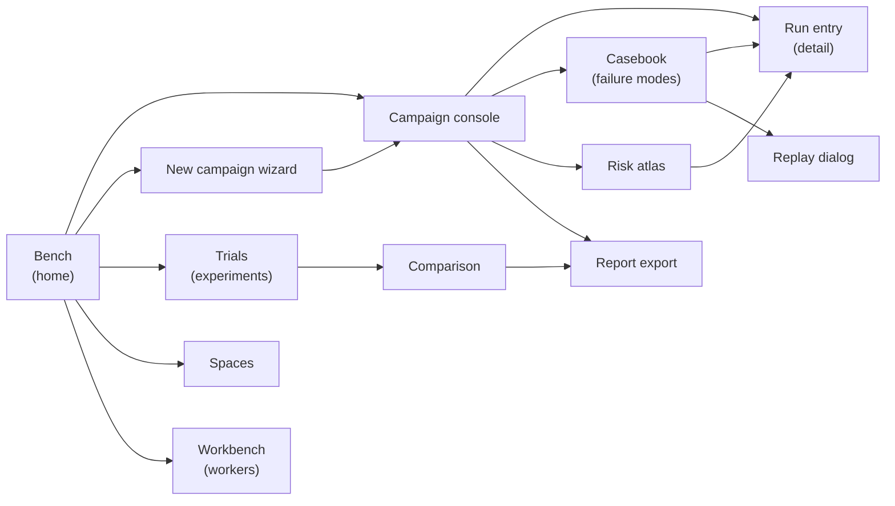

# 13 — Dashboard UX/UI Specification (M8)

> Related: [12 API](12-api-specification.md) · [03 User stories](03-personas-user-stories-use-cases.md) · [ADR-0010](adr/ADR-0010-frontend-react-typescript-vite.md)
> The design language below is **original to RoboProbe**. It is not derived from, and must not imitate, any existing product's website or design system.

## 1. Design concept — "Field Notebook"

RoboProbe behaves like a lab engineer's notebook during a test campaign: every run is an *entry*,
every failure mode is a *case*, the risk map is an *atlas* of the operating envelope. The visual
language borrows from engineering paper and instrument panels:

- **Paper & ink:** warm off-white "paper" surface with a very faint 8 px engineering grid; ink-dark text. Dark mode ("Night Shift") inverts to graphite paper with chalk-like text.
- **Margin rail:** a narrow left margin, like a notebook's red margin line, carries navigation and the campaign "spine" (a vertical timeline of runs as tick marks coloured by verdict).
- **Specimen tags:** runs and modes are shown as small rectangular "tags" with a punched-hole motif (a 6 px circle at the left edge), mono-spaced ids, and a coloured verdict notch.
- **Condition strips:** a scenario is drawn as a horizontal strip of `d` short bars, one per parameter, each filled to its normalised value — scenarios can be compared at a glance without reading numbers. The strip is RoboProbe's signature glyph, reused everywhere (lists, tooltips, mode cards, report).
- **Three-colour safety semantics** used *only* for risk/verdict meaning, never for decoration.

### 1.1 Design tokens (`web/src/styles/tokens.css`)

Source of truth: `web/src/styles/tokens.json`. `pnpm --dir web gen:tokens` renders it to `tokens.css` and copies it to
`backend/src/roboprobe/reporting/assets/tokens.json` for the report theme; `pnpm lint` fails if either output is stale.
Light is the default. The OS dark preference applies unless `data-theme` on `<html>` pins a theme (runtime
`defaultTheme`, doc 27 §4.12). Stylelint rejects raw hex colours and px font sizes outside `tokens.css`. The pairs that
are contrast-checked are listed in `tokens.pairs.json`.

| Token | Light ("Paper") | Dark ("Night Shift") | Use |
|-------|-----------------|----------------------|-----|
| `--paper` | `#F6F3EC` | `#1E2124` | app background |
| `--paper-raised` | `#FFFDF8` | `#272B2F` | cards |
| `--grid-line` | `rgba(60,70,90,0.06)` | `rgba(220,225,235,0.05)` | background grid |
| `--ink` | `#1F2A33` | `#E8E6E1` | primary text |
| `--ink-muted` | `#5B6670` | `#A7AFB6` | secondary text |
| `--margin-line` | `#C8553D` | `#D9775F` | notebook margin rule, focus ring |
| `--accent` | `#2F5D8A` | `#7FA9D6` | interactive (links, primary buttons) |
| `--risk-safe` | `#009E73` | `#33C29A` | PASS / SAFE |
| `--risk-uncertain` | `#E69F00` | `#F2B53A` | UNCERTAIN / warnings |
| `--risk-failure` | `#D55E00` | `#F07A2A` | FAIL / FAILURE region |
| `--invalid` | `#8A8F98` | `#7C828A` | INVALID |

Risk colours come from the Okabe–Ito colour-blind-safe palette; every risk colour is also paired with a
shape/pattern (○ pass, ✕ fail, △ uncertain hatching) so meaning never depends on colour alone (WCAG 1.4.1).
All text/background pairs meet WCAG 2.2 AA (4.5:1); verified by an automated contrast test on the token file.

### 1.2 Typography

- UI: **IBM Plex Sans** (SIL OFL, self-hosted via `@fontsource`), sizes 12/14/16/20/28 px, line-height 1.45.
- Data & ids: **IBM Plex Mono** for run ids, hashes, parameter values, code.
- Numbers in tables use tabular figures (`font-variant-numeric: tabular-nums`).

### 1.3 Spacing, shape, motion

- 4 px base unit; card padding 16 px; section gap 24 px.
- Corners: 3 px (cards), 2 px (tags) — deliberately "paper-cut", not pill-shaped.
- Shadows: none; elevation by a 1 px ink-tinted border + `--paper-raised`.
- Motion: 120–180 ms ease-out for state changes; new run tags "ink in" (opacity + 2 px slide). `prefers-reduced-motion` disables all non-essential motion.

## 2. Information architecture & navigation



Routes (React Router): `/` Bench · `/campaigns/new` · `/campaigns/:id` (tabs: `console`, `runs`, `casebook`, `atlas`, `insights`, `settings`) · `/runs/:id` · `/trials` · `/trials/:id` · `/spaces` · `/spaces/:id/:version` · `/workbench` · `/reports/:id`.

## 3. Screens

### 3.1 Bench (home) — FR-DSH-001

```text
┌──┬──────────────────────────────────────────────────────────────────────────┐
│RP│  Bench                                             [ + New campaign ]   │
│  │  ┌ Active ──────────────────────────────┐ ┌ Workbench ───────────────┐  │
│● │  │ night-shift probe   S-PROBE  k2d     │ │ k2d   ●●●● 4 online      │  │
│  │  │ ▓▓▓▓▓▓▓▓░░░░ 87/200   3 cases  ✕15   │ │ gz    ●○   1 online      │  │
│◆ │  └──────────────────────────────────────┘ └──────────────────────────┘  │
│  │  Recent campaigns (table: name · strategy · backend · status · runs ·   │
│▲ │  fails · cases · first failure at · started)                            │
│  │  Recent cases: specimen tags  [FM-03 F-COL · speed↑ light↓ noise↑]      │
└──┴──────────────────────────────────────────────────────────────────────────┘
```

Recent case tags come from the modes of the most recent campaigns. The Bench uses the ordinary campaign and mode endpoints.

Margin rail icons: Bench, Campaigns, Trials, Spaces, Workbench, Settings; theme toggle at the bottom.

### 3.2 New campaign wizard — FR-DSH-001, US-002 (4 steps, all defaults pre-filled)

1. **Space** — pick space + version; table of parameters with range sliders to *pin* values (FR-SCN-007); live dimension count.
2. **Robot & backend** — SUT profile, backend (disabled if no worker online, with explanation), repeats.
3. **Strategy** — card per strategy with a one-sentence plain-language description ("Learns where failures hide and probes there"), budget, batch size (default = online workers), seed (random default, editable). Advanced accordion: strategy params with validation from `/meta`.
4. **Review** — YAML preview (copyable — equals the CLI config), estimated duration = budget × typical episode time / workers, "Start now" checkbox.

### 3.3 Campaign console (live) — FR-DSH-002, US-003, US-012, US-013

```text
┌──┬─────────────────────────────────────────────────────────────────────────────┐
│  │ night-shift probe · S-PROBE · kinematic2d · seed 42   [Pause][Cancel][⋯]   │
│  │ ┌ Progress ───────┐ ┌ Discovery curve (unique cases vs runs) ────────────┐ │
│  │ │  87 / 200       │ │      ┌──────────────── S-PROBE (this)             │ │
│  │ │  PASS 71 ○      │ │  3 ──┘   · · · · random reference band (if any)   │ │
│  │ │  FAIL 15 ✕      │ │ 0 ┴────────────────────────────────────────────    │ │
│  │ │  INVALID 1      │ └────────────────────────────────────────────────────┘ │
│  │ │  phase: mode_search                                                    │ │
│  │ └─────────────────┘                                                        │
│  │ Entry stream (newest first)                                               │
│  │ #087 ✕ F-COL  ρ −0.37  ▮▮▯▮▯▮ condition strip   mode_search  μ −0.11 σ .21 │
│  │ #086 ○ PASS   ρ  0.42  ▯▮▮▯▮▯                    boundary                 │
│  │ Spine (left margin): one tick per run, coloured by verdict, click = jump  │
└──┴─────────────────────────────────────────────────────────────────────────────┘
```

"Why this scenario?" popover per entry: phase, predicted μ ± σ, acquisition value, nearest known case.
Alert banner when `alert` SSE event arrives (e.g. INFRA_UNHEALTHY auto-pause).

### 3.4 Run entry (detail) — FR-DSH-005, US-007, US-017

- Header: verdict notch, ρ, primary class, warnings, seed, scenario hash, worker, durations; actions: *Replay ×N*, *Export scenario*, *Open bag* (download), *Copy CLI command*.
- **Parameter panel:** each parameter with value, unit, position within range (mini track) and delta from nominal.
- **Top-down trajectory plot:** map underlay, ground-truth path (ink), estimated path (dashed accent), pallet rectangle, failure marker ✕ at `first_violation_t`, robot footprint ghosts every 2 s.
- **Synced timelines:** clearance `d(t)` with `d_safe` line, localisation error with `e_max`, `cmd_v` vs `meas_v`, Nav2 status band. Hovering any chart moves a shared cursor and the robot ghost on the map.
- **Oracle table:** each oracle, robustness bar (−1…1 with zero line), violated?, first violation time, details.
- **Provenance drawer:** manifest JSON (pretty), artefact list with SHA-256.

### 3.5 Casebook (failure modes) — FR-DSH-003, US-004, US-005, US-018

Grid of **case cards**:

```text
┌ FM-03 ─────────────────────────── ✕ F-COL · 23 runs ┐
│ "dark-fast-noisy collision"            [rename ✎]   │
│ speed      ├──────────[████]┤  0.38–0.50 m/s        │
│ light      ├[██]──────────────┤  5–32 lux            │
│ noise      ├─────────[█████]┤  0.04–0.10 m          │
│ Rule: speed > 0.38 ∧ light < 32 ∧ noise > 0.041      │
│       precision 0.83 · support 41                    │
│ Interaction ×3 confirmed  ·  reproduces 5/5          │
│ [Medoid run] [Minimal scenario] [Replay ×5] [Export] │
└──────────────────────────────────────────────────────┘
```

Status chip per case: open / accepted / fixed / duplicate. Side panel "Insights": SHAP importance bars,
interaction heatmap (parameter × parameter), GP lengthscale comparison, classifier CV AUC with
confidence label.

### 3.6 Risk atlas — FR-DSH-004, US-006

- Left: **pair matrix** — `d×d` small multiples (upper triangle) of `p_fail` slices; click to enlarge.
- Main: enlarged slice heatmap (`p_fail` colour ramp from `--risk-safe` through `--risk-uncertain` to `--risk-failure`, with hatching for UNCERTAIN), evaluated points (○/✕), contour line at `p_fail = 0.5`; axes in physical units (log axis for illuminance).
- Anchor selector: nominal or any case medoid; sliders for the other parameters (re-query slice).
- Volume gauge: stacked bar SAFE/UNCERTAIN/FAILURE with Wilson CIs; robustness score.
- Click a cell → "Probe here" (manual run, UC-05).

### 3.7 Trials (experiments) & comparison — FR-DSH-006, US-010

Design table (strategies × seeds × budget), progress per cell; comparison page: discovery curves with
95 % bands per strategy, box plots per metric, statistics table (median, IQR, p, p_Holm, Â12 + verbal
effect), "threats to validity" notes field.

### 3.8 Spaces, Workbench, Settings

Spaces: list, YAML viewer with schema validation messages, parameter table. Workbench: workers (backend,
status, current run, last heartbeat age, version). Settings: API token, theme, number formatting, SSE status.

### 3.9 Report export — FR-DSH-007

Server-rendered HTML (12 `/reports`) styled with the same tokens + print stylesheet (A4, page breaks
before each case, figure captions, run ids as footnotes).

## 4. Interaction & state rules

- Data fetching: TanStack Query; cache keys mirror API paths; SSE events invalidate/patch matching queries (`run.finished` → prepend to stream + update counters without refetch).
- Optimistic UI only for rename/label; lifecycle commands show pending state until the server confirms.
- Empty states always explain the next action ("No cases yet — failures will appear here as the campaign runs").
- Errors from problem+json shown inline with `title` + `detail`; `trace_id` copyable.
- Large tables virtualised (TanStack Virtual) beyond 200 rows.
- Keyboard: `g b` Bench, `g c` current campaign, `/` search, `j/k` move in entry stream, `r` replay selected run, `?` shortcuts dialog. All interactive elements reachable by Tab with the `--margin-line` focus ring.

## 5. Frontend architecture

```text
web/src/
  app/            router.tsx, providers.tsx (QueryClient, Theme, SSE)
  api/            generated client (openapi-typescript) + typed hooks per resource
  features/
    bench/ campaigns/ console/ runs/ casebook/ atlas/ trials/ spaces/ workbench/ reports/
  components/     ConditionStrip, SpecimenTag, VerdictNotch, RobustnessBar, RiskHeatmap,
                  TrajectoryPlot, TimelineChart, MarginRail, Spine, StatTable, EmptyState
  styles/         tokens.json → tokens.css (generated), fonts.css, base.css, print.css, theme.ts
  lib/            format.ts (units, durations), sse.ts, keyboard.ts
  test/           msw handlers, fixtures
```

- Charts: Plotly.js (`react-plotly.js`, partial bundle: heatmap, scatter, box) for analytical charts; trajectory plot and condition strip as hand-written SVG components (small, testable).
- Styling: CSS Modules + tokens (no CSS-in-JS runtime); Radix UI primitives (dialog, popover, tabs, tooltip) for accessibility.
- Types: API types generated from `api/openapi.json` (`openapi-typescript`) — never hand-written.
- Config: `VITE_API_BASE_URL` (build-time) with runtime override from `/config.json` served by nginx (so one image works in any environment).

## 6. Component specs (selected)

| Component | Props | Behaviour |
|-----------|-------|-----------|
| `ConditionStrip` | `values: number[]` (unit), `labels`, `highlight?: number[]`, `size: "xs"\|"sm"\|"md"` | `d` bars; highlighted (characteristic) params drawn in ink, others muted; tooltip shows physical values |
| `SpecimenTag` | `kind: run\|mode`, `id`, `verdict`, `label`, `strip?` | punched-hole motif, mono id, verdict notch, click navigates |
| `RobustnessBar` | `value: number` (−1…1) | centred zero line; negative fill `--risk-failure`, positive `--risk-safe` |
| `RiskHeatmap` | `slice: RiskSlice`, `logX?`, `logY?`, `onCellClick` | Plotly heatmap + scatter overlay + 0.5 contour; hatched uncertain band via SVG pattern overlay |
| `TrajectoryPlot` | `trace`, `map`, `obstacles`, `cursorT` | SVG, pan/zoom, synced cursor |
| `Spine` | `runs: {ordinal, verdict}[]` | vertical tick timeline in margin rail; virtualised |

## 7. Usability acceptance

- SC-6: a first-time user starts a campaign in ≤ 5 min (hallway test with 3 people, recorded in `docs/evidence/`).
- Lighthouse accessibility ≥ 95; axe-core: 0 serious/critical violations on every route (Playwright).
- Bundle: initial JS ≤ 350 KB gzip (Plotly lazy-loaded on Atlas/Insights/Trials only).

### Foundation implementation notes (T-085b/c/d)

The shell exposes every documented route as an independently lazy-loaded feature module. Feature
PRs replace the contextual empty mount points. `api/hooks.ts` exports the generated-type query and
mutation hooks, with path-based keys and cursor pagination. `api/client.ts` resolves snapshot paths
against the runtime API base, adds the session token, retains response ETags, and raises structured
`ProblemError` instances. The generated declaration is never edited by hand; `pnpm check:api`
regenerates and checks it in CI.

`public/config.json` is a valid development default, avoiding Vite's HTML fallback for a missing
JSON file. At boot, malformed configuration fails visibly; missing files/network unavailability use
build defaults. SSE uses explicit exponential reconnect with configurable jitter, resumes by event
id and drops previously processed ids. Sparse server events invalidate authoritative queries rather
than synthesizing incomplete run records; complete run payloads patch infinite-page caches. Native
EventSource cannot observe comment heartbeats, so it relies on transport errors for reconnect.

Development-only component galleries register through a DEV-only module glob; production builds
exclude the gallery module. The shell accepts feature content in its margin via `MarginRailSlot`.
