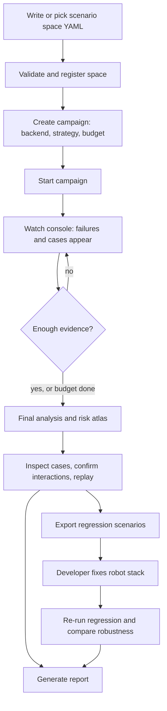
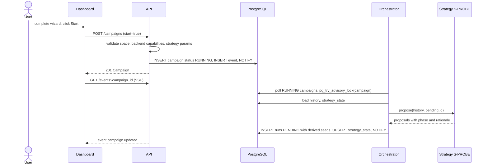
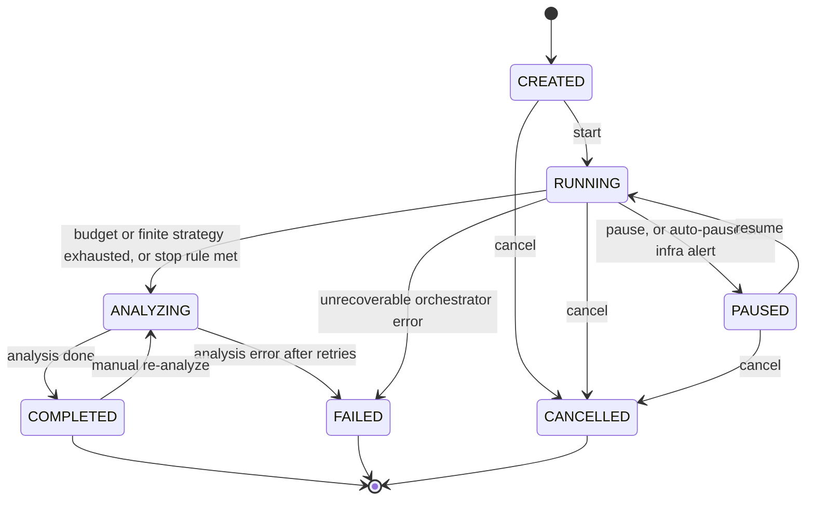
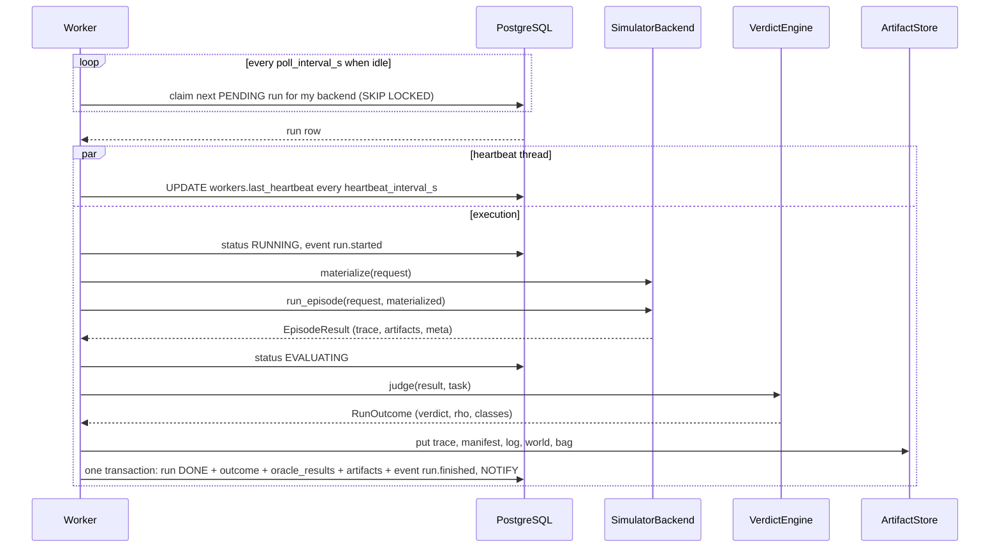
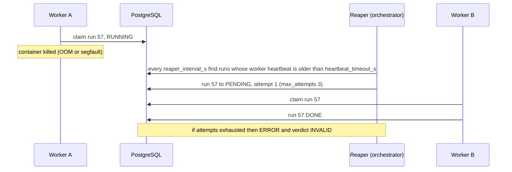
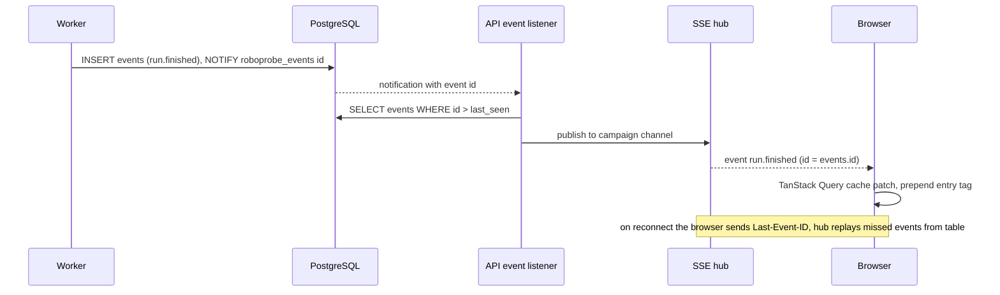
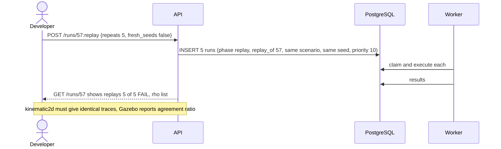
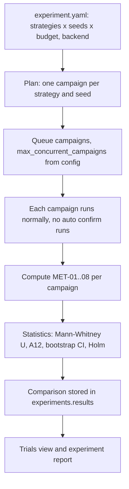
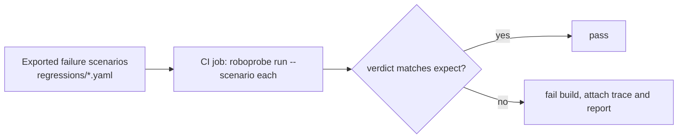
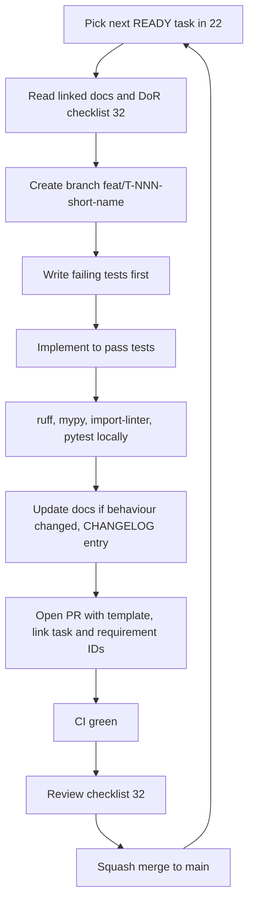

# 14 — Workflows & End-to-End Sequence Diagrams

> Related: [04 Architecture](04-system-architecture.md) · [10 §5 Gazebo episode](10-simulator-integration.md#5-episode-lifecycle-gazebo) · [09 §8 Analysis](09-failure-analysis-and-risk-mapping.md#8-sequence-automatic-post-campaign-analysis)

## 1. Overall user workflow

## 2. Campaign create → start → first proposals

## 3. Campaign state machine

Stop rules (campaign `stop_rules`, all optional): `max_modes`, `max_wall_s`, `max_consecutive_invalid` (default 10 ⇒ auto-pause), `invalid_ratio` (> 0.2 after ≥ 20 runs ⇒ auto-pause).

Workers can claim explicitly queued Casebook confirmations, replays, and Atlas manual probes
after a campaign completes. The campaign stays completed, and strategy-generated runs are not restarted.
The final confirmation run commits the interaction verdict and publishes a campaign update
in the same transaction. Existing case labels, statuses and member assignments are preserved.

## 4. Worker executes a run

## 5. Failure recovery (worker crash)

## 6. Live updates to the browser

## 7. Replay a failure (reproducibility)

## 8. Strategy comparison experiment

Fairness rules: identical budget, backend, space, SUT profile and seed set for every strategy; the
`k`-th seed of every strategy uses the same derived seed stream for the simulator (common random
numbers) so differences come from the strategy, not luck.

## 9. Regression workflow in CI (developer's robot repo)

## 10. Developer workflow for building RoboProbe itself (AI agent loop)

