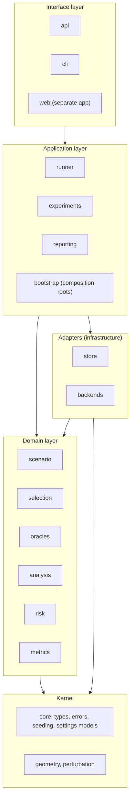

# 16 — Repository Structure & Coding Standards

> Related: [34 Design principles](34-design-principles-patterns-and-conventions.md) · [32 Engineering process](32-engineering-process-code-review-dor-dod.md) · [18 Testing](18-testing-strategy-and-qa.md) · `AGENTS.md`

## 1. Target repository tree (created progressively by tasks in 22)

```text
RoboProbe/
├── README.md  AGENTS.md  CONTRIBUTING.md  CHANGELOG.md  SECURITY.md  LICENSE  .gitignore
├── Makefile                       # thin wrappers: make setup | up | down | test | lint | docs-check
├── roboprobe.example.toml         # documented config file template (27)
├── .env.example                   # every env var with safe defaults, no secrets
├── docs/                          # this documentation set (00–34, adr/, templates/, evidence/)
├── schemas/                       # JSON Schemas: scenario_space, scenario, campaign, experiment, task
├── configs/
│   ├── scenario_spaces/warehouse_v1.yaml
│   ├── campaigns/*.yaml           # ready-made campaign configs (CI + demos)
│   ├── experiments/*.yaml         # EXP-01 … EXP-06 designs
│   ├── sut_profiles/*.yaml        # robot stack profiles (Nav2 param sets / k2d gains)
│   └── perception/oakd_lowlight_v1.yaml
├── tasks/warehouse_delivery_v1.yaml
├── backend/
│   ├── pyproject.toml             # package "roboprobe", extras [ml] [worker] [api] [dev]
│   ├── uv.lock
│   ├── migrations/                # Alembic (env.py, versions/)
│   ├── src/roboprobe/
│   │   ├── core/                  # types/, settings/ (one module per section), errors.py, seeding.py, logging.py, clock.py
│   │   ├── bootstrap/             # composition roots: api.py, orchestrator.py, worker.py, cli.py
│   │   ├── scenario/              # space.py, samplers.py, normalize.py, constraints.py, materialize.py
│   │   ├── selection/             # base.py, baselines.py, surrogate.py, acquisition.py, bo.py, lse.py, probe.py, benchmarks.py, registry.py
│   │   ├── oracles/               # base.py, clearance.py, goal.py, progress.py, localization.py, nav.py, stability.py, oscillation.py, infra.py, verdict.py
│   │   ├── analysis/              # features.py, clustering.py, modes.py, importance.py, rules.py, interaction.py, pipeline.py
│   │   ├── risk/                  # mapper.py, volume.py
│   │   ├── metrics/               # definitions.py (MET-*), statistics.py
│   │   ├── experiments/           # planner.py, runner.py
│   │   ├── runner/                # loop.py, scheduler.py, reaper.py, worker.py, queue.py
│   │   ├── backends/              # base.py, registry.py, kinematic2d/, gazebo_nav2/, replay/
│   │   ├── geometry/              # footprint, distance transform (shared with ROS pkg)
│   │   ├── perturbation/          # noise/dropout/delay/perception models (shared with ROS pkg)
│   │   ├── store/                 # orm.py, repositories/, uow.py, artifacts.py, upcasters.py
│   │   ├── api/                   # app.py, deps.py, routers/, schemas/, sse.py, errors.py
│   │   ├── reporting/             # render.py, figures.py, templates/
│   │   └── cli/                   # main.py and command modules
│   └── tests/
│       ├── unit/ integration/ api/ contract/ property/ benchmark/ sim/ e2e/
│       └── fixtures/              # golden traces, spaces, DB seeds
├── ros_ws/src/roboprobe_ros/      # ament_python package: nodes, launch/, config/, maps/, models/
├── web/                           # Vite React app (13 §5)
├── docker/
│   ├── compose.yaml               # profiles: core, gazebo, dev, observability
│   ├── backend.Dockerfile  gazebo.Dockerfile  web.Dockerfile  nginx.conf
├── scripts/                       # gen_config_docs.py, check_mermaid.sh, seed_demo.py, …
└── .github/
    ├── workflows/                 # ci.yml, docs.yml, images.yml, nightly-sim.yml, release.yml (20)
    ├── ISSUE_TEMPLATE/  PULL_REQUEST_TEMPLATE.md  CODEOWNERS  dependabot.yml
```

## 2. Layering (enforced)



`import-linter` contracts (in `backend/pyproject.toml`):

1. *Layers:* `roboprobe.api | roboprobe.cli` → `roboprobe.runner | roboprobe.experiments | roboprobe.reporting` → `roboprobe.selection | roboprobe.oracles | roboprobe.analysis | roboprobe.risk | roboprobe.metrics | roboprobe.scenario` → `roboprobe.core`.
2. *Independence:* domain packages may not import `roboprobe.store`, `roboprobe.backends`, `roboprobe.api`, `fastapi`, `sqlalchemy`, `rclpy`.
3. *Only `bootstrap`* may import concrete adapters together with application services.
4. *Adapters point inward:* `roboprobe.store` and `roboprobe.backends` may not import application, interface or bootstrap packages.
5. *Services never import bootstrap:* `runner`, `experiments`, `reporting` get dependencies injected; only interfaces call composition roots.

Notation: in contract 1, packages listed on the same layer may import each other, except the interface
packages `api` and `cli`, which are independent. Kernel packages (`core`, `geometry`, `perturbation`) are bound by
contract 2 as well. The executable form (ids `layers`, `domain-independence`, `adapters-wired-in-bootstrap`,
`adapters-point-inward`, `services-never-import-bootstrap`) lives in `[tool.importlinter]` and is run by `make lint`.

## 3. Python standards

- Formatting & lint: **ruff** (`ruff format`, line length 100; rules `E,F,W,I,N,UP,B,A,C4,SIM,RET,PTH,D,ANN,PL,RUF,S,TRY,ERA`; `D` with Google convention; `PLR2004` magic-value rule ON).
- Typing: **mypy --strict** on `src/`; no `Any` in public signatures except JSON payload aliases (`JsonValue`); `numpy.typing` for arrays with shapes documented in docstrings.
- Naming: modules `snake_case`; classes `PascalCase`; functions/vars `snake_case`; constants `UPPER_SNAKE` (only true constants); private `_leading`; IDs from docs kept verbatim in strings (`"S-PROBE"`, `"F-COL"`).
- Docstrings: every public module/class/function; include Args/Returns/Raises and the requirement IDs implemented (`Implements: FR-ORC-002`).
- Errors: raise subclasses of `RoboProbeError` (34 §5); never bare `except:`; never swallow exceptions silently.
- Logging: `structlog.get_logger(__name__)`; no `print` outside CLI presentation code (34 §6).
- Pure functions preferred in domain code; no I/O, no clocks (inject `Clock`), no global RNG (inject `np.random.Generator`).
- Dataclasses/Pydantic models are frozen where possible.
- File size guide: ≤ 400 lines per module, ≤ 50 lines per function (soft; reviewers ask for splits).

## 4. TypeScript/React standards

- `strict: true`, `noUncheckedIndexedAccess: true`; ESLint (typescript-eslint strict, react-hooks, jsx-a11y) + Prettier.
- Components: function components, named exports, one component per file, `PascalCase.tsx` + `PascalCase.module.css` + `PascalCase.test.tsx`.
- No `any`; API types only from generated `api/schema.d.ts`.
- No hard-coded URLs/colours/sizes: URLs from runtime config, colours/spacing from tokens.

## 5. ROS 2 package standards

- `ament_python`, nodes as classes inheriting `rclpy.node.Node`, all tunables as declared ROS parameters loaded from the generated YAML (never literals); topic names from `config/topics.yaml`.
- Follow ROS 2 naming (snake_case topics, `~/` private params); launch files in Python.

## 6. Git conventions

- Default branch `main` (protected: PR + green CI required, linear history).
- Branches: `feat/T-041-worker-heartbeat`, `fix/…`, `docs/…`, `chore/…`, `spike/…`.
- Commits: **Conventional Commits** — `type(scope): summary` (types: feat, fix, docs, test, refactor, perf, build, ci, chore, revert); scope = package or doc (`selection`, `api`, `docs`); body references task/requirement IDs (`Refs: T-041, FR-RUN-002`).
- Commit authorship: only the repository owner's identity (`CodewithJha`); no co-author trailers (see `AGENTS.md`).
- PRs: small (≤ 400 changed lines excluding generated files/lockfiles), one task per PR, template filled.
- Tags: `vMAJOR.MINOR.PATCH` (33).

## 7. Generated & vendored files

`uv.lock`, `pnpm-lock.yaml`, `web/src/api/schema.d.ts`, `api/openapi.json`, config tables in 27 are generated — regenerate, never hand-edit; CI checks freshness.
