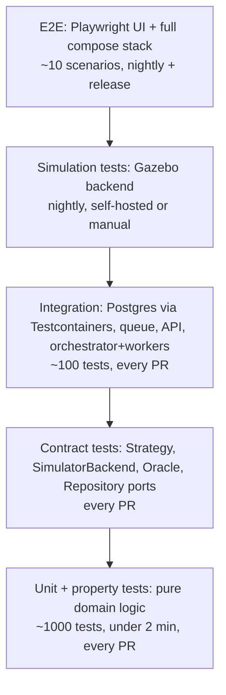

# 18 — Testing Strategy & QA Plan (for RoboProbe itself)

> Related: [28 Traceability](28-traceability-matrix.md) · [20 CI/CD](20-ci-cd-and-devops.md) · [32 DoD](32-engineering-process-code-review-dor-dod.md)
> Note: RoboProbe *tests robots*; this document is about *testing RoboProbe*.

## 1. Objectives

1. Every FR/NFR has at least one automated test (traceability in 28).
2. The intelligent loop is verifiable without ROS in CI (kinematic2d + analytic benchmarks).
3. Algorithms are tested **statistically** (multiple seeds, thresholds with margins) — never on one lucky seed.
4. Regressions in scientific behaviour (e.g. S-PROBE getting worse) are caught by benchmark gates.

## 2. Test pyramid



| Level | Location | Tooling | Runs | Budget |
|-------|----------|---------|------|--------|
| Unit | `backend/tests/unit` | pytest, numpy.testing | every push | < 2 min |
| Property | `backend/tests/property` | Hypothesis (`max_examples` profile: ci=200, nightly=2000) | every push | < 1 min |
| Contract | `backend/tests/contract` | parametrised pytest over registered plugins | every push | < 2 min |
| Integration | `backend/tests/integration`, `tests/api` | Testcontainers Postgres 17, httpx `TestClient` | every PR | < 6 min |
| Benchmark (algorithmic) | `backend/tests/benchmark` | pytest + fixed seed sets, pytest-benchmark | PR (smoke), nightly (full) | smoke < 3 min |
| Simulation | `backend/tests/sim` (`-m sim`) | Gazebo image | nightly / manual | ≤ 60 min |
| Web unit/component | `web/src/**/*.test.tsx` | Vitest, Testing Library, MSW | every PR | < 2 min |
| E2E | `web/e2e` | Playwright + axe-core against compose `core` | nightly + release | < 15 min |
| Migration | `backend/tests/migrations` | Alembic up/down/up | every PR | < 1 min |
| Docs | `scripts/check_docs.sh` | markdownlint, mermaid-cli, lychee | docs changes | < 2 min |

Pytest markers: `unit`, `property`, `contract`, `integration`, `benchmark`, `sim`, `slow`. Default `pytest` = everything except `sim` and `slow`.

## 3. Coverage & quality gates

- Line coverage ≥ **85 %** for `roboprobe` (excluding `backends/gazebo_nav2` which is covered by sim tests), branch coverage ≥ 75 %; web ≥ 70 %.
- Domain packages (`scenario, selection, oracles, analysis, risk, metrics`) ≥ **90 %**.
- Mutation testing (`mutmut`) on `selection/` and `oracles/` weekly (`.github/workflows/mutation.yml`, T-131); surviving mutants reviewed. The job is not a pull-request check.
- mypy strict, ruff, import-linter, ESLint must pass (0 warnings policy).

## 4. What is tested, by module

### 4.1 Scenario (M2)

Round-trip normalisation (property); log-scale correctness; constraint evaluator rejects unsafe expressions (`__import__`, attribute access); scenario hash stability across processes/platforms (golden hashes); materialisation byte-identical (FR-SCN-005); schema validation errors carry JSON-pointer paths.

### 4.2 Oracles (M5)

Golden traces (08 §7) with exact expected outputs; invariants (`FAIL ⇔ ρ < 0`; time-shift invariance; monotonicity in clearance); InfraCheck triggers; threshold overrides honoured.

### 4.3 Contract suites (ports)

- **Strategy contract** (every registered strategy): proposals in bounds; feasible; deterministic with seed; no duplicates with pending; ignores INVALID; `state_dict` round-trip reproduces next proposals; `propose(q)` returns exactly q (or fewer only if exhausted); time limit.
- **SimulatorBackend contract**: materialise determinism; trace schema/columns/units; sample rate ≥ 10 Hz; cancel works within 10 s; infra errors reported not raised; supported_params honest (unsupported ⇒ error).
- **Oracle contract**: robustness in [−1,1]; pure (same input ⇒ same output; no I/O — enforced by running inside a sandbox fixture that patches `open`/`socket`).
- **Repository/RunQueue contract**: exactly-once claim; ordering by priority; reaper semantics.

### 4.4 Selection algorithms (M3) — statistical tests

On `branin_falsify` and `multi_mode_6d` (07 §9) with a fixed list of 20 seeds:

- S-BO median first failure ≤ 25 (branin).
- S-PROBE finds ≥ 3/4 modes in ≥ 80 % of seeds within 150 evals; S-RANDOM baseline result recorded for comparison.
- S-PROBE median first failure ≤ 0.5 × S-RANDOM median (multi_mode_6d).
Thresholds are set with margin from a calibration run (T-061) and stored in `tests/benchmark/thresholds.yaml` (config, not code).

### 4.5 Runner & storage (M4)

4 workers / 100 runs exactly-once; worker kill → re-queue (chaos fixture sends SIGKILL); orchestrator restart resumes from `strategy_states`; campaign pause stops enqueuing; cancellation propagates; SSE events emitted in order; outbox recovery after missed NOTIFY.

### 4.6 Analysis & risk (M6, M7)

Synthetic Gaussian blobs ⇒ HDBSCAN recovers clusters (ARI ≥ 0.9); SHAP ranks the planted parameters top-k; rule extraction recovers planted thresholds within ±0.05 (unit scale); risk volumes match analytic volumes on `multi_mode_6d` within CI; mode-id stability across re-analysis.

### 4.7 kinematic2d backend

Determinism (bit-identical trace hash); speed (NFR-PERF-001 benchmark); designed mechanisms present (calibration test: each GT mode's canonical scenario fails, nominal passes).

### 4.8 Gazebo backend (sim tests, nightly)

Nominal scenario passes in ≥ 4/5 runs; canonical collision scenario (P2 = 0, P3 = 5 lux) fails; every parameter visibly changes the materialised files; teardown leaves no processes; RTF recorded.

The nominal check runs seeds 1 through 5 with the opt-in
[`tb4_nav2_warehouse_acceptance`](../configs/sut_profiles/tb4_nav2_warehouse_acceptance.yaml)
profile. The production oracle judges the original warehouse task and its ground-truth goal
tolerance. The [acceptance evidence](evidence/T-098-warehouse-acceptance.md) records the
tuned and shipped-profile results separately.

The Gazebo nightly runs at 02:00 IST. It builds the worker from that revision and runs
the marked backend tests against the pinned warehouse cache. A disposable PostgreSQL service
supports the replay and bag integration test. The same workflow runs the Jazzy package tests
with colcon. GitHub's job summary reports the per-test durations and
measured episode real-time factors, and the failing jobs retain their logs and traces.
Milestone sign-off requires three consecutive green scheduled runs.

### 4.9 API

Schema conformance (`schemathesis` against OpenAPI, nightly); error envelope; pagination; ETag/If-Match; auth token on/off; OpenAPI snapshot unchanged unless intended.

### 4.10 Web

Component tests for ConditionStrip, RiskHeatmap, RobustnessBar (rendering & a11y); MSW-mocked feature tests for wizard and console; Playwright flows: create campaign → see runs stream → open case → replay → export report; axe on every route; visual snapshot of tokens page (light/dark).

From `web/`, install Chromium and Firefox with `pnpm exec playwright install chromium firefox`.
Run the seeded smoke in both browsers with `pnpm test:e2e smoke.spec.ts`. The harness builds
the production images, loads the shared seed into a dedicated Compose project, and tears it down
on completion. The seed retains its historical campaign, and the Wizard creates new campaigns
using the version returned when the harness registers the shipped warehouse definition.
Browser reports and Compose logs are under `web/playwright-report/`,
`web/e2e-results/`, and `web/e2e-artifacts/`.

## 5. Test data & fixtures

- `fixtures/spaces/warehouse_v1.yaml`, `fixtures/traces/*.parquet` (golden), `fixtures/db/seed_small.sql` (1 campaign, 60 runs, 3 modes) for API/web tests, `fixtures/reference/` small reference set for risk tests.
- Factories (`tests/factories.py`) build domain objects; no shared mutable fixtures.
- Fakes of ports live in `tests/fakes/` and pass the same contract tests as the real adapters.
- Hypothesis profiles (`tests/conftest.py`): `dev` (default), `ci` (200 examples), `nightly` (2000), selected with `HYPOTHESIS_PROFILE`.
- Integration DB (`tests/integration/conftest.py`): `postgres_url` uses `ROBOPROBE_TEST_DATABASE_URL` if set (CI service container), else a session-scoped `postgres:17` Testcontainers container, else skips with the reason; `pg_connection` rolls back each test's transaction.

### Shared demo dataset (T-107)

Use a dedicated disposable PostgreSQL 17 database. The generator migrates an empty database
and refuses to seed one with application rows. Use the locked backend environment and PostgreSQL
17 client tools when regenerating checked-in fixtures.

```bash
backend/.venv/bin/python scripts/seed_demo.py --size small --seed 20261119 \
  --database-url "$SEED_DATABASE_URL" --artifact-root "$SEED_ARTIFACT_ROOT" \
  --export-sql backend/tests/fixtures/db/seed_small.sql \
  --export-artifacts backend/tests/fixtures/db/seed_small_artifacts.tar.zst
```

The 60-run warehouse campaign is also the experiment campaign. Generation uses the normal
simulation, analysis and comparison services, then canonicalizes fixture metadata and omits
transient event history. The archive carries the three medoid traces and the blobs referenced
by the seed. For a byte comparison, run the command against two fresh databases with separate
working directories. The large generator accepts `--size large` and writes 10,000 analytic
benchmark runs into a separate empty database.

Point the API at a seeded database and artifact root, then export the real responses using the
campaign, medoid and experiment IDs emitted by the generator.

```bash
backend/.venv/bin/python scripts/export_web_fixtures.py --base-url http://127.0.0.1:8000 \
  --campaign-id "$CAMPAIGN_ID" --run-id "$MEDOID_RUN_ID" \
  --experiment-id "$EXPERIMENT_ID" --risk-resolution 8
```

To load the checked-in SQL and artifact archive, migrate another empty database to head, then
run `backend/.venv/bin/python backend/tests/fixtures/db/load_seed.py --database-url "$SEED_DATABASE_URL" --artifact-root "$SEED_ARTIFACT_ROOT"`.
`backend/tests/integration/test_seed_data.py` checks the restore, artifact digests and seven
API responses against the committed OpenAPI schema and fixture JSON.

## 6. Non-functional testing

| NFR | Method |
|-----|--------|
| PERF-001/002 | pytest-benchmark with stored baselines; fail if > 20 % slower |
| PERF-004 | `locust` headless 60 s against seeded 10 000-run DB (nightly) |
| REL-001/002 | chaos fixtures (kill worker/orchestrator) |
| REP-001 | trace hash equality across two processes |
| SEC-001/002 | bind-address test; `pip-audit`, `pnpm audit`, gitleaks, Trivy image scan |
| ACC-001 | axe-core in Playwright |

The [API performance workflow](../.github/workflows/api-perf.yml) runs nightly and on changes to the
load harness. It starts with a fresh PostgreSQL database, verifies all 10,000 benchmark runs
completed, then runs Locust headless for 60 seconds with 20 users and a spawn rate of 5 per second.
The workflow checks p95 per endpoint and uploads the CSV, API log and a five-page keyset query plan.
See [T-106 performance evidence](evidence/T-106-perf.md) for the workload and reproduction steps.

## 7. Defect management

Bugs filed with the issue template (steps, expected, actual, run id/manifest, logs). Severity: S1 data loss/incorrect verdicts, S2 feature broken, S3 degraded, S4 cosmetic. Every fixed bug gets a regression test referencing the issue number.
