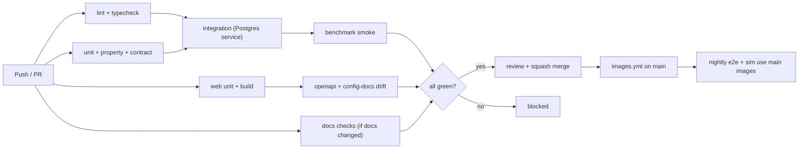

# 20 — CI/CD & DevOps

> Related: [ADR-0013](adr/ADR-0013-docker-compose-and-github-actions.md) · [18 Testing](18-testing-strategy-and-qa.md) · [29 Deployment](29-deployment-guide.md) · [33 Versioning & release](33-versioning-release-and-changelog-policy.md)
> Cost: GitHub Actions minutes and GHCR storage are free for public repositories. No paid services.

## 1. Workflows (`.github/workflows/`)

| Workflow | Trigger | Jobs | Target duration |
|----------|---------|------|-----------------|
| `ci.yml` | push, pull_request | `lint` (ruff, mypy, import-linter, ESLint, Prettier), `test-backend` (matrix ubuntu/macos; unit, property, contract), `test-integration` (Postgres 17 service), `benchmark-smoke`, `test-web` (Vitest), `build-web`, `openapi-check`, `config-docs-check`, `license-check`, `security` (pip-audit, pnpm audit, gitleaks) | ≤ 10 min |
| `docs.yml` | changes in `docs/**`, `*.md` | markdownlint, mermaid-cli render of every Mermaid block, lychee link check, ADR index check | ≤ 3 min |
| `images.yml` | push to `main`, tags | build `backend`, `web`, `gazebo` images (Buildx + GHA cache), Trivy scan, push to GHCR (`:sha`, `:main`, `:vX.Y.Z`), SBOM (Syft) attached | ≤ 25 min (gazebo cached) |
| `e2e.yml` | dashboard/API PRs, nightly 02:00 IST, manual | locally built Compose stack, seeded campaigns, Chromium/Firefox + axe | < 10 min |
| `nightly-sim.yml` | nightly / manual (`workflow_dispatch`) | pull gazebo image, `pytest -m sim` with 1 worker, upload artefacts | ≤ 60 min (hosted runner CPU) |
| `benchmark-full.yml` | weekly, manual | EXP-02 analytic + reduced EXP-01 (10 seeds) → compare with baseline JSON, comment on regression | ≤ 45 min |
| `release.yml` | tag `v*` | verify CHANGELOG entry, build/push images, create GitHub Release with notes, report bundle | ≤ 30 min |

## 2. PR pipeline



## 3. Branch protection (`main`)

Policy: every change reaches `main` through a squash-merged PR whose required checks are green. History stays
linear, force pushes and branch deletion are blocked, and review conversations must be resolved before merge.

### 3.1 As built (T-132)

Repository ruleset **`main`** (Settings → Rules → Rulesets) targets the default branch. It is `active` with
**no bypass actors**, so it applies to administrators too.

| Rule | Setting |
|------|---------|
| Restrict deletions | on |
| Block force pushes | on (`non_fast_forward`) |
| Require linear history | on |
| Require a pull request before merging | 0 required approvals (single-maintainer project; self-review is recorded on the PR, doc 32 §5); conversation resolution required; allowed merge method: squash |
| Require status checks to pass | `lint`, `test-backend (ubuntu-latest)`, `test-integration`, `test-web`, `build-web` (GitHub Actions app); branch need **not** be up to date before merging, so parallel PRs don't force rebase-and-rerun loops |

Advisory checks (not required) and why:

| Check | Why it isn't required |
|-------|----------------------|
| `test-backend (macos-latest)` | portability signal only |
| `config-docs-check`, `security`, `license-check` | run on every PR and block via review |
| `docs-check` | `docs.yml` runs only when Markdown changes, so a required check would never report on code-only PRs |
| `openapi-check` | to be added to the ruleset when T-084b creates it |

Repository merge settings: squash merge only (merge commits and rebase merges disabled), squash commit title is the PR
title and the body is the PR body (it carries `Closes #N`), head branches are deleted automatically, and auto-merge
is allowed (`gh pr merge --squash --auto`).

Backlog board: GitHub Project [RoboProbe backlog](https://github.com/users/CodewithJha/projects/2), linked to the
repository, with a `Status` field of `Backlog → Ready → In progress → In review → Done` that mirrors doc 32 §1.
Every `task` issue is on the board.

To re-apply (owner token with `repo` and `project` scopes):

```bash
gh api -X PATCH repos/CodewithJha/RoboProbe -F allow_squash_merge=true -F allow_merge_commit=false \
  -F allow_rebase_merge=false -F delete_branch_on_merge=true -F allow_auto_merge=true \
  -f squash_merge_commit_title=PR_TITLE -f squash_merge_commit_message=PR_BODY
gh api -X POST repos/CodewithJha/RoboProbe/rulesets --input ruleset.json   # JSON in the T-132 PR description
```

Owner UI step (no public API): in the project's **Workflows**, enable *Auto-add to project* for
`repo:CodewithJha/RoboProbe label:task` so new task issues appear on the board automatically.

## 4. Caching & speed

`astral-sh/setup-uv` with cache keyed on `uv.lock`; `pnpm` store cache keyed on lockfile; Docker layer cache `type=gha`; Hypothesis database cached; tests parallelised with `pytest-xdist -n auto` for unit tiers.

## 5. Environments & configuration

| Env | Where | Config source |
|-----|-------|---------------|
| `ci` | GitHub runners | workflow `env:` + service containers; `ROBOPROBE_ENV=ci` |
| `local` | developer laptop | `.env` + `roboprobe.toml` |
| `lab` (optional) | spare machine / free-tier VM running remote workers | `.env.lab`, secrets via files, WireGuard/SSH tunnel to DB |

Secrets in CI: only `GITHUB_TOKEN` (GHCR push). No external secret is needed.

## 6. Release & deployment flow

1. Merge to `main` → images `:main` and `:sha-<7>` pushed.
2. Release: bump version (33), update `CHANGELOG.md`, tag `vX.Y.Z` → `release.yml` publishes images `:vX.Y.Z` and a GitHub Release.
3. Deploy on a machine: `ROBOPROBE_IMAGE_TAG=vX.Y.Z make up` (migrations run automatically via the `migrate` one-shot service) — see 29.
4. Rollback: set previous tag and `make up`; DB migrations are backward-compatible for one minor version (expand/contract pattern, 33 §5).

## 7. Dependency management

Dependabot weekly for `uv`, `npm`, `github-actions`, `docker`; grouped minor/patch updates; major updates as separate PRs with a changelog review. ROS/Gazebo base images pinned by digest and updated monthly via a manual PR after `nightly-sim` passes.

## 8. Observability of CI

Test reports as JUnit XML uploaded and summarised in the job summary; coverage uploaded as artefact and summarised (no paid coverage service required; Codecov free tier optional).
