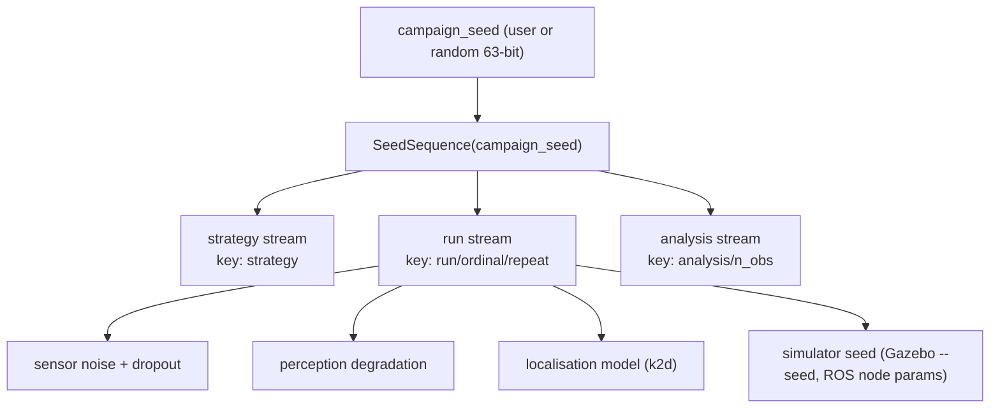

# 21 — Security, Reproducibility & Observability

> Related: [31 Threat model](31-threat-model.md) · [ADR-0014](adr/ADR-0014-seeding-and-provenance.md) · [34 §6 Logging standards](34-design-principles-patterns-and-conventions.md) · [30 Runbook](30-operations-runbook.md)

## 1. Security controls (summary; analysis in 31)

| Control | Implementation |
|---------|---------------|
| Network exposure | API/web bind `127.0.0.1` by default; Postgres not published outside compose network except `dev` profile |
| Authentication | optional static bearer token `ROBOPROBE_API_TOKEN` (`SecretStr`), constant-time compare; required automatically when `api.host` ≠ loopback |
| Input validation | Pydantic DTOs; JSON Schema for YAML; restricted AST evaluator for constraints (no `eval`); YAML via `yaml.safe_load` only |
| File safety | artefact paths resolved under `ARTIFACT_ROOT` (`Path.resolve().is_relative_to`), uploads size-limited (`api.max_upload_mb`) |
| Subprocess safety | Gazebo launched with argument lists (no shell), env whitelist, per-run workdir, process-group kill |
| Secrets | never in repo; `.env` and `secrets/` git-ignored; gitleaks in CI; Docker secrets for DB password |
| Supply chain | lockfiles, digest-pinned base images, pip-audit/pnpm audit/Trivy, SBOM per image, Dependabot |
| Containers | non-root users, read-only FS where possible, `no-new-privileges`, dropped capabilities |
| Web | CSP `default-src 'self'`, no inline scripts, CORS allow-list, `X-Content-Type-Options`, `Referrer-Policy` |

## 2. Reproducibility principles

1. Everything that influences a run is either in the scenario, the seed, the config snapshot or a versioned artefact.
2. Randomness only through injected generators derived from the seed tree.
3. Every run carries a provenance manifest; every report embeds the manifests of the runs it shows.
4. Replays are first-class (FR-REP-001) and measured (MET-06).

## 3. Seed derivation tree



`derive_seed(root: int, *path: str | int) -> int`: `SeedSequence(root, spawn_key=tuple(stable_hash(p) for p in path)).generate_state(1, np.uint64)[0] & (2**63-1)`, `stable_hash` = first 4 bytes of SHA-256 as int (never Python `hash`). Experiment seed `k` → `campaign_seed = derive_seed(experiment_seed, "rep", k)` (common random numbers).

## 4. Provenance manifest (`manifest.json`, `manifest_schema_version: 1`)

```json
{
  "manifest_schema_version": 1,
  "run_id": "0193…", "campaign_id": "0193…", "experiment_id": null,
  "roboprobe": {"version": "0.4.0", "git_sha": "3c1e9a7", "dirty": false, "uv_lock_sha256": "…"},
  "backend": {"name": "gazebo_nav2", "image": "ghcr.io/codewithjha/roboprobe-gazebo@sha256:…",
              "ros_distro": "jazzy", "gz": "harmonic 8.x", "nav2": "1.3.14", "rmw": "rmw_cyclonedds_cpp"},
  "space": {"id": "warehouse_v1", "version": "3f9a1c2b7d10"},
  "task": {"id": "warehouse_delivery_v1", "sha256": "…"},
  "sut_profile": {"id": "tb4_nav2_default", "config_hash": "…"},
  "scenario": {"hash": "a1b2…", "values": {}},
  "seeds": {"run": 1849302231, "sensor": 9…, "perception": 7…, "simulator": 3…},
  "materialized": {"world.sdf": "sha256:…", "nav2_params.yaml": "sha256:…", "perturb_params.yaml": "sha256:…"},
  "config_snapshot": {"oracles": {}, "backends.gazebo_nav2": {}},
  "host": {"hostname_hash": "…", "cpu": "…", "cores": 8, "ram_gb": 16},
  "timing": {"wall_s": 96.2, "sim_s": 58.4, "rtf_mean": 0.98}
}
```

Host names are hashed (privacy when sharing bundles).

## 5. Observability

### 5.1 Logs

JSON lines via structlog to stdout (Docker collects); fields: `ts` (UTC ISO), `level`, `logger`, `event`, `service`, `version`, `campaign_id`, `run_id`, `worker_id`, `trace_id`, plus event-specific keys. Event names are dotted and stable (`run.claimed`, `episode.launch_failed`, `selector.fallback`) — catalogue in 34 §6. Episode subprocess logs are captured to the `episode.log` artefact, not to the main log stream.

### 5.2 Metrics (Prometheus, `/metrics` on API; workers/orchestrator expose on an internal port)

| Metric | Type | Labels |
|--------|------|--------|
| `roboprobe_runs_total` | counter | backend, verdict, primary_failure |
| `roboprobe_run_duration_seconds` | histogram | backend, phase |
| `roboprobe_queue_depth` | gauge | backend |
| `roboprobe_workers` | gauge | backend, status |
| `roboprobe_selector_propose_seconds` | histogram | strategy |
| `roboprobe_gp_fit_seconds` | histogram | – |
| `roboprobe_episode_rtf` | histogram | backend |
| `roboprobe_infra_errors_total` | counter | backend, reason |
| `roboprobe_api_request_duration_seconds` | histogram | route, method, status |

All metrics are defined once in `roboprobe.core.metrics_registry` (dedicated registry injected into each service; a no-op Null Object when `observability.metrics_enabled=false`). Histogram buckets are documented *instrumentation constants* in that module rather than settings, because changing them breaks dashboard continuity and no service needs per-deployment overrides.

Optional `observability` compose profile (`make observability`) ships Prometheus + Grafana with a provisioned dashboard (`docker/observability/`) and an OTLP collector forwarding to Jaeger. Prometheus adds a bearer token only when the `api_token` secret file is non-empty.

### 5.3 Tracing (optional)

OpenTelemetry SDK with OTLP exporter disabled by default (`observability.otlp_endpoint` unset; `roboprobe.observability.tracing.configure_tracing` does not import the SDK until the endpoint is set — extra `roboprobe[otel]`). Spans: `campaign.tick`, `strategy.propose`, `run.execute` (child spans `materialize`, `episode`, `judge`, `persist`). `trace_id` propagated into log context and problem+json.

### 5.4 Health

`/health/live` (process up), `/health/ready` (DB reachable, migrations at head, artefact root writable). Worker health = heartbeat age; orchestrator health = last tick age (`/healthz` internal).

### 5.5 Alerts (in-app, no paid alerting)

SSE `alert` events + banner: `INFRA_UNHEALTHY` (auto-pause), `NO_WORKERS` (campaign RUNNING but no worker for backend for 60 s), `DISK_LOW` (artefact volume < `storage.min_free_gb`), `GP_FALLBACK_REPEATED` (≥ 3 consecutive fallbacks).
