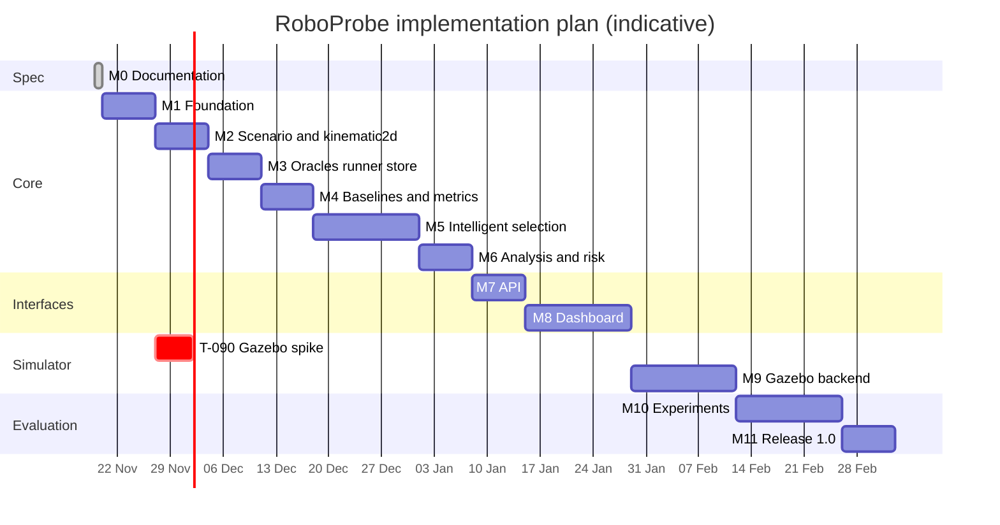
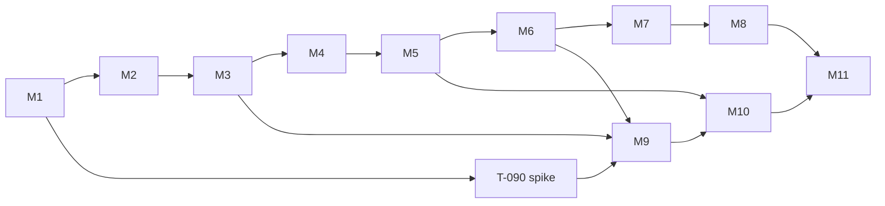

# 22 — Roadmap, Milestones & Implementation Plan

> Related: [AGENTS.md](../AGENTS.md) · [32 DoR/DoD](32-engineering-process-code-review-dor-dod.md) · [28 Traceability](28-traceability-matrix.md) · [templates/task-template.md](templates/task-template.md)
> Tasks are sized for one AI-agent session: **S** ≤ 300 changed lines, **M** ≤ 600, **L** ≤ 1 000 (split if larger). Each task = one branch = one PR.

## 1. Milestones

| Milestone | Goal | Exit criteria | Target (indicative) |
|-----------|------|---------------|---------------------|
| **M0** Specification | This documentation set | Docs merged; Mermaid renders; owner sign-off in 26 §14 | 2026-11-19 ✅ |
| **M1** Foundation | Skeleton, settings, logging, CI, compose with Postgres | `make setup && make test` green on CI; `make up` starts empty stack | +1 week |
| **M2** Scenario + kinematic2d | Space loading, sampling, k2d backend with designed mechanisms | k2d episode ≤ 2 s; calibration test shows GT-A…D | +2 weeks |
| **M3** Oracles + runner + store | Verdicts, queue, workers, persistence, CLI `campaign run --inline` | 100-run S-RANDOM campaign end-to-end in CI | +3 weeks |
| **M4** Baselines + experiments core | RANDOM/LHS/SOBOL/GRID/OFAT, metrics MET-01..06, statistics | EXP-02 analytic runs; metric unit tests | +4 weeks |
| **M5** Intelligent selection | RobustnessGP, S-BO, S-LSE, S-PROBE | 07 §9 benchmark gates pass | +6 weeks |
| **M6** Analysis + risk | Clustering, SHAP, rules, interaction test, risk maps, report v1 | HTML report for a k2d campaign | +7 weeks |
| **M7** API | REST + SSE complete per 12 | OpenAPI snapshot; schemathesis clean | +8 weeks |
| **M8** Dashboard | All MVP screens in Field Notebook design | Playwright flows + axe green | +10 weeks |
| **M9** Gazebo backend | Docker image, roboprobe_ros nodes, adapter, sim tests | SC-4 demo failure on Gazebo | +12 weeks |
| **M10** Evaluation | EXP-01…EXP-07 executed, experiment report | SC-1…SC-5 assessed (pass or honestly reported) | +14 weeks |
| **M11** Release 1.0 | Polish, docs update, demo video | v1.0.0 tag; README quick-start verified on clean machine | +15 weeks |

T-090 (Gazebo feasibility spike) is scheduled early (parallel to M2) to retire risk R-01.

## 2. Dependency graph (milestones)

## 3. Task backlog

Columns: ID · title · size · depends on · implements · key docs · acceptance (beyond DoD).

### M1 — Foundation

| ID | Task | Size | Deps | Implements | Docs | Acceptance |
|----|------|------|------|-----------|------|-----------|
| T-001 | Monorepo skeleton: `backend/` uv project, `web/` Vite app, Makefile, pre-commit, `.env.example`, `roboprobe.example.toml` | M | – | NFR-MNT-001 | 16, 17 | `make setup && make lint && make test` pass on empty code |
| T-002 | `roboprobe.core`: types (05 §1), errors hierarchy, seeding (`derive_seed`), clock abstraction | M | T-001 | FR-REP-002, ADR-0014 | 05, 21 §3, 34 | seeding golden values; 100 % coverage |
| T-003 | Settings tree with pydantic-settings + `roboprobe config show` + `scripts/gen_config_docs.py --check` | M | T-001 | ADR-0015 | 27 | precedence tests; generated tables equal 27 |
| T-004 | Logging (structlog JSON), metrics registry, health helpers | S | T-003 | NFR-OBS-001 | 21 §5, 34 §6 | log schema test |
| T-005 | Docker: backend image, compose `core` profile with Postgres + migrate placeholder | M | T-001 | ADR-0013 | 17, 29 | `make up` healthy; non-root |
| T-006 | CI workflows `ci.yml`, `docs.yml` (incl. mermaid check), dependabot, PR/issue templates, CODEOWNERS | M | T-001 | 20 | 20 | workflows green on PR |

### Storage

| ID | Task | Size | Deps | Implements | Docs | Acceptance |
|----|------|------|------|-----------|------|-----------|
| T-010 | SQLAlchemy ORM models + Alembic `0001_initial` exactly per 11 §3 | L | T-002 | FR-STO-001 | 11 | migration up/down/up test |
| T-011 | Repositories + UnitOfWork + outbox events/NOTIFY | M | T-010 | FR-STO-001 | 05 §9, 11 §4 | repo contract tests |
| T-012 | `RunQueue` (claim SKIP LOCKED, priorities) + reaper SQL | M | T-011 | FR-RUN-001/002 | 11 §4 | exactly-once test 4×100 |
| T-013 | `ArtifactStore` local content-addressed + `gc` + `verify` | M | T-002 | FR-STO-002 | 11 §6 | path-traversal tests |
| T-014 | Campaign export/import bundle | S | T-011, T-013 | FR-STO-003 | 11 | round-trip test |

### M2 — Scenario (M2 module) & kinematic2d (M1)

| ID | Task | Size | Deps | Implements | Docs | Acceptance |
|----|------|------|------|-----------|------|-----------|
| T-020 | JSON Schemas (`schemas/`) + space YAML loader + semantic checks | M | T-002 | FR-SCN-001/002 | 06 §4–5 | invalid fixtures → precise errors |
| T-021 | Normalisation (linear/log/int/categorical) | S | T-020 | FR-SCN-003 | 06 §4.1 | Hypothesis round-trip |
| T-022 | Constraint evaluator (restricted AST) + rejection sampling | S | T-020 | FR-SCN-004 | 06 §5 | unsafe expressions rejected |
| T-023 | Samplers: uniform/prior, LHS, Sobol, grid | S | T-021 | FR-SEL-001 | 07 §3 | distribution tests |
| T-024 | Scenario hashing + canonical JSON | S | T-021 | FR-SCN-006 | 06 | golden hashes |
| T-025 | Pins & sub-spaces | S | T-021 | FR-SCN-007 | 06 | pinned never vary |
| T-026 | Regression scenario export/import | S | T-024 | FR-SCN-008 | 06 §6 | round-trip |
| T-030 | `roboprobe.geometry` (footprint, distance transform, ray casting) | M | T-002 | FR-SIM-001 | 10 §7 | analytic geometry tests |
| T-031 | `roboprobe.perturbation` (noise, dropout, delay, lighting model, slip) | M | T-002 | FR-SIM-001 | 06 §3 | formula tests vs 06 |
| T-032 | k2d world/map loader + task file + nominal path | M | T-030 | FR-SIM-001 | 06 §1, 10 §7 | path matches fixture |
| T-033 | k2d robot, sensors, localisation, costmap, A*, pure pursuit, episode loop, Trace output | L | T-031, T-032 | FR-SIM-001 | 10 §7 | ≤ 2 s/episode; determinism |
| T-034 | k2d calibration: tune constants (config) so GT-A…GT-D exist; calibration test | M | T-033, T-036…T-039 | FR-SIM-002 | 10 §7.2 | each GT canonical fails, nominal passes |
| T-035 | Backend port, registry, `Kinematic2DBackend`, `ReplayBackend`, backend contract suite | M | T-033 | FR-RUN-006 | 05 §2, 18 §4.3 | contract green |

### M3 — Oracles (M5) & runner (M4)

| ID | Task | Size | Deps | Implements | Docs | Acceptance |
|----|------|------|------|-----------|------|-----------|
| T-036 | Oracle base + InfraCheck + `O-CLEAR`, `O-GOAL` | M | T-002 | FR-ORC-001/002 | 08 | golden traces |
| T-037 | `O-PROG`, `O-LOC`, `O-NAV` | M | T-036 | FR-ORC-001 | 08 | golden traces |
| T-038 | `O-STAB`, `O-OSC` | S | T-036 | FR-ORC-001 | 08 | golden traces |
| T-039 | VerdictEngine, run metrics, `oracle reevaluate` | S | T-037, T-038 | FR-ORC-003/004/006 | 08 §5–6 | invariant FAIL⇔ρ<0 |
| T-040 | Worker process (claim, heartbeat thread, execute, persist, drain on SIGTERM) | L | T-012, T-013, T-035, T-039 | FR-RUN-001…004 | 05 §5.2, 14 §4 | chaos kill test |
| T-041 | CampaignLoop + Scheduler + leader lock + strategy checkpoints | L | T-012, T-023 | FR-RUN-*, NFR-REL-002 | 05 §5.1, 14 §2–3 | restart-resume test |
| T-042 | Reaper + stop rules + auto-pause alerts | S | T-041 | FR-RUN-002 | 14 §3, 21 §5.5 | timing tests with fake clock |
| T-043 | Provenance manifest builder | S | T-040 | FR-REP-002 | 21 §4 | schema test |
| T-044 | Replay command + replay runs | S | T-040 | FR-REP-001 | 14 §7 | k2d bit-identical |
| T-045 | CLI: db, space, campaign (create/start/…/run --inline/status), worker, orchestrator, run | M | T-041 | FR-CLI-001 | 05 §11 | CLI tests (typer CliRunner) |
| T-046 | Composition roots (`roboprobe.bootstrap`) + entry-point registries | S | T-035, T-041 | ADR-0016 | 34 §3 | import-linter contracts |
| T-047 | Compose: orchestrator + worker-k2d services; `make demo` | S | T-045 | ADR-0013 | 17 | demo campaign completes |

### M4 — Baselines, metrics, experiments

| ID | Task | Size | Deps | Implements | Docs | Acceptance |
|----|------|------|------|-----------|------|-----------|
| T-050 | Strategy base, registry, contract suite | M | T-023 | FR-SEL-001/005/006/007 | 05 §4, 18 §4.3 | contract green |
| T-051 | S-RANDOM, S-LHS, S-SOBOL, S-GRID, S-OFAT | M | T-050 | FR-SEL-001 | 07 §3 | contract + design tests |
| T-052 | Analytic benchmarks module (`branin_falsify`, `multi_mode_6d`) + benchmark backend | S | T-050 | 07 §9 | 07 §9 | volume ≈ 0.7 % check |
| T-100 | Metrics MET-01…MET-09 | M | T-011 | FR-EXP-001 | 19 §3 | hand-computed examples |
| T-101 | Statistics: MWU, Â12, bootstrap, Holm, log-rank | M | T-100 | FR-EXP-002 | 19 §5 | published examples |
| T-102 | Experiment planner/runner + CLI | M | T-041, T-100 | FR-EXP-001 | 14 §8 | small experiment end-to-end |
| T-103 | k2d reference set generation + GT mode labelling tool | M | T-034, T-102 | MET-02/08 | 19 §3 | artefact hash recorded |

### M5 — Intelligent selection

| ID | Task | Size | Deps | Implements | Docs | Acceptance |
|----|------|------|------|-----------|------|-----------|
| T-055 | `RobustnessGP` (fit/predict/p_fail, subsampling, fallbacks) | M | T-050 | FR-SEL-002, FR-RSK-001 | 07 §4 | calibration test on synthetic GP draws |
| T-056 | Acquisitions: LogEI wrapper, EV, diversity penalty, straddle, Kriging Believer batches | M | T-055 | FR-SEL-002/006 | 07 §5 | analytic checks of EV/straddle |
| T-057 | S-BO | S | T-056 | FR-SEL-002 | 07 §7 | branin gate |
| T-058 | S-LSE | S | T-056 | FR-SEL-004 | 07 §7 | boundary accuracy on benchmark |
| T-059 | S-PROBE phase controller, refine (bisection + perturbation), adaptive weights, rationale | L | T-056 | FR-SEL-003/008 | 07 §6 | multi_mode_6d gates |
| T-060 | Strategy params models + validation + `/meta` exposure | S | T-059 | FR-SEL-008 | 07 §6.3, 27 | invalid params rejected |
| T-061 | Calibrate benchmark thresholds (`tests/benchmark/thresholds.yaml`) and freeze hyper-parameters | S | T-059 | 19 §8 | 18 §4.4 | documented in evidence/ |
| T-062 | [V1-opt] S-CEM | S | T-050 | FR-SEL-009 | 07 §8 | contract green |

### M6 — Analysis & risk

| ID | Task | Size | Deps | Implements | Docs | Acceptance |
|----|------|------|------|-----------|------|-----------|
| T-070 | Feature builder + HDBSCAN clusterer + fallbacks | M | T-011 | FR-ANA-001 | 09 §3 | ARI ≥ 0.9 synthetic |
| T-071 | Mode summariser + stable mode ids (Hungarian) | M | T-070 | FR-ANA-002 | 09 §3.3 | id stability test |
| T-072 | Importance: HistGB + SHAP + interactions + lengthscale cross-check | M | T-055 | FR-ANA-003 | 09 §4 | planted params top-k |
| T-073 | Rule extraction | S | T-072 | FR-ANA-004 | 09 §4.3 | planted thresholds ±0.05 |
| T-074 | Interaction tester (plan + conclude) | M | T-071, T-041 | FR-ANA-005 | 09 §6 | synthetic interaction detected, single-factor not |
| T-075 | Analysis pipeline + job runner + incremental mode | M | T-071…T-074 | FR-ANA-006 | 09 §2, §8 | campaign → report.json |
| T-076 | RiskMapper slices | S | T-055 | FR-RSK-001…003 | 09 §5 | grid shapes, log axes |
| T-077 | VolumeEstimator + robustness score + Wilson CIs | S | T-076 | FR-RSK-004/005 | 09 §5.4 | analytic volume match |
| T-078 | Static HTML campaign report (Jinja2 + Matplotlib SVG) | M | T-075, T-077 | FR-DSH-007 | 05 §12 | report renders offline |
| T-079 | Experiment report | M | T-101, T-078 | FR-EXP-003 | 19 §7 | report renders |

### M7 — API

| ID | Task | Size | Deps | Implements | Docs | Acceptance |
|----|------|------|------|-----------|------|-----------|
| T-080 | App factory, error handling (problem+json), auth token, CORS, health, meta | M | T-011 | FR-API-001/003, NFR-SEC-001 | 12 §1 | error envelope tests |
| T-081 | Spaces, SUT profiles, campaigns (+ commands), runs, artefacts | L | T-080 | FR-API-001 | 12 §2–3 | API tests |
| T-082 | Modes, importance, risk, analyze, replay, export endpoints | M | T-081, T-075 | FR-API-001 | 12 | API tests |
| T-083 | SSE hub + outbox listener + Last-Event-ID | M | T-080 | FR-API-002 | 12 §4, 14 §6 | latency ≤ 2 s |
| T-084 | Experiments + reports endpoints; OpenAPI snapshot + oasdiff | S | T-102, T-078 | FR-API-001 | 12 | snapshot committed |

### M8 — Dashboard

| ID | Task | Size | Deps | Implements | Docs | Acceptance |
|----|------|------|------|-----------|------|-----------|
| T-085 | Web foundation: tokens, fonts, MarginRail, routing, providers, runtime config, generated API client | M | T-084 | FR-DSH-008 | 13 §1, §5 | contrast test; a11y |
| T-086 | Signature components: ConditionStrip, SpecimenTag, VerdictNotch, RobustnessBar, Spine, EmptyState | M | T-085 | – | 13 §6 | component tests |
| T-087 | Bench + campaign list + wizard | M | T-086 | FR-DSH-001 | 13 §3.1–3.2 | Playwright create flow |
| T-088 | Campaign console (SSE, discovery curve, entry stream, controls, rationale popover) | L | T-086, T-083 | FR-DSH-002 | 13 §3.3 | live update e2e |
| T-089 | Run entry: trajectory plot, synced timelines, oracle table, provenance | L | T-086 | FR-DSH-005 | 13 §3.4 | component + e2e |
| T-110 | Casebook + insights panel | M | T-089 | FR-DSH-003 | 13 §3.5 | e2e |
| T-111 | Risk atlas | M | T-089 | FR-DSH-004 | 13 §3.6 | e2e |
| T-112 | Trials + comparison | M | T-084 | FR-DSH-006 | 13 §3.7 | e2e |
| T-113 | Spaces, Workbench, Settings, report export, print CSS | M | T-085 | FR-DSH-007 | 13 §3.8–3.9 | e2e |
| T-114 | Accessibility & performance pass (axe, keyboard, bundle budget) | S | T-110…T-113 | NFR-ACC-001 | 13 §7 | Lighthouse ≥ 95 |

### M9 — Gazebo backend

| ID | Task | Size | Deps | Implements | Docs | Acceptance |
|----|------|------|------|-----------|------|-----------|
| T-090 | **Spike:** headless TB4 + Nav2 warehouse in Docker on owner's laptop; measure RTF, startup, CPU; record findings | S | T-005 | R-01 | 10 | `docs/evidence/T-090-gazebo-spike.md` |
| T-091 | Verify & record topics/frames/param names, lidar plane height, pallet height → `topics.yaml`, task file | S | T-090 | FR-SIM-003 | 10 §3, 06 §7 | no `TBD_T091` left |
| T-092 | Map + goal pose + nominal path for `warehouse_delivery_v1` | S | T-091 | FR-SIM-003 | 06 §1 | no `TBD_T092` left |
| T-093 | `roboprobe_ros` nodes: sensor_perturber, perception_degrader, cmd_delay | M | T-031, T-091 | FR-SIM-003 | 10 §3–4 | node unit tests (launch_testing) |
| T-094 | ground_truth_monitor, episode_recorder, episode_manager, episode.launch.py | L | T-093 | FR-SIM-003 | 10 §5–6 | single episode produces trace |
| T-095 | Gazebo image (Dockerfile), bridge config, worker venv | M | T-094 | ADR-0013 | 17 §5 | image builds in CI |
| T-096 | `GazeboNav2Backend`: materialiser (SdfPatcher, Nav2ParamOverlay), subprocess lifecycle, teardown, InfraCheck mapping | L | T-095, T-035 | FR-SIM-003 | 10 §4–5, §9 | backend contract (sim) |
| T-097 | Parallel isolation (domain id, partition), rosbag MCAP recording | M | T-096 | FR-SIM-004/005 | 10 §6, §9 | 2 parallel episodes clean |
| T-098 | Sim test suite + nightly workflow | M | T-097 | 18 §4.8 | 20 | nightly green |

### M10/M11 — Evaluation & release

| ID | Task | Size | Deps | Implements | Docs | Acceptance |
|----|------|------|------|-----------|------|-----------|
| T-104 | Experiment configs EXP-01…EXP-07 | S | T-102 | 19 §4 | 19 | configs validate |
| T-105 | Run EXP-01/02/03/07 (k2d) and write results evidence | M | T-104, T-059 | SC-1…3 | 19 | report in `docs/evidence/` |
| T-120 | Run EXP-04/05/06 (Gazebo), demo recording | M | T-098, T-105 | SC-4/5 | 19 | report + video |
| T-121 | Docs refresh to as-built; CHANGELOG; ADR updates | S | all | – | all | docs CI green |
| T-122 | Clean-machine quick-start verification (SC-6) | S | T-121 | NFR-USE-001 | 29 | timed log in evidence |
| T-123 | Release v1.0.0 | S | T-122 | 33 | 20 §6 | GitHub Release |

## 4. Parallelisation guidance for multiple agents

Independent streams after M1: (A) storage T-010…T-014, (B) scenario T-020…T-026, (C) geometry/perturbation T-030/T-031, (D) oracles T-036…T-039, (E) Gazebo spike T-090. Interfaces in 05 are frozen, so streams integrate through the ports. Never assign two agents tasks touching the same module in the same week.
