# 23 — Risk Register & Mitigations

> Scale: Likelihood (L) and Impact (I) 1–5; Score = L × I. Reviewed at each milestone exit; owner: Priyanshu Jha.

| ID | Risk | L | I | Score | Mitigation | Contingency / trigger | Owner task |
|----|------|---|---|-------|-----------|------------------------|-----------|
| R-01 | Gazebo + Nav2 too slow/unstable headless on the laptop (RTF < 0.5, crashes) | 3 | 5 | 15 | [T-090](evidence/T-090-gazebo-spike.md) validated headless software navigation. Use 1 worker and a 150 s startup timeout on the measured VM. | Cold starts exceeded 40 s and both overlapping goals ran below 0.5 RTF. Pre-stage world assets and remeasure before raising concurrency. | T-090 |
| R-02 | Intelligent strategy does not beat random on the real stack | 2 | 5 | 10 | Validate on k2d + analytic first; ablations; robustness signal | Report honestly (negative result is still a result); analyse why (noise, dimension) | T-105, T-120 |
| R-03 | Too few/too many failures (space too easy/hard) | 3 | 4 | 12 | Calibrate ranges with OFAT + 50 random runs before experiments | Adjust ranges (new space version), never silently | T-034, T-105 |
| R-04 | ROS/Gazebo version churn breaks image (Jazzy updates, Lyrical migration) | 2 | 3 | 6 | Digest-pinned images; nightly sim test; adapter isolation | Stay on last good digest; migrate via new ADR | T-095 |
| R-05 | Gazebo non-determinism makes failures irreproducible | 4 | 3 | 12 | Seeded perturbations; replays; learned GP noise; report MET-06 | Treat failures as probabilistic (report rate); repeats per scenario | T-097, EXP-06 |
| R-06 | Lighting has no physical effect on sensors in sim (A3) | 5 | 3 | 15 | Documented perception-degradation model + sub-lidar obstacle (06 §1, §3.3) | State explicitly as modelling assumption in reports | T-093 |
| R-07 | GP scales poorly (n > 1 500) or misfits | 2 | 3 | 6 | Subsampling, fallbacks, explore slots | Switch to SVGP or local GPs (future ADR) | T-055 |
| R-08 | AI agents drift from the spec / inconsistent interfaces | 3 | 4 | 12 | AGENTS.md, frozen interfaces, contract tests, import-linter, small PRs, review checklist | Revert PR; update spec first | all |
| R-09 | Scope creep (multi-robot, VLA, RL) | 3 | 3 | 9 | MoSCoW in PRD; FUT tags | Defer via RFC | owner |
| R-10 | Time shortage (student schedule) | 4 | 4 | 16 | MVP path clearly marked; k2d results sufficient for core claims; Gazebo demo minimal | Cut S-CEM, Trials UI polish, observability profile | owner |
| R-11 | Disk fills with bags/artefacts | 3 | 2 | 6 | Bags for failures only; retention; `DISK_LOW` alert | `roboprobe gc` | T-013 |
| R-12 | Dependency licence or security issue | 1 | 3 | 3 | License check + audits in CI | Replace dependency | T-006 |
| R-13 | Metric/oracle bug invalidates results | 2 | 5 | 10 | Golden tests, mutation testing, independent re-computation notebook | Re-run experiments from stored runs (oracles are re-evaluable) | T-039, T-100 |
| R-14 | Evaluator questions realism of k2d | 3 | 3 | 9 | Label backend everywhere; Gazebo evidence; threats-to-validity | Emphasise Gazebo results for external validity | T-120 |
| R-15 | Windows/WSL2 setup friction | 3 | 2 | 6 | Documented WSL2 path; devcontainer optional | Use Codespaces for core work | T-122 |

```mermaid
flowchart LR
    subgraph ACT["Score 12 or more: act now"]
        R10["R-10 time shortage 16"]
        R01["R-01 Gazebo performance 15"]
        R06["R-06 lighting realism 15"]
        R03["R-03 space difficulty 12"]
        R05["R-05 non-determinism 12"]
        R08["R-08 agent drift 12"]
    end
    subgraph MON["Score 8 to 11: monitor"]
        R02["R-02 no win vs random 10"]
        R13["R-13 metric bug 10"]
        R09["R-09 scope creep 9"]
        R14["R-14 k2d realism 9"]
    end
    subgraph ACC["Score 7 or less: accept and watch"]
        R04["R-04 version churn 6"]
        R07["R-07 GP scaling 6"]
        R11["R-11 disk 6"]
        R15["R-15 WSL friction 6"]
        R12["R-12 licence or CVE 3"]
    end
    ACT --> MON --> ACC
```

