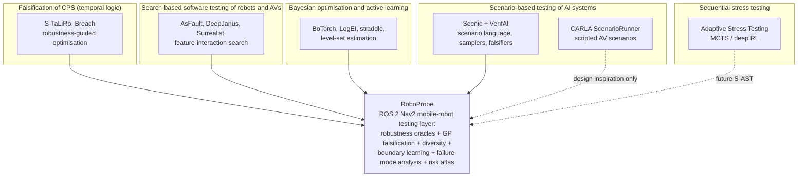

# 25 — References & Prior Art

> How RoboProbe relates to existing work, and what it borrows. Citations are to the original publications / official documentation.

## 1. Positioning

**Gap RoboProbe addresses:** existing falsification toolkits are generic or automotive-focused; robotics
SBST tools typically optimise for *a* failure. RoboProbe combines, for a ROS 2/Nav2 mobile robot,
(1) continuous STL-style oracles, (2) GP-based falsification with explicit *mode diversity*, (3) boundary
learning that yields a calibrated risk map, (4) automatic failure-mode clustering with interaction
verification, and (5) a reproducible experiment harness comparing against random/predefined baselines.

## 2. Bibliography

### Falsification, robustness & safety validation
1. Y. Annpureddy, C. Liu, G. Fainekos, S. Sankaranarayanan. *S-TaLiRo: A Tool for Temporal Logic Falsification for Hybrid Systems.* TACAS 2011. — robustness-guided falsification (→ ADR-0006).
2. A. Donzé. *Breach, a Toolbox for Verification and Parameter Synthesis of Hybrid Systems.* CAV 2010.
3. A. Donzé, O. Maler. *Robust Satisfaction of Temporal Logic over Real-Valued Signals.* FORMATS 2010. — quantitative STL semantics used in 08.
4. A. Corso, R. Moss, M. Koren, R. Lee, M. Kochenderfer. *A Survey of Algorithms for Black-Box Safety Validation of Cyber-Physical Systems.* JAIR 70, 2021. — taxonomy of optimisation, path-planning, importance sampling methods.
5. R. Lee, O. Mengshoel, A. Saksena, R. Gardner, D. Genin, J. Silbermann, M. Owen, M. Kochenderfer. *Adaptive Stress Testing: Finding Likely Failure Events with Reinforcement Learning.* JAIR 69, 2020 (arXiv:1811.02188). — basis for future `S-AST`.
6. M. Koren, A. Nassar, M. Kochenderfer. *Finding Failures in High-Fidelity Simulation using Adaptive Stress Testing and the Backward Algorithm.* IROS 2021 (arXiv:2107.12940). — low→high fidelity idea mirrors k2d→Gazebo.
7. M. O'Kelly, A. Sinha, H. Namkoong, J. Duchi, R. Tedrake. *Scalable End-to-End Autonomous Vehicle Testing via Rare-event Simulation.* NeurIPS 2018. — cross-entropy rare-event baseline (`S-CEM`).

### Scenario-based testing
8. D. Fremont, T. Dreossi, S. Ghosh, X. Yue, A. Sangiovanni-Vincentelli, S. Seshia. *Scenic: A Language for Scenario Specification and Scene Generation.* PLDI 2019.
9. T. Dreossi, D. Fremont, S. Ghosh, E. Kim, H. Ravanbakhsh, M. Vazquez-Chanlatte, S. Seshia. *VerifAI: A Toolkit for the Formal Design and Analysis of AI-Based Systems.* CAV 2019. Docs: https://verifai.readthedocs.io — active samplers (cross-entropy, simulated annealing, BO) and passive (random, Halton); RoboProbe's strategy catalogue follows the same active/passive split.
10. A. Dosovitskiy et al. *CARLA: An Open Urban Driving Simulator.* CoRL 2017; CARLA ScenarioRunner (https://github.com/carla-simulator/scenario_runner).

### Search-based testing of robots / autonomous systems
11. R. Ben Abdessalem, S. Nejati, L. Briand, T. Stifter. *Testing Autonomous Cars for Feature Interaction Failures using Many-Objective Search.* ASE 2018. — interaction failures (→ 09 §6).
12. R. Ben Abdessalem, A. Panichella, S. Nejati, L. Briand, T. Stifter. *Testing Autonomous Cars Using Learnable Evolutionary Algorithms.* ICSE 2018 (decision-tree-guided search; → rule extraction 09 §4.3).
13. A. Gambi, M. Müller, G. Fraser. *Automatically Testing Self-Driving Cars with Search-Based Procedural Content Generation.* ISSTA 2019 (AsFault).
14. V. Riccio, P. Tonella. *Model-based Exploration of the Frontier of Behaviours for Deep Learning System Testing.* ESEC/FSE 2020 (DeepJanus). — "frontier of behaviours" ≈ our pass/fail boundary.
15. S. Khatiri, S. Panichella, P. Tonella. *Simulation-based Test Case Generation for Unmanned Aerial Vehicles in the Neighborhood of Real Flights.* ICST 2023 (Surrealist); and *Bridging Research and Practice in Simulation-based Testing of Industrial Robot Navigation Systems*, arXiv:2510.09396 (2025) — industrial evidence that search-based navigation testing finds failures manual tests miss.

### Bayesian optimisation, active learning, Gaussian processes
16. C. E. Rasmussen, C. K. I. Williams. *Gaussian Processes for Machine Learning.* MIT Press, 2006.
17. M. Balandat et al. *BoTorch: A Framework for Efficient Monte-Carlo Bayesian Optimization.* NeurIPS 2020. https://botorch.org (v0.18, Python ≥ 3.11).
18. S. Ament, S. Daulton, D. Eriksson, M. Balandat, E. Bakshy. *Unexpected Improvements to Expected Improvement for Bayesian Optimization.* NeurIPS 2023. — LogEI.
19. B. Bryan, J. Schneider, R. Nichol, C. Miller, C. Genovese, L. Wasserman. *Active Learning for Identifying Function Threshold Boundaries.* NeurIPS 2005. — straddle heuristic.
20. A. Gotovos, N. Casati, G. Hitz, A. Krause. *Active Learning for Level Set Estimation.* IJCAI 2013.
21. J. González, Z. Dai, P. Hennig, N. Lawrence. *Batch Bayesian Optimization via Local Penalization.* AISTATS 2016. — inspiration for the diversity penalty.
22. D. Ginsbourger, R. Le Riche, L. Carraro. *Kriging Is Well-Suited to Parallelize Optimization.* In: Computational Intelligence in Expensive Optimization Problems, Springer 2010. — Kriging Believer.
23. M. McKay, R. Beckman, W. Conover. *A Comparison of Three Methods for Selecting Values of Input Variables in the Analysis of Output from a Computer Code.* Technometrics 1979 (LHS). I. M. Sobol'. 1967 (Sobol sequences); SciPy `stats.qmc` docs.

### Analysis & statistics
24. R. Campello, D. Moulavi, J. Sander. *Density-Based Clustering Based on Hierarchical Density Estimates.* PAKDD 2013 (HDBSCAN).
25. S. Lundberg, S.-I. Lee. *A Unified Approach to Interpreting Model Predictions.* NeurIPS 2017; S. Lundberg et al. *From Local Explanations to Global Understanding with Explainable AI for Trees.* Nature Machine Intelligence 2020 (TreeExplainer, interaction values).
26. A. Arcuri, L. Briand. *A Practical Guide for Using Statistical Tests to Assess Randomized Algorithms in Software Engineering.* ICSE 2011. — 30 repetitions, Mann–Whitney, Â12.
27. A. Vargha, H. Delaney. *A Critique and Improvement of the CL Common Language Effect Size Statistics of McGraw and Wong.* J. Educational and Behavioral Statistics 25(2), 2000.
28. S. Holm. *A Simple Sequentially Rejective Multiple Test Procedure.* Scandinavian J. Statistics 6, 1979.
29. D. R. Kuhn, R. Kacker, Y. Lei. *Introduction to Combinatorial Testing.* CRC Press 2013. — 2-way coverage (MET-04).

### Robotics platform
30. S. Macenski, F. Martín, R. White, J. Ginés Clavero. *The Marathon 2: A Navigation System.* IROS 2020 (Nav2). Docs: https://docs.nav2.org (Jazzy quickstart, `tb4_simulation_launch.py`, `nav2_minimal_tb4_sim` warehouse world).
31. S. Macenski, T. Foote, B. Gerkey, C. Lalancette, W. Woodall. *Robot Operating System 2: Design, Architecture, and Uses in the Wild.* Science Robotics 7(66), 2022.
32. N. Koenig, A. Howard. *Design and Use Paradigms for Gazebo, an Open-Source Multi-Robot Simulator.* IROS 2004. Gazebo docs: https://gazebosim.org/docs (ROS/Gazebo pairing table: Jazzy ↔ Harmonic).
33. REP-2000, ROS 2 Releases and Target Platforms: https://reps.openrobotics.org/rep-2000/ (Jazzy May 2024–May 2029).

### Engineering practice
34. IEEE Std 830-1998, *Recommended Practice for Software Requirements Specifications*; ISO/IEC/IEEE 29148:2018.
35. S. Brown. *The C4 model for visualising software architecture.* https://c4model.com
36. M. Nygard. *Documenting Architecture Decisions.* 2011; MADR template (https://adr.github.io/madr/).
37. RFC 2119 (requirement keywords); RFC 9457 (Problem Details for HTTP APIs); Semantic Versioning 2.0.0; Keep a Changelog 1.1.0; Conventional Commits 1.0.0.
38. A. Cockburn. *Hexagonal Architecture* (Ports & Adapters), 2005; R. C. Martin, *Clean Architecture*, 2017 (SOLID).
39. M. Okabe, K. Ito. *Color Universal Design* (colour-blind-safe palette) — risk colours in 13.
40. W3C. *Web Content Accessibility Guidelines (WCAG) 2.2*, 2023.
41. OWASP ASVS 4.0 and STRIDE (Microsoft) — threat model in 31.

## 3. What we deliberately do *not* copy
- No proprietary simulators or paid services.
- No UI/visual design from any existing product; the dashboard design language is original (13 §1).
- No code from the cited tools is vendored; ideas are re-implemented from the papers with attribution in docstrings.
