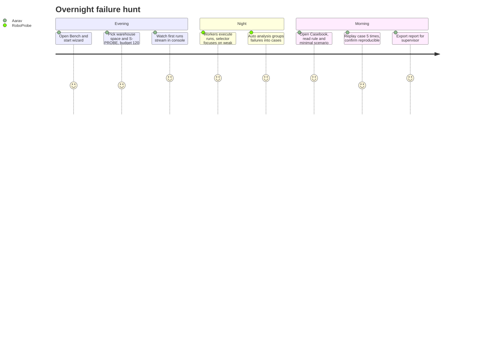

# 26 — Product Requirements Document (PRD)

| Field | Value |
|-------|-------|
| Product | RoboProbe — Intelligent Virtual Robotics Testing & Failure Discovery Platform |
| Document owner | Priyanshu Jha (Product & Engineering, @CodewithJha) |
| Status | **Approved for build (v1.0)** |
| Version | 1.0.0 · 2026-11-19 |
| Release target | RoboProbe 1.0 (milestone M11, see 22) |
| Related | [01 Vision](01-vision-and-product-brief.md) · [02 SRS](02-software-requirements-specification.md) · [03 Personas](03-personas-user-stories-use-cases.md) · [19 Evaluation](19-evaluation-and-experiment-plan.md) · [28 Traceability](28-traceability-matrix.md) |

> **PRD vs SRS.** This PRD states *what* we build and *why*, for whom, and how success is measured.
> The [SRS](02-software-requirements-specification.md) states the detailed, testable *requirements*.
> Every PRD requirement (`PR-xx`) maps to SRS IDs (`FR-*`/`NFR-*`) in §7 and in [28](28-traceability-matrix.md).

## 1. TL;DR
Robots fail in rare *combinations* of moderate conditions that hand-written or random tests rarely hit.
RoboProbe is a free, laptop-friendly testing layer on top of Gazebo/ROS 2 Nav2 that learns from each
simulation where the robot is weak, deliberately probes there, groups failures into explained modes,
and maps the robot's safe operating envelope — with statistical proof that it beats random and
predefined testing.

## 2. Problem & opportunity

### 2.1 Problem statement
Robot software teams validate autonomy in simulation, but **choosing which scenarios to simulate** is
manual or random. Simulation time is expensive (minutes per realistic episode), so most budget is spent
on ordinary passing cases, and **interaction failures** (e.g. high speed + low light + sensor noise)
stay hidden until field tests — the most expensive and least safe place to find them.

### 2.2 Evidence
- Concept report problem list (01 §2).
- Literature: feature-interaction failures in autonomous systems are found by search, not by OFAT
  plans (Abdessalem et al. 2018); industrial navigation testing finds failures manual tests miss
  (arXiv:2510.09396, 2025); falsification with robustness guidance is far more efficient than random
  sampling for rare events (Corso et al. 2021).

### 2.3 Opportunity
A reusable, open-source "virtual testing engineer" for ROS 2 mobile robots: valuable for warehouse/logistics
AMR teams, robotics labs and students; demonstrates an AI method with measurable benefit.

## 3. Goals, non-goals, success metrics

### 3.1 Product goals
| ID | Goal |
|----|------|
| PG-1 | Find robot failures with **fewer simulations** than random/predefined testing |
| PG-2 | Find **more distinct** failure modes, especially interaction failures |
| PG-3 | **Explain** each failure mode (conditions, rules, importance) and make it **reproducible** |
| PG-4 | Show **where** the robot is safe / uncertain / failing (risk atlas) |
| PG-5 | Be **free, local, one-command** to run, and **extensible** to other robots/simulators |

### 3.2 Non-goals (v1.0)
Physical robots; building a simulator; fixing Nav2; multi-robot; VLA models; formal verification;
multi-user SaaS/auth; cloud dependence; paid services.

### 3.3 Success metrics / KPIs
| KPI | Definition | Target v1.0 | Source |
|-----|-----------|-------------|--------|
| KPI-1 Efficiency | median sims-to-first-failure S-PROBE ÷ S-RANDOM (k2d, 30 seeds) | ≤ 0.5, p_Holm < 0.05 | MET-03 |
| KPI-2 Diversity | Â12 of unique modes S-PROBE vs S-RANDOM at B = 200 | ≥ 0.64 | MET-02 |
| KPI-3 Interaction discovery | share of seeds where GT-A (3-way) is found within 200 sims | ≥ 90 % | 19 §6 |
| KPI-4 Real-stack proof | interaction failures confirmed on Gazebo | ≥ 1 | EXP-04 |
| KPI-5 Reproducibility | replay agreement k2d / Gazebo | 1.0 / ≥ 0.8 | MET-06 |
| KPI-6 Time-to-first-campaign | new user, README only | ≤ 5 min | SC-6 |
| KPI-7 Cost | money spent | ₹0 | NFR-COST-001 |
| KPI-8 Quality | core coverage / CI green rate on main | ≥ 85 % / ≥ 95 % | 18 |
Guardrail metrics: INVALID-run ratio ≤ 5 % on Gazebo; selector overhead ≤ 2 s/proposal; dashboard p95 API latency ≤ 200 ms.

## 4. Users & personas
Summarised from [03](03-personas-user-stories-use-cases.md): **Aarav** (test engineer, primary),
**Meera** (robot developer), **Dr. Rao** (evaluator), **Agent** (AI coding agent building the product).
Jobs-to-be-done:
- *When* I prepare a robot for a demo/deployment, *I want* the system to hunt for failure conditions overnight, *so that* I can fix weaknesses before people see them.
- *When* a failure is reported, *I want* an exact replay and the minimal triggering conditions, *so that* I can fix and regression-test it.
- *When* I evaluate the project, *I want* fair, statistically sound comparisons, *so that* the AI claim is credible.

## 5. Scope

| Area | MVP (M1–M9) | v1.0 (M10–M11) | Later (FUT) |
|------|-------------|----------------|-------------|
| Task | warehouse delivery, 1 injected pallet | same, d = 6 and 8 | more tasks, multi-robot |
| Simulators | kinematic2d, Gazebo Harmonic/Nav2 | + parallel Gazebo workers | Webots, MuJoCo, Isaac, Lyrical/Jetty |
| Strategies | RANDOM, LHS, SOBOL, GRID, OFAT, BO, PROBE | + LSE, (CEM) | AST (RL), adversarial generators |
| Oracles | collision, timeout, stuck, localisation, plan abort, warnings | + stability, oscillation | formal STL specs, task-level VLA oracles |
| Analysis | clustering, SHAP, rules | + interaction confirmation | causal analysis |
| Risk | GP p_fail slices, volumes | + robustness score comparison | sim-to-real estimates |
| UI | Bench, wizard, console, run entry, casebook, atlas | + trials, reports, workbench | human-in-the-loop approvals |
| Ops | compose, CI, nightly sim | + release images, observability profile | k8s, remote worker fleet |

## 6. Requirements (MoSCoW)

| ID | Requirement (what) | Why | MoSCoW | SRS mapping |
|----|-------------------|-----|--------|-------------|
| PR-01 | Users define the scenario space (parameters, ranges, priors, constraints) in a validated YAML file | control & reproducibility | **Must** | FR-SCN-001…006 |
| PR-02 | The system runs campaigns autonomously on a chosen simulator with a budget and parallel workers | core loop | **Must** | FR-RUN-001…006, FR-SIM-001/003 |
| PR-03 | An intelligent strategy selects the next scenarios from past outcomes | core innovation (PG-1/2) | **Must** | FR-SEL-002/003/005/006/007 |
| PR-04 | Random and predefined baselines are available under identical conditions | fair comparison | **Must** | FR-SEL-001 |
| PR-05 | Failures are detected automatically with a documented taxonomy and a continuous robustness score | trust, learning signal | **Must** | FR-ORC-001…006 |
| PR-06 | Failures are grouped into modes with conditions, rules and importance | explainability (PG-3) | **Must** | FR-ANA-001…003, 006 |
| PR-07 | A risk atlas shows safe / uncertain / failure regions | PG-4 | **Must** | FR-RSK-001…003 |
| PR-08 | Every run is replayable from its manifest; failures exportable as regression scenarios | PG-3 | **Must** | FR-REP-001/002, FR-SCN-008 |
| PR-09 | A dashboard lets users create, monitor and inspect campaigns live | usability | **Must** | FR-DSH-001…005 |
| PR-10 | Experiments compare strategies with statistics and produce a report | evaluation credibility | **Must** | FR-EXP-001/002, FR-DSH-007 |
| PR-11 | A fast built-in simulator enables CI and large experiments without ROS | velocity, ground truth | **Must** | FR-SIM-001/002 |
| PR-12 | All configuration is typed, validated and overridable; no hard-coded tunables | maintainability, research reproducibility | **Must** | NFR-CFG-001…003 |
| PR-13 | One-command local deployment; free CI/CD | deployability | **Must** | NFR-DEP-001…003 |
| PR-14 | Interaction failures are confirmed with targeted runs | core research claim | **Should** | FR-ANA-005 |
| PR-15 | Boundary-focused strategy (LSE) and rules extraction | analysis depth | **Should** | FR-SEL-004, FR-ANA-004 |
| PR-16 | Parallel Gazebo workers and remote workers | scalability | **Should** | FR-SIM-004, NFR-SCAL-001/002 |
| PR-17 | Robustness comparison between robot configurations | closes the loop to improvement | **Should** | FR-RSK-005, UC-10 |
| PR-18 | Experiment comparison UI with discovery curves | evaluator UX | **Should** | FR-DSH-006, FR-EXP-003 |
| PR-19 | Plugin APIs for simulators, strategies, oracles, stores | extensibility | **Should** | NFR-EXT-001…003 |
| PR-20 | Campaign bundles export/import | sharing results | **Could** | FR-STO-003 |
| PR-21 | Cross-entropy strategy | extra baseline | **Could** | FR-SEL-009 |
| PR-22 | Observability profile (Prometheus/Grafana) | ops insight | **Could** | NFR-OBS-002 |
| PR-23 | RL-based adaptive stress testing; multi-robot; VLA; formal specs | future scope | **Won't (v1.0)** | FR-SEL-009 (FUT) |
| PR-24 | User accounts, multi-tenant hosting | not needed locally | **Won't (v1.0)** | – |

## 7. User journeys

### J1 — "Overnight hunt" (Aarav)

### J2 — "Fix and prove" (Meera)
Open case → download bag & scenario YAML → reproduce locally → change Nav2 profile → run regression scenarios (all PASS) → run S-PROBE on new profile → compare robustness score (UC-10) → share report.

### J3 — "Is the AI real?" (Dr. Rao)
Open Trials → EXP-01 comparison → discovery curves with CI bands → statistics table (p_Holm, Â12) → threats-to-validity → Gazebo evidence (EXP-04) → replay one case live.

### J4 — "Build a task" (Agent)
Read AGENTS.md → pick READY task in 22 → DoR check → TDD → PR with traceability → CI → merge.

## 8. UX principles
1. *Evidence first* — every claim on screen links to runs/replays.
2. *Explain the AI* — every proposal shows why it was chosen.
3. *Calm by default, loud on failure* — risk colours reserved for meaning.
4. *Same thing, every surface* — CLI, API and UI expose the same capabilities.
5. *Original identity* — the Field Notebook language (13), not a generic admin template.

## 9. Release criteria (v1.0 "go/no-go")
| # | Criterion | Evidence |
|---|-----------|---------|
| RC-1 | All **Must** PRD requirements implemented and their SRS ACs pass | CI + traceability report (28) |
| RC-2 | KPI-1…KPI-3 evaluated on k2d with the pre-registered protocol (pass, or negative result documented and accepted by owner) | EXP-01 report |
| RC-3 | KPI-4 demo on Gazebo recorded | EXP-04 evidence + video |
| RC-4 | No open S1/S2 defects | issue tracker |
| RC-5 | Clean-machine quick-start ≤ 5 min (core profile) | T-122 log |
| RC-6 | Security checks green (audits, secret scan, image scan: no critical CVEs) | CI |
| RC-7 | Docs updated to as-built; CHANGELOG; ADRs current | docs CI |
| RC-8 | Accessibility: axe 0 serious/critical | Playwright |

## 10. Dependencies
| Dependency | Type | Risk | Mitigation |
|-----------|------|------|-----------|
| ROS 2 Jazzy, Nav2 1.3.x, Gazebo Harmonic, nav2_minimal_tb4_sim | external OSS | R-01, R-04 | pinned images, spike T-090 |
| BoTorch/GPyTorch/PyTorch CPU | external OSS | API changes | lockfile, contract tests |
| GitHub (repo, Actions, GHCR) free tier | platform | quota | keep Gazebo CI nightly only |
| Owner's laptop | hardware | performance | k2d for heavy experiments |

## 11. Assumptions
A1–A4 from SRS §2.6; the owner can dedicate several nights of laptop time to Gazebo experiments; AI coding agents implement tasks under owner review.

## 12. Open questions
| ID | Question | Owner | Due | Default if unresolved |
|----|----------|-------|-----|------------------------|
| OQ-1 | Exact goal pose / route in warehouse world | Agent (T-092) | M9 | pick longest single-aisle route ≥ 12 m |
| OQ-2 | TB4 lidar plane height ⇒ pallet height | Agent (T-091) | M9 | from URDF; pallet top 5 cm below plane |
| OQ-3 | Laptop specs ⇒ Gazebo parallelism | Owner (T-090) | M2 | 1 worker |
| OQ-4 | Is S-CEM needed for the evaluation? | Owner | M5 | skip unless time allows |
| OQ-5 | Nav2 default controller for TB4 on Jazzy (MPPI vs others) and its speed param keys | Agent (T-091) | M9 | read from installed `nav2_params.yaml` |
| OQ-6 | Should OFAT include pairwise sweeps as a stronger predefined baseline? | Owner | M4 | no; add as `S-OFAT2` only if requested |

## 13. Launch & communication
Public GitHub repo, README quick-start, demo video (Gazebo failure discovery + casebook), experiment report PDF, short write-up of results (negative results included).

## 14. Sign-off
| Role | Name | Decision | Date |
|------|------|----------|------|
| Product owner | Priyanshu Jha | ☐ Approved | |
| Engineering lead | Priyanshu Jha | ☐ Approved | |
| Academic supervisor / evaluator | _(name)_ | ☐ Reviewed | |
