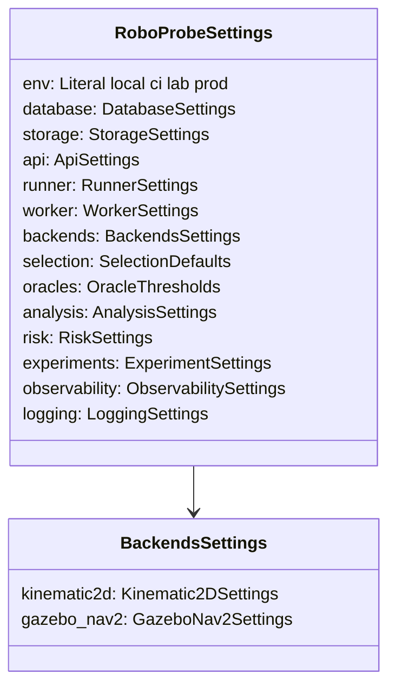

# 27 — Configuration Reference

> Decision: [ADR-0015](adr/ADR-0015-typed-layered-configuration.md). **Rule: no hard-coded tunables.** Every
> threshold, timeout, path, URL, port, hyper-parameter and secret is a field of a typed settings model
> listed here. Code reads values only from injected settings objects. After T-003 the tables in §4 are
> **generated** from the Pydantic models (`scripts/gen_config_docs.py`) and CI fails on drift.

## 1. Two kinds of configuration

| Kind | Scope | Where defined | Where stored | Examples |
|------|-------|---------------|-------------|----------|
| **Service settings** | per process / deployment | `roboprobe.core.settings` (`pydantic-settings`) | env vars, `.env`, `roboprobe.toml` | DB URL, ports, worker concurrency, timeouts, paths |
| **Domain configuration** | per campaign / experiment | Pydantic models in domain packages (`OracleThresholds`, `ProbeParams`, …) | YAML files in `configs/`, API payloads; **snapshotted** into DB + manifest | oracle thresholds, strategy hyper-parameters, analysis weights |
Service settings provide *defaults* for domain configuration (`defaults.oracles.*`); a campaign may override them; the resolved values are frozen into the campaign row (`oracle_config`, `strategy_params`).

## 2. Sources & precedence (highest first)
1. CLI flags (`--budget`, `--workers`, …)
2. Environment variables: prefix `ROBOPROBE_`, nested delimiter `__` (e.g. `ROBOPROBE_RUNNER__TICK_INTERVAL_S=0.5`)
3. `.env` file in the working directory (git-ignored; template `.env.example`)
4. TOML file: path in `ROBOPROBE_CONFIG_FILE`, else `./roboprobe.toml` (template `roboprobe.example.toml`)
5. Secret files: `ROBOPROBE_SECRETS_DIR` (default `/run/secrets`) — e.g. file `db_password`
6. Defaults in the settings classes
`roboprobe config show [--sources]` prints the resolved tree and which source set each value; secrets are masked.

Implementation notes (`roboprobe.core.settings`, T-003a):
- `ROBOPROBE_CONFIG_FILE` and `ROBOPROBE_SECRETS_DIR` locate the other sources and are therefore read from the
  process environment only (not from `.env` or the TOML file).
- Recognised secret files: `db_password` (sets `database.password_file`) and `api_token` (sets `api.token`).
- Env aliases `ROBOPROBE_DATABASE_URL` / `ROBOPROBE_API_TOKEN` are read from the process environment; the
  canonical `ROBOPROBE_DATABASE__URL` / `ROBOPROBE_API__TOKEN` wins when both are set. Empty values count as unset.
- Unknown keys fail validation inside every section and at the top level of the TOML file and CLI overrides;
  unknown top-level `ROBOPROBE_*` variables are ignored because `.env` also carries compose variables (§4.12).
- A password already present in `database.url` takes precedence over `database.password_file`.
- `worker.backend` is optional at load time and enforced by the worker entry point, so non-worker
  processes (API, CLI) can load the same configuration.
- Cross-field rules: `api.page_limit_default ≤ api.page_limit_max`, `runner.retry.base_delay_s ≤ max_delay_s`,
  `selection.probe.weights` sum to 1, `risk.thresholds.safe < failure`,
  `worker.heartbeat_interval_s < runner.heartbeat_timeout_s`, non-loopback `api.host` ⇒ `api.token`.
Validation happens at process start; invalid config ⇒ exit code 2 with a list of errors (fail fast).

## 3. Settings model tree



## 4. Reference tables (defaults; env var = `ROBOPROBE_` + path in upper case with `__`)

### 4.1 Core & database
| Key | Type | Default | Env var | Notes |
|-----|------|---------|---------|-------|
| `env` | enum | `local` | `ROBOPROBE_ENV` | `local`, `ci`, `lab`, `prod` |
| `database.url` | SecretStr (DSN) | `postgresql+psycopg://roboprobe@localhost:5432/roboprobe` | `ROBOPROBE_DATABASE__URL` (alias `ROBOPROBE_DATABASE_URL`) | password via secret file if not in URL |
| `database.password_file` | Path? | `None` | `ROBOPROBE_DATABASE__PASSWORD_FILE` | merged into DSN |
| `database.pool_size` | int | 5 | `…__POOL_SIZE` | per process |
| `database.statement_timeout_ms` | int | 30000 | | |
| `database.notify_channel` | str | `roboprobe_events` | | |

### 4.2 Storage
| Key | Type | Default | Notes |
|-----|------|---------|-------|
| `storage.artifact_root` | Path | `./data/artifacts` | `ROBOPROBE_STORAGE__ARTIFACT_ROOT` |
| `storage.workdir_root` | Path | `./data/workdirs` | per-run scratch |
| `storage.min_free_gb` | float | 5.0 | `DISK_LOW` alert |
| `storage.retention.bags_days` | int | 30 | |
| `storage.retention.keep_failure_bags` | bool | true | |
| `storage.backend` | enum | `local` | plugin key in `roboprobe.stores` (`local`, future `s3`) |

### 4.3 API
| Key | Type | Default | Notes |
|-----|------|---------|-------|
| `api.host` | str | `127.0.0.1` | non-loopback ⇒ token required |
| `api.port` | int | 8000 | |
| `api.base_path` | str | `/api/v1` | |
| `api.token` | SecretStr? | `None` | `ROBOPROBE_API_TOKEN` alias |
| `api.cors_origins` | list[str] | `["http://localhost:5173","http://localhost:8080"]` | |
| `api.max_upload_mb` | int | 10 | |
| `api.page_limit_default` / `page_limit_max` | int | 50 / 500 | |
| `api.sse.ping_interval_s` | float | 15 | |
| `api.idempotency_ttl_s` | int | 86400 | |

### 4.4 Runner (orchestrator) & worker
| Key | Type | Default | Notes |
|-----|------|---------|-------|
| `runner.tick_interval_s` | float | 1.0 | campaign loop tick |
| `runner.inflight_factor` | float | 1.5 | target in-flight = workers × factor |
| `runner.reaper_interval_s` | float | 10 | |
| `runner.heartbeat_timeout_s` | float | 30 | |
| `runner.max_attempts` | int | 3 | 1 + 2 retries |
| `runner.max_budget` | int | 20000 | per campaign |
| `runner.max_batch_size` | int | 32 | |
| `runner.auto_pause.invalid_ratio` | float | 0.2 | after `min_runs` |
| `runner.auto_pause.min_runs` | int | 20 | |
| `runner.auto_pause.max_consecutive_invalid` | int | 10 | |
| `runner.analysis.incremental_every_n` | int | 25 | |
| `runner.count_invalid_in_budget` | bool | false | INVALID runs don't consume budget by default |
| `runner.retry.max_attempts` / `base_delay_s` / `max_delay_s` | int / float / float | 3 / 0.5 / 10 | transient infra retries (34 §5) |
| `runner.max_concurrent_campaigns` | int | 4 | per orchestrator |
| `worker.backend` | str | – (required) | `kinematic2d` / `gazebo_nav2` |
| `worker.id_prefix` | str | hostname | worker id = `<prefix>:<pid>:<slot>` |
| `worker.concurrency` | int | 1 | slots per process |
| `worker.poll_interval_s` | float | 1.0 | |
| `worker.heartbeat_interval_s` | float | 5.0 | |
| `worker.drain_timeout_s` | float | 600 | on SIGTERM |
| `worker.default_wall_timeout_s` | float | 300 | per run |
| `worker.default_sim_time_budget_s` | float | 120 | |
| `worker.health_port` | int | 9101 | internal `/healthz` + metrics |

### 4.5 Backends
| Key | Type | Default | Notes |
|-----|------|---------|-------|
| `backends.kinematic2d.dt` | float | 0.05 | s |
| `backends.kinematic2d.sample_hz` | float | 20 | |
| `backends.kinematic2d.lidar_beams` / `depth_beams` | int | 180 / 60 | |
| `backends.kinematic2d.model_file` | Path | `configs/backends/kinematic2d_v1.yaml` | robot/controller/planner constants (calibrated in T-034) |
| `backends.gazebo_nav2.image` | str | `ghcr.io/codewithjha/roboprobe-gazebo:${tag}` | informational (manifest) |
| `backends.gazebo_nav2.launch_package` / `launch_file` | str | `roboprobe_ros` / `episode.launch.py` | |
| `backends.gazebo_nav2.topics_file` | Path | `ros_ws/src/roboprobe_ros/config/topics.yaml` | |
| `backends.gazebo_nav2.base_world` | str | `nav2_minimal_tb4_sim/worlds/warehouse.sdf` | package-relative |
| `backends.gazebo_nav2.base_nav2_params` | str | `nav2_bringup/params/nav2_params.yaml` | |
| `backends.gazebo_nav2.headless_rendering` | bool | true | |
| `backends.gazebo_nav2.software_rendering` | bool | false | sets `LIBGL_ALWAYS_SOFTWARE=1` |
| `backends.gazebo_nav2.physics.real_time_factor` | float | 1.0 | |
| `backends.gazebo_nav2.rmw` | str | `rmw_cyclonedds_cpp` | |
| `backends.gazebo_nav2.domain_id_base` | int | 30 | + slot |
| `backends.gazebo_nav2.startup_timeout_s` | float | 60 | |
| `backends.gazebo_nav2.teardown_grace_s` | float | 10 | |
| `backends.gazebo_nav2.sample_hz` | float | 20 | |
| `backends.gazebo_nav2.record_bag` | enum | `failures` | `never`, `failures`, `always` |
| `backends.gazebo_nav2.max_parallel_per_host` | int | 1 | |
| `backends.gazebo_nav2.perception_model_file` | Path | `configs/perception/oakd_lowlight_v1.yaml` | 06 §3.3 constants |

### 4.6 Oracles (`oracles.*`, defaults for campaigns) — see 08 §4 for meaning
`clear.d_norm=0.5`, `clear.d_safe=0.10`, `clear.r_contact_base=0.1`, `clear.v_ref=0.5`, `goal.r_min=0.01`,
`prog.window_s=10`, `prog.delta_min=0.05`, `prog.delta_norm=0.5`, `loc.e_max=0.5`, `loc.hold_s=2.0`,
`nav.r_abort=-0.5`, `stab.theta_max=0.35`, `stab.omega_max=3.0`, `osc.window_s=5`, `osc.omega_min=0.3`,
`osc.n_max=6`, `infra.max_gap_s=1.0`, `infra.min_rtf=0.2`, `infra.startup_timeout_s=60`, `infra.spawn_tolerance_m=0.2`.
Env example: `ROBOPROBE_ORACLES__LOC__E_MAX=0.4`.

### 4.7 Selection defaults (`selection.*`) — see 07 §6.3
`probe.n0_fraction=0.1`, `probe.n0_min_factor=2` (× d), `probe.weights={mode_search:0.6, boundary:0.25, refine:0.15}`,
`probe.epsilon=0.05`, `probe.lambda_div=1.0`, `probe.kappa_radius=0.5`, `probe.beta_straddle=1.96`,
`probe.refine_bisect_steps=4`, `probe.refine_perturb_n=4`, `probe.refine_perturb_std=0.05`, `probe.adapt_window=20`,
`gp.max_points=1500`, `gp.noise_lower_bound=1e-4`, `gp.torch_threads=4`, `acq.num_restarts=10`, `acq.raw_samples=512`,
`acq.maxiter=200`, `acq.dedupe_tol=1e-3`, `ofat.levels=[0,0.25,0.5,0.75,1.0]`, `grid.min_levels=2`,
`mode_cache_refresh_every=10`, `propose_timeout_s=10` (then fallback).

### 4.8 Analysis & risk
`analysis.feature_weights={param:1.0, class:0.75, traj:0.5}`, `analysis.hdbscan.min_cluster_fraction=0.03`,
`analysis.hdbscan.min_cluster_size_floor=3`, `analysis.mode_match_jaccard=0.5`, `analysis.characteristic_coverage=0.5`,
`analysis.gbm={max_depth:4, learning_rate:0.1, max_iter:200}`, `analysis.cv_folds=5`, `analysis.min_failures_confident=10`,
`analysis.rules.max_depth=4`, `analysis.rules.min_precision=0.6`, `analysis.interaction.repeats=3`,
`analysis.interaction.success_ratio=0.67`, `risk.thresholds={safe:0.05, failure:0.95}`, `risk.slice_resolution=50`,
`risk.volume_samples=8192`.

### 4.9 Experiments
`experiments.default_seeds=30`, `experiments.max_concurrent_campaigns=2`, `experiments.bootstrap_resamples=10000`,
`experiments.alpha=0.05`, `experiments.reference_set.n=20000`, `experiments.reference_set.seed=20261119`,
`experiments.mode_match_radius=0.05`, `experiments.coverage_bins=5`.

### 4.10 Logging & observability
| Key | Default | Notes |
|-----|---------|-------|
| `logging.level` | `INFO` | `ROBOPROBE_LOGGING__LEVEL` |
| `logging.format` | `json` | `console` for local dev |
| `logging.include_caller` | false | |
| `observability.metrics_enabled` | true | |
| `observability.otlp_endpoint` | `None` | tracing off when unset |
| `observability.service_name` | derived (`roboprobe-api`, …) | |

### 4.11 Web (runtime `config.json`, served by nginx from env)
| Key | Env | Default |
|-----|-----|---------|
| `apiBaseUrl` | `ROBOPROBE_WEB_API_BASE_URL` | `/api/v1` (proxied) |
| `sseUrl` | `ROBOPROBE_WEB_SSE_URL` | `/api/v1/events` |
| `defaultTheme` | `ROBOPROBE_WEB_DEFAULT_THEME` | `system` |
| `featureFlags` | `ROBOPROBE_WEB_FEATURES` | `trials,reports` |

Build/dev-time variables (Vite, `web/.env.example`; read in `web/vite.config.ts`, never in components):

| Env | Default | Notes |
|-----|---------|-------|
| `VITE_API_BASE_URL` | `/api/v1` | baked into the bundle; overridden at runtime by `config.json` `apiBaseUrl` |
| `VITE_API_PROXY_TARGET` | `http://127.0.0.1:8000` | `pnpm --dir web dev` only: origin that `/api/*` requests are proxied to |

### 4.12 Compose-level variables (`.env`)
`ROBOPROBE_IMAGE_TAG` (dev), `ROBOPROBE_API_PORT` (8000), `ROBOPROBE_WEB_PORT` (8080), `ROBOPROBE_DB_NAME`/`ROBOPROBE_DB_USER` (roboprobe), `ROBOPROBE_K2D_REPLICAS` (2).

## 5. Example `roboprobe.toml`
```toml
env = "local"

[database]
url = "postgresql+psycopg://roboprobe@localhost:5432/roboprobe"

[storage]
artifact_root = "./data/artifacts"

[worker]
concurrency = 2

[backends.gazebo_nav2]
max_parallel_per_host = 1
software_rendering = true

[oracles.loc]
e_max = 0.5
```

## 6. Rules for contributors
1. A new tunable ⇒ new settings/params field with type, default, unit in the description, validation (`Field(gt=0)` …), and doc regeneration.
2. Never read `os.environ` outside `roboprobe.core.settings`.
3. Never put secrets in TOML/YAML committed to git; use `SecretStr` + env/secret file.
4. Domain configuration used by a run must appear in its manifest `config_snapshot`.
5. Changing a default is a behaviour change ⇒ CHANGELOG entry (33) and, for oracles/strategies, bump the respective `*_version` so old results stay interpretable.
