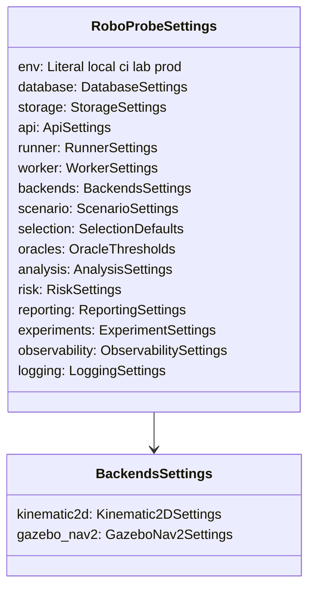

# 27 — Configuration Reference

> Decision: [ADR-0015](adr/ADR-0015-typed-layered-configuration.md). **Rule: no hard-coded tunables.** Every
> threshold, timeout, path, URL, port, hyper-parameter and secret is a field of a typed settings model
> listed here. Code reads values only from injected settings objects. After T-003 the tables in §4 are
> **generated** from the Pydantic models (`scripts/gen_config_docs.py`) and CI fails on drift.

## 1. Two kinds of configuration

| Kind | Scope | Where defined | Where stored | Examples |
|------|-------|---------------|-------------|----------|
| **Service settings** | per process / deployment | `roboprobe.core.settings` (`pydantic-settings`) | env vars, `.env`, `roboprobe.toml` | DB URL, ports, worker concurrency, timeouts, paths |
| **Domain configuration** | per campaign / experiment | Pydantic models in domain packages (`OracleThresholds`, `ProbeParams`, …) | YAML files in `configs/`, API payloads; **snapshotted** into DB + manifest | oracle thresholds, strategy hyper-parameters, analysis weights |

Service settings provide *defaults* for domain configuration (`defaults.oracles.*`); a campaign may override them; the resolved values are frozen into the campaign row (`oracle_config`, `strategy_params`).

## 2. Sources & precedence (highest first)

1. CLI flags (`--budget`, `--workers`, …)
2. Environment variables: prefix `ROBOPROBE_`, nested delimiter `__` (e.g. `ROBOPROBE_RUNNER__TICK_INTERVAL_S=0.5`)
3. `.env` file in the working directory (git-ignored; template `.env.example`)
4. TOML file: path from the CLI `--config` flag, else `ROBOPROBE_CONFIG_FILE`, else `./roboprobe.toml` (template `roboprobe.example.toml`)
5. Secret files: `ROBOPROBE_SECRETS_DIR` (default `/run/secrets`) — e.g. file `db_password`
6. Defaults in the settings classes
`roboprobe config show [--sources]` prints the resolved tree and which source set each value; secrets are masked.

Implementation notes (`roboprobe.core.settings`, T-003a):

- `ROBOPROBE_CONFIG_FILE` and `ROBOPROBE_SECRETS_DIR` locate the other sources and are therefore read from the
  process environment only (not from `.env` or the TOML file).
- Recognised secret files: `db_password` (sets `database.password_file`) and `api_token` (sets `api.token`).
- Env aliases `ROBOPROBE_DATABASE_URL` / `ROBOPROBE_API_TOKEN` are read from the process environment; the
  canonical `ROBOPROBE_DATABASE__URL` / `ROBOPROBE_API__TOKEN` wins when both are set. Empty values count as unset.
- Unknown keys fail validation inside every section and at the top level of the TOML file and CLI overrides;
  unknown top-level `ROBOPROBE_*` variables are ignored because `.env` also carries compose variables (§4.13).
- A password already present in `database.url` takes precedence over `database.password_file`.
- `worker.backend` is optional at load time and enforced by the worker entry point, so non-worker
  processes (API, CLI) can load the same configuration.
- Cross-field rules: `api.page_limit_default ≤ api.page_limit_max`, `runner.retry.base_delay_s ≤ max_delay_s`,
  `selection.probe.weights` sum to 1, `risk.thresholds.safe < failure`,
  `worker.heartbeat_interval_s < runner.heartbeat_timeout_s`, non-loopback `api.host` ⇒ `api.token`.
Validation happens at process start; invalid config ⇒ exit code 2 with a list of errors (fail fast).

## 3. Settings model tree



## 4. Reference tables (defaults; env var = `ROBOPROBE_` + path in upper case with `__`)

§4.1–§4.11 are generated from the settings models by `make config-docs` (`scripts/gen_config_docs.py`);
edit the field descriptions in `backend/src/roboprobe/core/settings/`, never the tables. `make config-docs-check`
fails on drift. `.env.example` and `roboprobe.example.toml` are generated the same way.

<!-- BEGIN GENERATED: config-tables -->

### 4.1 Core & database

| Key | Type | Default | Env var | Description |
|-----|------|---------|---------|-------------|
| `env` | enum: `local` / `ci` / `lab` / `prod` | `local` | `ROBOPROBE_ENV` | Deployment environment. |
| `database.url` | SecretStr | `postgresql+psycopg://roboprobe@localhost:5432/roboprobe` | `ROBOPROBE_DATABASE__URL` (alias `ROBOPROBE_DATABASE_URL`) | SQLAlchemy DSN of the RoboProbe database. Keep the password out of the URL and use `password_file` or the `db_password` secret file instead. |
| `database.password_file` | Path? | – | `ROBOPROBE_DATABASE__PASSWORD_FILE` | File holding the database password; merged into `url` [path]. |
| `database.pool_size` | int | `5` | `ROBOPROBE_DATABASE__POOL_SIZE` | Connection pool size per process. |
| `database.statement_timeout_ms` | int | `30000` | `ROBOPROBE_DATABASE__STATEMENT_TIMEOUT_MS` | Server-side statement timeout [ms]. |
| `database.notify_channel` | str | `roboprobe_events` | `ROBOPROBE_DATABASE__NOTIFY_CHANNEL` | PostgreSQL LISTEN/NOTIFY channel for live events. |

### 4.2 Storage

| Key | Type | Default | Env var | Description |
|-----|------|---------|---------|-------------|
| `storage.artifact_root` | Path | `data/artifacts` | `ROBOPROBE_STORAGE__ARTIFACT_ROOT` | Root directory of run artefacts [path]. |
| `storage.workdir_root` | Path | `data/workdirs` | `ROBOPROBE_STORAGE__WORKDIR_ROOT` | Root of per-run scratch directories [path]. |
| `storage.min_free_gb` | float | `5.0` | `ROBOPROBE_STORAGE__MIN_FREE_GB` | Free-space floor that raises `DISK_LOW` [GB]. |
| `storage.retention.bags_days` | int | `30` | `ROBOPROBE_STORAGE__RETENTION__BAGS_DAYS` | Days to keep rosbag artefacts [d]. |
| `storage.retention.keep_failure_bags` | bool | `true` | `ROBOPROBE_STORAGE__RETENTION__KEEP_FAILURE_BAGS` | Keep bags of failing runs regardless of `bags_days`. |
| `storage.bundle.format_version` | int | `1` | `ROBOPROBE_STORAGE__BUNDLE__FORMAT_VERSION` | Campaign bundle format version written on export. |
| `storage.bundle.max_uncompressed_bytes` | int | `2147483648` | `ROBOPROBE_STORAGE__BUNDLE__MAX_UNCOMPRESSED_BYTES` | Maximum total uncompressed payload accepted on import [bytes]. |
| `storage.bundle.max_member_bytes` | int | `536870912` | `ROBOPROBE_STORAGE__BUNDLE__MAX_MEMBER_BYTES` | Maximum size of any single tar member on import [bytes]. |
| `storage.bundle.read_chunk_bytes` | int | `1048576` | `ROBOPROBE_STORAGE__BUNDLE__READ_CHUNK_BYTES` | I/O chunk size when hashing or copying bundle members [bytes]. |
| `storage.bundle.hostname_hash_hex` | int | `16` | `ROBOPROBE_STORAGE__BUNDLE__HOSTNAME_HASH_HEX` | Hex length of hostname hashes written into exported manifests (TM-15). |
| `storage.backend` | str | `local` | `ROBOPROBE_STORAGE__BACKEND` | Artifact store plugin key in the `roboprobe.stores` entry-point group. |

### 4.3 API

| Key | Type | Default | Env var | Description |
|-----|------|---------|---------|-------------|
| `api.host` | str | `127.0.0.1` | `ROBOPROBE_API__HOST` | Bind address; any non-loopback address requires `api.token`. |
| `api.port` | int | `8000` | `ROBOPROBE_API__PORT` | Listen port. |
| `api.base_path` | str | `/api/v1` | `ROBOPROBE_API__BASE_PATH` | URL prefix of the versioned API. |
| `api.token` | SecretStr? | – | `ROBOPROBE_API__TOKEN` (alias `ROBOPROBE_API_TOKEN`) | Bearer token required on every request (and for any non-loopback `host`). |
| `api.cors_origins` | list[str] | `["http://localhost:5173", "http://localhost:8080"]` | `ROBOPROBE_API__CORS_ORIGINS` | Origins allowed by CORS (dev server and dashboard). |
| `api.trace_default_hz` | float | `10.0` | `ROBOPROBE_API__TRACE_DEFAULT_HZ` | Default JSON trace sampling target [Hz]. |
| `api.trace_max_hz` | float | `50.0` | `ROBOPROBE_API__TRACE_MAX_HZ` | Maximum JSON trace sampling target [Hz]. |
| `api.max_upload_mb` | int | `10` | `ROBOPROBE_API__MAX_UPLOAD_MB` | Maximum request body size [MB]. |
| `api.page_limit_default` | int | `50` | `ROBOPROBE_API__PAGE_LIMIT_DEFAULT` | Default page size [items]. |
| `api.page_limit_max` | int | `500` | `ROBOPROBE_API__PAGE_LIMIT_MAX` | Maximum page size [items]. |
| `api.sse.ping_interval_s` | float | `15.0` | `ROBOPROBE_API__SSE__PING_INTERVAL_S` | Keep-alive ping interval on SSE streams [s]. |
| `api.sse.poll_interval_s` | float | `2.0` | `ROBOPROBE_API__SSE__POLL_INTERVAL_S` | How often the outbox listener re-reads events.id when NOTIFY is missed [s]. |
| `api.sse.queue_size` | int | `256` | `ROBOPROBE_API__SSE__QUEUE_SIZE` | Per-subscriber SSE queue depth; overflow drops the oldest event and sends resync. |
| `api.sse.batch_size` | int | `200` | `ROBOPROBE_API__SSE__BATCH_SIZE` | Maximum events read from the outbox per poll [rows]. |
| `api.sse.reconnect_initial_s` | float | `0.5` | `ROBOPROBE_API__SSE__RECONNECT_INITIAL_S` | Initial delay before reopening a dropped LISTEN connection [s]. |
| `api.sse.reconnect_max_s` | float | `30.0` | `ROBOPROBE_API__SSE__RECONNECT_MAX_S` | Cap on LISTEN reconnect backoff [s]. |
| `api.sse.connect_timeout_s` | float | `5.0` | `ROBOPROBE_API__SSE__CONNECT_TIMEOUT_S` | TCP timeout for the dedicated LISTEN and poll connections [s]. |
| `api.idempotency_ttl_s` | int | `86400` | `ROBOPROBE_API__IDEMPOTENCY_TTL_S` | Retention of idempotency keys [s]. |
| `api.error_type_base` | str | `https://github.com/CodewithJha/RoboProbe/blob/main/docs/errors.md` | `ROBOPROBE_API__ERROR_TYPE_BASE` | Base URL for RFC 9457 problem `type` links (docs/errors.md anchors). |
| `api.cursor_secret` | SecretStr | `roboprobe-dev-cursor-secret` | `ROBOPROBE_API__CURSOR_SECRET` | HMAC key for opaque pagination cursors. Override in production so cursors survive process restarts; the committed default is for local/dev only. |

### 4.4 Runner (orchestrator) & worker

| Key | Type | Default | Env var | Description |
|-----|------|---------|---------|-------------|
| `runner.tick_interval_s` | float | `1.0` | `ROBOPROBE_RUNNER__TICK_INTERVAL_S` | Campaign loop tick [s]. |
| `runner.inflight_factor` | float | `1.5` | `ROBOPROBE_RUNNER__INFLIGHT_FACTOR` | Target in-flight runs = workers x factor. |
| `runner.reaper_interval_s` | float | `10.0` | `ROBOPROBE_RUNNER__REAPER_INTERVAL_S` | Reaper sweep interval [s]. |
| `runner.heartbeat_timeout_s` | float | `30.0` | `ROBOPROBE_RUNNER__HEARTBEAT_TIMEOUT_S` | Heartbeat age after which a run is reaped [s]. |
| `runner.max_attempts` | int | `3` | `ROBOPROBE_RUNNER__MAX_ATTEMPTS` | Run attempts (1 + retries). |
| `runner.max_budget` | int | `20000` | `ROBOPROBE_RUNNER__MAX_BUDGET` | Maximum runs per campaign. |
| `runner.max_batch_size` | int | `32` | `ROBOPROBE_RUNNER__MAX_BATCH_SIZE` | Maximum proposals per batch. |
| `runner.max_manual_repeats` | int | `100` | `ROBOPROBE_RUNNER__MAX_MANUAL_REPEATS` | Maximum repeats per manual request. |
| `runner.manual_priority` | int | `10` | `ROBOPROBE_RUNNER__MANUAL_PRIORITY` | Queue priority for manual runs. |
| `runner.auto_pause.invalid_ratio` | float | `0.2` | `ROBOPROBE_RUNNER__AUTO_PAUSE__INVALID_RATIO` | INVALID share that pauses a campaign [0-1]. |
| `runner.auto_pause.min_runs` | int | `20` | `ROBOPROBE_RUNNER__AUTO_PAUSE__MIN_RUNS` | Finished runs before `invalid_ratio` is evaluated. |
| `runner.auto_pause.max_consecutive_invalid` | int | `10` | `ROBOPROBE_RUNNER__AUTO_PAUSE__MAX_CONSECUTIVE_INVALID` | Consecutive INVALID runs that pause a campaign. |
| `runner.alerts.no_workers_after_s` | float | `60.0` | `ROBOPROBE_RUNNER__ALERTS__NO_WORKERS_AFTER_S` | Emit NO_WORKERS when a RUNNING campaign has no worker this long [s]. |
| `runner.alerts.gp_fallback_repeat` | int | `3` | `ROBOPROBE_RUNNER__ALERTS__GP_FALLBACK_REPEAT` | Emit GP_FALLBACK_REPEATED after this many consecutive selector fallbacks. |
| `runner.analysis.incremental_every_n` | int | `25` | `ROBOPROBE_RUNNER__ANALYSIS__INCREMENTAL_EVERY_N` | Re-run incremental failure analysis every N finished runs. |
| `runner.analysis.max_workers` | int | `1` | `ROBOPROBE_RUNNER__ANALYSIS__MAX_WORKERS` | Concurrent analysis jobs per orchestrator process (ThreadPoolExecutor). |
| `runner.count_invalid_in_budget` | bool | `false` | `ROBOPROBE_RUNNER__COUNT_INVALID_IN_BUDGET` | Whether INVALID runs consume campaign budget. |
| `runner.retry.max_attempts` | int | `3` | `ROBOPROBE_RUNNER__RETRY__MAX_ATTEMPTS` | Attempts including the first. |
| `runner.retry.base_delay_s` | float | `0.5` | `ROBOPROBE_RUNNER__RETRY__BASE_DELAY_S` | First backoff delay [s]. |
| `runner.retry.max_delay_s` | float | `10.0` | `ROBOPROBE_RUNNER__RETRY__MAX_DELAY_S` | Backoff delay cap [s]. |
| `runner.max_concurrent_campaigns` | int | `4` | `ROBOPROBE_RUNNER__MAX_CONCURRENT_CAMPAIGNS` | Campaigns driven concurrently per orchestrator. |
| `runner.confirm_priority` | int | `10` | `ROBOPROBE_RUNNER__CONFIRM_PRIORITY` | Queue priority for confirmatory interaction runs (lower runs sooner). |
| `worker.backend` | str? | – | `ROBOPROBE_WORKER__BACKEND` | Simulator backend key (`kinematic2d`, `gazebo_nav2`); required to start a worker. |
| `worker.id_prefix` | str | `<hostname>` | `ROBOPROBE_WORKER__ID_PREFIX` | Worker id prefix; id = `<prefix>:<pid>:<slot>` (default: host name). |
| `worker.concurrency` | int | `1` | `ROBOPROBE_WORKER__CONCURRENCY` | Simulation slots per process. |
| `worker.poll_interval_s` | float | `1.0` | `ROBOPROBE_WORKER__POLL_INTERVAL_S` | Queue poll interval [s]. |
| `worker.heartbeat_interval_s` | float | `5.0` | `ROBOPROBE_WORKER__HEARTBEAT_INTERVAL_S` | Heartbeat interval [s]. |
| `worker.heartbeat_join_timeout_s` | float | `10.0` | `ROBOPROBE_WORKER__HEARTBEAT_JOIN_TIMEOUT_S` | Max wait when joining the heartbeat thread on stop [s]. |
| `worker.drain_timeout_s` | float | `600.0` | `ROBOPROBE_WORKER__DRAIN_TIMEOUT_S` | Grace period to finish runs on SIGTERM [s]. |
| `worker.default_wall_timeout_s` | float | `300.0` | `ROBOPROBE_WORKER__DEFAULT_WALL_TIMEOUT_S` | Default wall-clock limit per run [s]. |
| `worker.default_sim_time_budget_s` | float | `120.0` | `ROBOPROBE_WORKER__DEFAULT_SIM_TIME_BUDGET_S` | Default simulated-time budget per run [s]. |
| `worker.health_host` | str | `127.0.0.1` | `ROBOPROBE_WORKER__HEALTH_HOST` | Bind address for the worker `/healthz` + metrics server. |
| `worker.health_port` | int | `9101` | `ROBOPROBE_WORKER__HEALTH_PORT` | Internal `/healthz` + metrics port. |

### 4.5 Backends

| Key | Type | Default | Env var | Description |
|-----|------|---------|---------|-------------|
| `backends.kinematic2d.dt` | float | `0.05` | `ROBOPROBE_BACKENDS__KINEMATIC2D__DT` | Integration time step [s]. |
| `backends.kinematic2d.sample_hz` | float | `20.0` | `ROBOPROBE_BACKENDS__KINEMATIC2D__SAMPLE_HZ` | Trace sampling rate [Hz]. |
| `backends.kinematic2d.lidar_beams` | int | `180` | `ROBOPROBE_BACKENDS__KINEMATIC2D__LIDAR_BEAMS` | Simulated lidar beams. |
| `backends.kinematic2d.depth_beams` | int | `60` | `ROBOPROBE_BACKENDS__KINEMATIC2D__DEPTH_BEAMS` | Simulated depth-camera beams. |
| `backends.kinematic2d.model_file` | Path | `configs/backends/kinematic2d_v1.yaml` | `ROBOPROBE_BACKENDS__KINEMATIC2D__MODEL_FILE` | Robot, controller and planner constants (calibrated in T-034) [path]. |
| `backends.gazebo_nav2.image` | str | `ghcr.io/codewithjha/roboprobe-gazebo:${tag}` | `ROBOPROBE_BACKENDS__GAZEBO_NAV2__IMAGE` | Worker image reference recorded in run manifests (informational). |
| `backends.gazebo_nav2.launch_package` | str | `roboprobe_ros` | `ROBOPROBE_BACKENDS__GAZEBO_NAV2__LAUNCH_PACKAGE` | ROS package of the launch. |
| `backends.gazebo_nav2.launch_file` | str | `episode.launch.py` | `ROBOPROBE_BACKENDS__GAZEBO_NAV2__LAUNCH_FILE` | Episode launch file. |
| `backends.gazebo_nav2.topics_file` | Path | `ros_ws/src/roboprobe_ros/config/topics.yaml` | `ROBOPROBE_BACKENDS__GAZEBO_NAV2__TOPICS_FILE` | Topic and frame names used by the ROS nodes [path]. |
| `backends.gazebo_nav2.base_world` | str | `nav2_minimal_tb4_sim/worlds/warehouse.sdf` | `ROBOPROBE_BACKENDS__GAZEBO_NAV2__BASE_WORLD` | Package-relative base world patched per scenario. |
| `backends.gazebo_nav2.base_nav2_params` | str | `nav2_bringup/params/nav2_params.yaml` | `ROBOPROBE_BACKENDS__GAZEBO_NAV2__BASE_NAV2_PARAMS` | Package-relative Nav2 parameter file overlaid per SUT profile. |
| `backends.gazebo_nav2.headless_rendering` | bool | `true` | `ROBOPROBE_BACKENDS__GAZEBO_NAV2__HEADLESS_RENDERING` | Run Gazebo without a GUI. |
| `backends.gazebo_nav2.software_rendering` | bool | `false` | `ROBOPROBE_BACKENDS__GAZEBO_NAV2__SOFTWARE_RENDERING` | Force Mesa software rendering (`LIBGL_ALWAYS_SOFTWARE=1`). |
| `backends.gazebo_nav2.physics.real_time_factor` | float | `1.0` | `ROBOPROBE_BACKENDS__GAZEBO_NAV2__PHYSICS__REAL_TIME_FACTOR` | Target real-time factor of the simulation. |
| `backends.gazebo_nav2.rmw` | str | `rmw_cyclonedds_cpp` | `ROBOPROBE_BACKENDS__GAZEBO_NAV2__RMW` | ROS 2 middleware implementation. |
| `backends.gazebo_nav2.domain_id_base` | int | `30` | `ROBOPROBE_BACKENDS__GAZEBO_NAV2__DOMAIN_ID_BASE` | First `ROS_DOMAIN_ID`; each worker slot adds its index. |
| `backends.gazebo_nav2.startup_timeout_s` | float | `60.0` | `ROBOPROBE_BACKENDS__GAZEBO_NAV2__STARTUP_TIMEOUT_S` | Time allowed for Nav2 to become ACTIVE [s]. |
| `backends.gazebo_nav2.teardown_grace_s` | float | `10.0` | `ROBOPROBE_BACKENDS__GAZEBO_NAV2__TEARDOWN_GRACE_S` | SIGTERM-to-SIGKILL grace on episode teardown [s]. |
| `backends.gazebo_nav2.sample_hz` | float | `20.0` | `ROBOPROBE_BACKENDS__GAZEBO_NAV2__SAMPLE_HZ` | Trace sampling rate [Hz]. |
| `backends.gazebo_nav2.record_bag` | enum: `never` / `failures` / `always` | `failures` | `ROBOPROBE_BACKENDS__GAZEBO_NAV2__RECORD_BAG` | When to record rosbag2 MCAP: never, failures, always. |
| `backends.gazebo_nav2.max_parallel_per_host` | int | `1` | `ROBOPROBE_BACKENDS__GAZEBO_NAV2__MAX_PARALLEL_PER_HOST` | Gazebo episodes allowed in parallel on one host. |
| `backends.gazebo_nav2.perception_model_file` | Path | `configs/perception/oakd_lowlight_v1.yaml` | `ROBOPROBE_BACKENDS__GAZEBO_NAV2__PERCEPTION_MODEL_FILE` | Perception degradation constants (docs/06 §3.3) [path]. |

### 4.6 Oracles (`oracles.*`, defaults for campaigns) — see 08 §4

| Key | Type | Default | Env var | Description |
|-----|------|---------|---------|-------------|
| `oracles.clear.d_norm` | float | `0.5` | `ROBOPROBE_ORACLES__CLEAR__D_NORM` | Clearance normaliser [m]. |
| `oracles.clear.d_safe` | float | `0.1` | `ROBOPROBE_ORACLES__CLEAR__D_SAFE` | Near-miss (F-NEAR) distance [m]. |
| `oracles.clear.r_contact_base` | float | `0.1` | `ROBOPROBE_ORACLES__CLEAR__R_CONTACT_BASE` | Robustness magnitude of a zero-speed contact. |
| `oracles.clear.v_ref` | float | `0.5` | `ROBOPROBE_ORACLES__CLEAR__V_REF` | Impact speed normaliser [m/s]. |
| `oracles.goal.r_min` | float | `0.01` | `ROBOPROBE_ORACLES__GOAL__R_MIN` | Minimum robustness magnitude when not reached. |
| `oracles.prog.window_s` | float | `10.0` | `ROBOPROBE_ORACLES__PROG__WINDOW_S` | Progress window [s]. |
| `oracles.prog.delta_min` | float | `0.05` | `ROBOPROBE_ORACLES__PROG__DELTA_MIN` | Minimum progress per window [m]. |
| `oracles.prog.delta_norm` | float | `0.5` | `ROBOPROBE_ORACLES__PROG__DELTA_NORM` | Progress normaliser [m]. |
| `oracles.loc.e_max` | float | `0.5` | `ROBOPROBE_ORACLES__LOC__E_MAX` | Maximum tolerated pose error [m]. |
| `oracles.loc.hold_s` | float | `2.0` | `ROBOPROBE_ORACLES__LOC__HOLD_S` | Time the error must persist [s]. |
| `oracles.nav.r_abort` | float | `-0.5` | `ROBOPROBE_ORACLES__NAV__R_ABORT` | Robustness assigned to a navigation abort. |
| `oracles.stab.theta_max` | float | `0.35` | `ROBOPROBE_ORACLES__STAB__THETA_MAX` | Maximum roll/pitch [rad]. |
| `oracles.stab.omega_max` | float | `3.0` | `ROBOPROBE_ORACLES__STAB__OMEGA_MAX` | Maximum angular rate [rad/s]. |
| `oracles.osc.window_s` | float | `5.0` | `ROBOPROBE_ORACLES__OSC__WINDOW_S` | Sliding window [s]. |
| `oracles.osc.omega_min` | float | `0.3` | `ROBOPROBE_ORACLES__OSC__OMEGA_MIN` | Yaw-rate magnitude counted as a swing [rad/s]. |
| `oracles.osc.n_max` | int | `6` | `ROBOPROBE_ORACLES__OSC__N_MAX` | Sign changes per window before violation. |
| `oracles.infra.max_gap_s` | float | `1.0` | `ROBOPROBE_ORACLES__INFRA__MAX_GAP_S` | Largest allowed sampling gap [s]. |
| `oracles.infra.min_rtf` | float | `0.2` | `ROBOPROBE_ORACLES__INFRA__MIN_RTF` | Minimum mean real-time factor. |
| `oracles.infra.startup_timeout_s` | float | `60.0` | `ROBOPROBE_ORACLES__INFRA__STARTUP_TIMEOUT_S` | Time allowed for the stack to become ACTIVE [s]. |
| `oracles.infra.spawn_tolerance_m` | float | `0.2` | `ROBOPROBE_ORACLES__INFRA__SPAWN_TOLERANCE_M` | Allowed deviation of the spawn pose [m]. |

### 4.7 Scenario & selection defaults (`scenario.*`, `selection.*`) — see 06, 07 §6.3

| Key | Type | Default | Env var | Description |
|-----|------|---------|---------|-------------|
| `scenario.constraint_max_attempts` | int | `1000` | `ROBOPROBE_SCENARIO__CONSTRAINT_MAX_ATTEMPTS` | Sampler draws before rejection sampling of constrained spaces gives up. |
| `scenario.constraint_max_literal_exponent` | int | `8` | `ROBOPROBE_SCENARIO__CONSTRAINT_MAX_LITERAL_EXPONENT` | Largest absolute integer exponent allowed in a constraint (TM-03). |
| `scenario.yaml_max_aliases` | int | `32` | `ROBOPROBE_SCENARIO__YAML_MAX_ALIASES` | Maximum YAML alias expansions in one uploaded document (TM-02). |
| `selection.probe.n0_fraction` | float | `0.1` | `ROBOPROBE_SELECTION__PROBE__N0_FRACTION` | Warm-up share of the budget [0-1]. |
| `selection.probe.n0_min_factor` | int | `2` | `ROBOPROBE_SELECTION__PROBE__N0_MIN_FACTOR` | Minimum warm-up runs as a multiple of the dimension d. |
| `selection.probe.weights.mode_search` | float | `0.6` | `ROBOPROBE_SELECTION__PROBE__WEIGHTS__MODE_SEARCH` | Mode-search share. |
| `selection.probe.weights.boundary` | float | `0.25` | `ROBOPROBE_SELECTION__PROBE__WEIGHTS__BOUNDARY` | Boundary-refinement share. |
| `selection.probe.weights.refine` | float | `0.15` | `ROBOPROBE_SELECTION__PROBE__WEIGHTS__REFINE` | Local refinement share. |
| `selection.probe.epsilon` | float | `0.05` | `ROBOPROBE_SELECTION__PROBE__EPSILON` | Random exploration share. |
| `selection.probe.lambda_div` | float | `1.0` | `ROBOPROBE_SELECTION__PROBE__LAMBDA_DIV` | Diversity penalty weight. |
| `selection.probe.kappa_radius` | float | `0.5` | `ROBOPROBE_SELECTION__PROBE__KAPPA_RADIUS` | Diversity radius in GP length-scales. |
| `selection.probe.beta_straddle` | float | `1.96` | `ROBOPROBE_SELECTION__PROBE__BETA_STRADDLE` | Straddle (LSE) beta. |
| `selection.probe.refine_bisect_steps` | int | `4` | `ROBOPROBE_SELECTION__PROBE__REFINE_BISECT_STEPS` | Boundary bisection steps. |
| `selection.probe.refine_perturb_n` | int | `4` | `ROBOPROBE_SELECTION__PROBE__REFINE_PERTURB_N` | Perturbations per refined point. |
| `selection.probe.refine_perturb_std` | float | `0.05` | `ROBOPROBE_SELECTION__PROBE__REFINE_PERTURB_STD` | Perturbation std in the unit cube. |
| `selection.probe.adapt_window` | int | `20` | `ROBOPROBE_SELECTION__PROBE__ADAPT_WINDOW` | Window for phase-weight adaptation. |
| `selection.probe.adapt_shift` | float | `0.2` | `ROBOPROBE_SELECTION__PROBE__ADAPT_SHIFT` | Weight moved from ModeSearch to Boundary after an unproductive window. |
| `selection.probe.mode_search_floor` | float | `0.2` | `ROBOPROBE_SELECTION__PROBE__MODE_SEARCH_FLOOR` | Lower bound on ModeSearch weight after adaptive shifts. |
| `selection.gp.max_points` | int | `1500` | `ROBOPROBE_SELECTION__GP__MAX_POINTS` | Training points kept by the GP. |
| `selection.gp.noise_lower_bound` | float | `0.0001` | `ROBOPROBE_SELECTION__GP__NOISE_LOWER_BOUND` | Likelihood noise floor. |
| `selection.gp.torch_threads` | int | `4` | `ROBOPROBE_SELECTION__GP__TORCH_THREADS` | Torch intra-op threads. |
| `selection.acq.num_restarts` | int | `10` | `ROBOPROBE_SELECTION__ACQ__NUM_RESTARTS` | Optimiser restarts. |
| `selection.acq.raw_samples` | int | `512` | `ROBOPROBE_SELECTION__ACQ__RAW_SAMPLES` | Raw samples for initialisation. |
| `selection.acq.maxiter` | int | `200` | `ROBOPROBE_SELECTION__ACQ__MAXITER` | Optimiser iterations. |
| `selection.acq.dedupe_tol` | float | `0.001` | `ROBOPROBE_SELECTION__ACQ__DEDUPE_TOL` | Distance under which candidates are duplicates. |
| `selection.ofat.levels` | list[float] | `[0.0, 0.25, 0.5, 0.75, 1.0]` | `ROBOPROBE_SELECTION__OFAT__LEVELS` | Levels in the unit interval, strictly increasing. |
| `selection.grid.min_levels` | int | `2` | `ROBOPROBE_SELECTION__GRID__MIN_LEVELS` | Minimum levels per axis. |
| `selection.cem.round_size` | int | `20` | `ROBOPROBE_SELECTION__CEM__ROUND_SIZE` | Samples drawn per CEM update round. |
| `selection.cem.elite_fraction` | float | `0.2` | `ROBOPROBE_SELECTION__CEM__ELITE_FRACTION` | Fraction of lowest-rho samples kept as elite. |
| `selection.cem.n_components` | int | `1` | `ROBOPROBE_SELECTION__CEM__N_COMPONENTS` | Number of truncated-Gaussian mixture components. |
| `selection.cem.min_std` | float | `0.05` | `ROBOPROBE_SELECTION__CEM__MIN_STD` | Floor on per-dimension proposal std in the unit cube. |
| `selection.benchmarks.function` | enum: `branin_falsify` / `multi_mode_6d` | `multi_mode_6d` | `ROBOPROBE_SELECTION__BENCHMARKS__FUNCTION` | Analytic robustness function evaluated by the benchmark backend. |
| `selection.benchmarks.noise` | float | `0.02` | `ROBOPROBE_SELECTION__BENCHMARKS__NOISE` | Observation noise std for multi_mode_6d (ignored by branin_falsify). |
| `selection.benchmarks.typical_episode_wall_s` | float | `0.001` | `ROBOPROBE_SELECTION__BENCHMARKS__TYPICAL_EPISODE_WALL_S` | Typical wall time of one analytic episode [s]. |
| `selection.benchmarks.max_parallel_per_host` | int | `32` | `ROBOPROBE_SELECTION__BENCHMARKS__MAX_PARALLEL_PER_HOST` | Analytic episodes allowed in parallel on one host. |
| `selection.benchmarks.trace_samples` | int | `2` | `ROBOPROBE_SELECTION__BENCHMARKS__TRACE_SAMPLES` | Synthetic trace length written for each episode. |
| `selection.benchmarks.trace_dt_s` | float | `0.05` | `ROBOPROBE_SELECTION__BENCHMARKS__TRACE_DT_S` | Synthetic trace sample period [s]. |
| `selection.benchmarks.failure_volume_target` | float | `0.007` | `ROBOPROBE_SELECTION__BENCHMARKS__FAILURE_VOLUME_TARGET` | Expected failure volume fraction of multi_mode_6d under Sobol QMC. |
| `selection.benchmarks.failure_volume_atol` | float | `0.002` | `ROBOPROBE_SELECTION__BENCHMARKS__FAILURE_VOLUME_ATOL` | Absolute tolerance on the QMC failure-volume estimate. |
| `selection.benchmarks.volume_qmc_power` | int | `16` | `ROBOPROBE_SELECTION__BENCHMARKS__VOLUME_QMC_POWER` | Sobol sample count is 2**volume_qmc_power for the volume gate. |
| `selection.mode_cache_refresh_every` | int | `10` | `ROBOPROBE_SELECTION__MODE_CACHE_REFRESH_EVERY` | Refresh the failure-mode cache every N observations. |
| `selection.propose_timeout_s` | float | `10.0` | `ROBOPROBE_SELECTION__PROPOSE_TIMEOUT_S` | Time limit for `propose` before falling back [s]. |

### 4.8 Analysis & risk

| Key | Type | Default | Env var | Description |
|-----|------|---------|---------|-------------|
| `analysis.feature_weights.param` | float | `1.0` | `ROBOPROBE_ANALYSIS__FEATURE_WEIGHTS__PARAM` | Scenario-parameter block weight. |
| `analysis.feature_weights.class` | float | `0.75` | `ROBOPROBE_ANALYSIS__FEATURE_WEIGHTS__CLASS` | Failure-class block weight. |
| `analysis.feature_weights.traj` | float | `0.5` | `ROBOPROBE_ANALYSIS__FEATURE_WEIGHTS__TRAJ` | Trajectory-feature block weight. |
| `analysis.hdbscan.min_cluster_fraction` | float | `0.03` | `ROBOPROBE_ANALYSIS__HDBSCAN__MIN_CLUSTER_FRACTION` | Minimum cluster size as a share of failures. |
| `analysis.hdbscan.min_cluster_size_floor` | int | `3` | `ROBOPROBE_ANALYSIS__HDBSCAN__MIN_CLUSTER_SIZE_FLOOR` | Absolute minimum cluster size. |
| `analysis.mode_match_jaccard` | float | `0.5` | `ROBOPROBE_ANALYSIS__MODE_MATCH_JACCARD` | Jaccard overlap that matches modes across runs. |
| `analysis.characteristic_coverage` | float | `0.5` | `ROBOPROBE_ANALYSIS__CHARACTERISTIC_COVERAGE` | Coverage for a parameter range to be characteristic. |
| `analysis.gbm.max_depth` | int | `4` | `ROBOPROBE_ANALYSIS__GBM__MAX_DEPTH` | Maximum tree depth. |
| `analysis.gbm.learning_rate` | float | `0.1` | `ROBOPROBE_ANALYSIS__GBM__LEARNING_RATE` | Learning rate. |
| `analysis.gbm.max_iter` | int | `200` | `ROBOPROBE_ANALYSIS__GBM__MAX_ITER` | Boosting iterations. |
| `analysis.cv_folds` | int | `5` | `ROBOPROBE_ANALYSIS__CV_FOLDS` | Cross-validation folds. |
| `analysis.min_failures_confident` | int | `10` | `ROBOPROBE_ANALYSIS__MIN_FAILURES_CONFIDENT` | Failures needed before results are flagged confident. |
| `analysis.rules.max_depth` | int | `4` | `ROBOPROBE_ANALYSIS__RULES__MAX_DEPTH` | Maximum rule depth. |
| `analysis.rules.min_precision` | float | `0.6` | `ROBOPROBE_ANALYSIS__RULES__MIN_PRECISION` | Minimum precision of a reported rule. |
| `analysis.interaction.repeats` | int | `3` | `ROBOPROBE_ANALYSIS__INTERACTION__REPEATS` | Confirmation repeats per candidate. |
| `analysis.interaction.success_ratio` | float | `0.67` | `ROBOPROBE_ANALYSIS__INTERACTION__SUCCESS_RATIO` | Share of repeats that must reproduce the failure. |
| `analysis.interaction.auto_confirm_top_n` | int | `0` | `ROBOPROBE_ANALYSIS__INTERACTION__AUTO_CONFIRM_TOP_N` | Auto-enqueue confirmation for the top-N modes after final analysis (0=off). |
| `risk.thresholds.safe` | float | `0.05` | `ROBOPROBE_RISK__THRESHOLDS__SAFE` | Upper bound of the safe region. |
| `risk.thresholds.failure` | float | `0.95` | `ROBOPROBE_RISK__THRESHOLDS__FAILURE` | Lower bound of the failure-prone region. |
| `risk.slice_resolution` | int | `50` | `ROBOPROBE_RISK__SLICE_RESOLUTION` | Grid points per axis of a 2-D slice. |
| `risk.volume_samples` | int | `8192` | `ROBOPROBE_RISK__VOLUME_SAMPLES` | Sobol QMC sample count for region volume estimates (power of two). |

### 4.9 Reporting

| Key | Type | Default | Env var | Description |
|-----|------|---------|---------|-------------|
| `reporting.theme` | enum: `light` / `dark` | `light` | `ROBOPROBE_REPORTING__THEME` | Colour theme token set (Field Notebook). |
| `reporting.figures.width_in` | float | `6.0` | `ROBOPROBE_REPORTING__FIGURES__WIDTH_IN` | Figure width in inches. |
| `reporting.figures.height_in` | float | `4.0` | `ROBOPROBE_REPORTING__FIGURES__HEIGHT_IN` | Figure height in inches. |
| `reporting.figures.dpi` | int | `100` | `ROBOPROBE_REPORTING__FIGURES__DPI` | Rasterisation DPI (SVG metadata only). |

### 4.10 Experiments

| Key | Type | Default | Env var | Description |
|-----|------|---------|---------|-------------|
| `experiments.default_seeds` | int | `30` | `ROBOPROBE_EXPERIMENTS__DEFAULT_SEEDS` | Seeds per strategy and design. |
| `experiments.max_concurrent_campaigns` | int | `2` | `ROBOPROBE_EXPERIMENTS__MAX_CONCURRENT_CAMPAIGNS` | Campaigns an experiment runs concurrently. |
| `experiments.bootstrap_resamples` | int | `10000` | `ROBOPROBE_EXPERIMENTS__BOOTSTRAP_RESAMPLES` | Bootstrap resamples for confidence intervals. |
| `experiments.alpha` | float | `0.05` | `ROBOPROBE_EXPERIMENTS__ALPHA` | Significance level. |
| `experiments.reference_set.n` | int | `20000` | `ROBOPROBE_EXPERIMENTS__REFERENCE_SET__N` | Reference scenarios. |
| `experiments.reference_set.seed` | int | `20261119` | `ROBOPROBE_EXPERIMENTS__REFERENCE_SET__SEED` | Seed of the reference sample. |
| `experiments.mode_match_radius` | float | `0.05` | `ROBOPROBE_EXPERIMENTS__MODE_MATCH_RADIUS` | Unit-cube radius matching a found mode to a true one. |
| `experiments.coverage_bins` | int | `5` | `ROBOPROBE_EXPERIMENTS__COVERAGE_BINS` | Bins per axis for coverage metrics. |

### 4.11 Logging & observability

| Key | Type | Default | Env var | Description |
|-----|------|---------|---------|-------------|
| `logging.level` | enum: `DEBUG` / `INFO` / `WARNING` / `ERROR` / `CRITICAL` | `INFO` | `ROBOPROBE_LOGGING__LEVEL` | Minimum log level. |
| `logging.format` | enum: `json` / `console` | `json` | `ROBOPROBE_LOGGING__FORMAT` | `json` (prod/ci) or `console` (human-readable local output). |
| `logging.include_caller` | bool | `false` | `ROBOPROBE_LOGGING__INCLUDE_CALLER` | Add module/function/line to logs. |
| `observability.metrics_enabled` | bool | `true` | `ROBOPROBE_OBSERVABILITY__METRICS_ENABLED` | Expose Prometheus metrics. |
| `observability.otlp_endpoint` | AnyHttpUrl? | – | `ROBOPROBE_OBSERVABILITY__OTLP_ENDPOINT` | OTLP collector URL; tracing is off when unset. |
| `observability.service_name` | str? | – | `ROBOPROBE_OBSERVABILITY__SERVICE_NAME` | Service name in logs/traces; derived per process (`roboprobe-api`, ...). |

<!-- END GENERATED -->

### 4.12 Web (runtime `config.json`, served by nginx from env)

| Key | Env | Default |
|-----|-----|---------|
| `apiBaseUrl` | `ROBOPROBE_WEB_API_BASE_URL` | `/api/v1` (proxied) |
| `sseUrl` | `ROBOPROBE_WEB_SSE_URL` | `/api/v1/events` |
| `defaultTheme` | `ROBOPROBE_WEB_DEFAULT_THEME` | `system` |
| `featureFlags` | `ROBOPROBE_WEB_FEATURES` | `trials,reports` |

Build/dev-time variables (Vite, `web/.env.example`; read in `web/vite.config.ts`, never in components):

| Env | Default | Notes |
|-----|---------|-------|
| `VITE_API_BASE_URL` | `/api/v1` | baked into the bundle; overridden at runtime by `config.json` `apiBaseUrl` |
| `VITE_API_PROXY_TARGET` | `http://127.0.0.1:8000` | `pnpm --dir web dev` only: origin that `/api/*` requests are proxied to |

### 4.13 Compose-level variables (`.env`)

`ROBOPROBE_IMAGE_TAG` (dev), `ROBOPROBE_API_PORT` (8000), `ROBOPROBE_WEB_PORT` (8080), `ROBOPROBE_DB_NAME`/`ROBOPROBE_DB_USER` (roboprobe), `ROBOPROBE_DB_PORT` (5432; published on `127.0.0.1` only with the `dev` profile), `ROBOPROBE_K2D_REPLICAS` (2), `ROBOPROBE_GRAFANA_PORT` (3000), `ROBOPROBE_PROMETHEUS_PORT` (9090), `ROBOPROBE_JAEGER_PORT` (16686). Grafana, Prometheus and Jaeger are published on `127.0.0.1` only with the `observability` profile.
The database password is never a variable: `make setup` writes `secrets/db_password` (git-ignored) and Compose mounts it as the `db_password` secret.

## 5. Example `roboprobe.toml`

```toml
env = "local"

[database]
url = "postgresql+psycopg://roboprobe@localhost:5432/roboprobe"

[storage]
artifact_root = "./data/artifacts"

[worker]
concurrency = 2

[backends.gazebo_nav2]
max_parallel_per_host = 1
software_rendering = true

[oracles.loc]
e_max = 0.5
```

## 6. Rules for contributors

1. A new tunable ⇒ new settings/params field with type, default, unit in the description, validation (`Field(gt=0)` …), and doc regeneration.
2. Never read `os.environ` outside `roboprobe.core.settings`.
3. Never put secrets in TOML/YAML committed to git; use `SecretStr` + env/secret file.
4. Domain configuration used by a run must appear in its manifest `config_snapshot`.
5. Changing a default is a behaviour change ⇒ CHANGELOG entry (33) and, for oracles/strategies, bump the respective `*_version` so old results stay interpretable.

### Dashboard runtime policy fields (T-085d)

Optional `config.json` fields: `queryStaleTimeMs` (10000), `queryRetryAttempts` (2),
`sseReconnectInitialMs` (500), `sseReconnectMaxMs` (30000), `sseReconnectJitter` (0.2), and
`sseRecentEventLimit` (2048). Query retries apply only to network errors, never HTTP problems.
Reconnect jitter is a fraction in [0, 1]; the final delay remains bounded by the maximum.
Theme preference is stored in localStorage, while API credentials remain in sessionStorage.
