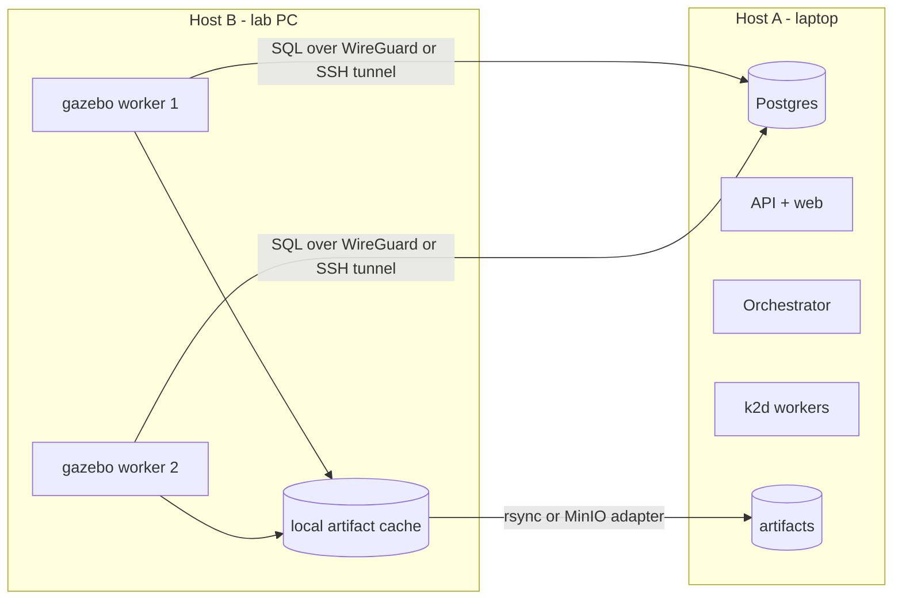

# 29 — Deployment Guide

> Related: [17 Dev environment](17-dev-environment-and-docker.md) · [20 CI/CD](20-ci-cd-and-devops.md) · [27 Configuration](27-configuration-reference.md) · [30 Runbook](30-operations-runbook.md)

## 1. Deployment topologies

| Topology | Use | Components |
|----------|-----|-----------|
| **T1 Single laptop (default)** | development, demos, most experiments | compose `core` (+ `gazebo`) on one host |
| **T2 Laptop + lab workers** | more Gazebo throughput | T1 + remote `worker-gazebo` containers on other machines connecting to the same Postgres and artefact sink |
| **T3 Free-tier VM batch** | overnight batches when laptop is busy | whole compose stack on a free-tier VM (e.g. an always-free ARM/x86 VM), results exported as a bundle |
| **T4 Future cluster** | scale-out beyond a few hosts | same images on Kubernetes (Deployment for api/orchestrator, scaled Deployment/Job for workers, managed or operator Postgres) — not in v1 |



## 2. Prerequisites
Docker Engine ≥ 24 + Compose v2; 16 GB RAM (8 GB without Gazebo); 25 GB disk; ports 8000/8080 free; for T2: network path to Postgres (WireGuard or `ssh -L`), never expose Postgres to the internet.

## 3. Install / upgrade (T1)
```bash
git clone https://github.com/CodewithJha/RoboProbe.git && cd RoboProbe
git checkout v1.0.0                       # or main
cp .env.example .env
mkdir -p secrets && openssl rand -base64 24 > secrets/db_password.txt
export ROBOPROBE_IMAGE_TAG=v1.0.0
docker compose -f docker/compose.yaml --profile core pull
docker compose -f docker/compose.yaml --profile core up -d     # == make up
docker compose -f docker/compose.yaml ps                         # all healthy
curl -fsS http://127.0.0.1:8000/health/ready
```
Gazebo workers: `docker compose -f docker/compose.yaml --profile core --profile gazebo up -d`.
Upgrade: change `ROBOPROBE_IMAGE_TAG`, `pull`, `up -d` (the `migrate` service applies migrations first; API/orchestrator wait for it).

## 4. Configuration in deployment
- All settings via `.env` / environment (27). Production-like (`ROBOPROBE_ENV=lab|prod`) enables: token required if API not on loopback, JSON logs, stricter CORS.
- Secrets: Docker secrets (`secrets/` directory, git-ignored) mounted at `/run/secrets`.
- Web runtime config generated at container start from `ROBOPROBE_WEB_*` env.

## 5. Scaling
| Dimension | How | Limit / note |
|-----------|-----|-------------|
| k2d throughput | `--scale worker-k2d=N` or `worker.concurrency` | ≈ CPU cores − 1 |
| Gazebo throughput | more `worker-gazebo` replicas per host (≤ `max_parallel_per_host`) or more hosts (T2) | each episode ≈ 1.5–2.5 cores, 2–3 GB RAM |
| Queue | Postgres SKIP LOCKED | comfortably ≥ 100 workers |
| Orchestrator | one active per campaign (advisory lock); several orchestrator replicas share campaigns | stateless besides DB |
| API | stateless; multiple replicas behind nginx possible | SSE hub per replica reads outbox |
| Artefacts | local FS → MinIO/S3 adapter when multi-host | ADR-0008 |
Because workers are stateless and pull from the queue, horizontal scaling needs **no code change** — only more worker processes with the same `DATABASE_URL`.

## 6. Remote worker (T2) setup
1. On host A, expose Postgres only on the WireGuard interface (`ports: ["10.8.0.1:5432:5432"]`, `dev` profile override) or use `ssh -N -L 5432:localhost:5432 hostA` from host B.
2. On host B: copy `.env` with `ROBOPROBE_DATABASE__URL` pointing at the tunnel and a unique `ROBOPROBE_WORKER__ID_PREFIX`; artefact sink: `storage.backend=local` + periodic `rsync -a data/artifacts/ hostA:RoboProbe/data/artifacts/`, or the MinIO adapter.
3. `docker compose --profile gazebo up -d worker-gazebo`. Worker appears in Workbench.

## 7. Backup & restore
- DB: `make db-backup` → `pg_dump -Fc` to `backups/roboprobe-YYYYMMDD.dump`; restore `pg_restore -c`.
- Artefacts: content-addressed ⇒ incremental `rsync`/`restic` of `data/artifacts`.
- Per-campaign portable bundle: `roboprobe export <id>` / `import`.

## 8. Rollback
Images are immutable tags. Roll back by setting the previous `ROBOPROBE_IMAGE_TAG` and `up -d`. Migrations follow expand/contract (33 §5), so the previous minor version runs against the newer schema. A destructive migration is only shipped in a major version with a documented backup step.

## 9. Uninstall
`make down` (keeps data) · `docker compose down -v` (deletes DB volume) · `rm -rf data/` (artefacts).

## 10. Post-deployment verification checklist
- [ ] `/health/ready` 200; Workbench shows expected workers.
- [ ] `make demo` (50-run k2d campaign) completes; casebook shows ≥ 1 case.
- [ ] Gazebo: `roboprobe run --scenario configs/scenarios/nominal.yaml --backend gazebo_nav2` → PASS.
- [ ] Logs JSON, no ERROR lines at idle; disk free > `storage.min_free_gb`.
