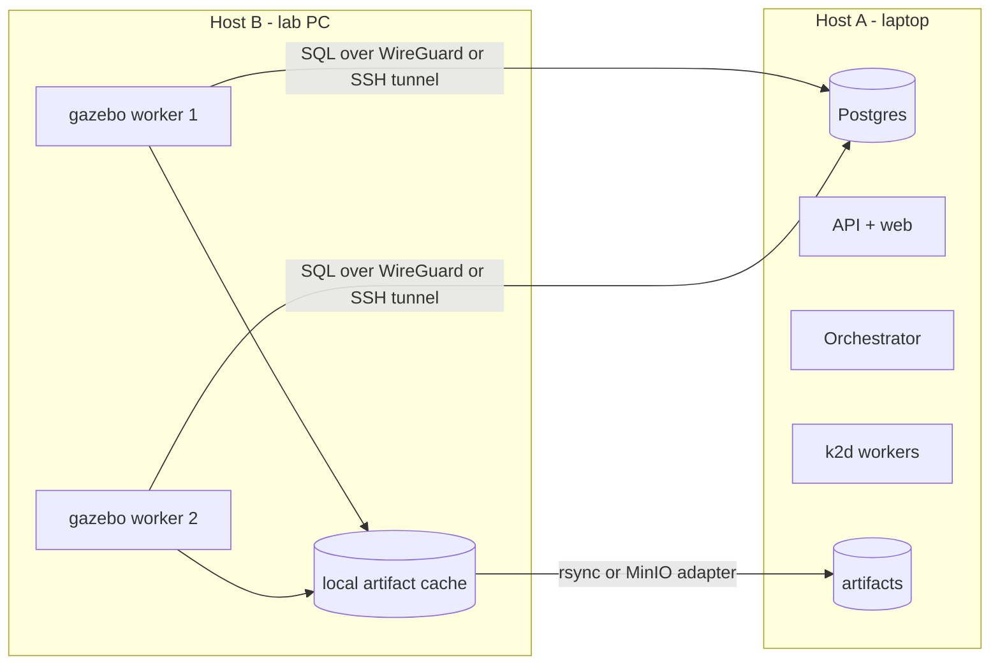

# 29 — Deployment Guide

> Related: [17 Dev environment](17-dev-environment-and-docker.md) · [20 CI/CD](20-ci-cd-and-devops.md) · [27 Configuration](27-configuration-reference.md) · [30 Runbook](30-operations-runbook.md)

## 1. Deployment topologies

| Topology | Use | Components |
|----------|-----|-----------|
| **T1 Single laptop (default)** | development, demos, most experiments | compose `core` (+ `gazebo`) on one host |
| **T2 Laptop + lab workers** | more Gazebo throughput | T1 + remote `worker-gazebo` containers on other machines connecting to the same Postgres and artefact sink |
| **T3 Free-tier VM batch** | overnight batches when laptop is busy | whole compose stack on a free-tier VM (e.g. an always-free ARM/x86 VM), results exported as a bundle |
| **T4 Future cluster** | scale-out beyond a few hosts | same images on Kubernetes (Deployment for api/orchestrator, scaled Deployment/Job for workers, managed or operator Postgres) — not in v1 |



## 2. Prerequisites

Docker Engine ≥ 24 + Compose v2, 16 GB RAM (8 GB without Gazebo), 25 GB disk, and host port 8080 free. A T2 deployment needs a private network path to Postgres, such as WireGuard or `ssh -L`.

## 3. Install / upgrade (T1)

```bash
git clone https://github.com/CodewithJha/RoboProbe.git && cd RoboProbe
git checkout v1.0.0                       # or main
cp .env.example .env
make secrets/db_password secrets/api_token
mkdir -p data/artifacts
# On native Linux, give the container user write access before starting Compose.
sudo chown 10001:10001 data/artifacts
export ROBOPROBE_IMAGE_TAG=v1.0.0
docker compose -f docker/compose.yaml --profile app pull
make up PROFILES=app UP_FLAGS=--no-build
docker compose -f docker/compose.yaml --profile app ps
curl -fsS http://127.0.0.1:8080/config.json
```

Open `http://127.0.0.1:8080` and enter the API token in dashboard Settings.
Browser API and SSE requests use the same origin as the dashboard.

Gazebo workers: `docker compose -f docker/compose.yaml --profile core --profile gazebo up -d`.
To upgrade, set `ROBOPROBE_IMAGE_TAG` to the next published version, pull the images, and repeat
`make up PROFILES=app UP_FLAGS=--no-build`. The API and orchestrator wait for migrations.

## 4. Configuration in deployment

- All settings via `.env` / environment (27). Production-like (`ROBOPROBE_ENV=lab|prod`) enables: token required if API not on loopback, JSON logs, stricter CORS.
- Secrets: Docker secrets (`secrets/` directory, git-ignored) mounted at `/run/secrets`.
- Web runtime config comes from the `ROBOPROBE_WEB_*` environment at container start. The dashboard
  serves a same-origin CSP. Its `style-src` allows inline styles for Plotly.

## 5. Scaling

| Dimension | How | Limit / note |
|-----------|-----|-------------|
| k2d throughput | `--scale worker-k2d=N` or `worker.concurrency` | ≈ CPU cores − 1 |
| Gazebo throughput | more `worker-gazebo` replicas per host (≤ `max_parallel_per_host`) or more hosts (T2) | each episode ≈ 1.5–2.5 cores, 2–3 GB RAM |
| Queue | Postgres SKIP LOCKED | comfortably ≥ 100 workers |
| Orchestrator | one active per campaign (advisory lock); several orchestrator replicas share campaigns | stateless besides DB |
| API | stateless; multiple replicas behind nginx possible | SSE hub per replica reads outbox |
| Artefacts | local FS → MinIO/S3 adapter when multi-host | ADR-0008 |

Because workers are stateless and pull from the queue, horizontal scaling needs **no code change** — only more worker processes with the same `DATABASE_URL`.

Each worker process has its own database pool. Begin with `database.pool_size=5`. In the
10,000-run benchmark, one, two, four, and eight worker processes saw sampled database peaks of
5, 7, 11, and 19 connections respectively. Reserve capacity for the API and administrative
connections on top of the deployed worker and orchestrator workload. Review `pg_stat_activity`,
pool wait time, and queue claim latency before increasing the per-process size. The full
eight-worker run reached 3.77× speedup against a 6× gate.
[T-130 scalability evidence](evidence/T-130-scalability.md)

## 6. Remote worker (T2) setup

On the database host, bind PostgreSQL to the private WireGuard address and enable TLS with
a certificate whose DNS name matches the worker's DSN. Restrict TCP 5432 to the worker's
private address in the firewall. Set a corresponding `hostssl` rule in `pg_hba.conf`
using the RoboProbe database and login, the worker address, and SCRAM authentication.

On the worker host, mount the same writable artifact filesystem used by the main app.
Copy the database CA certificate and place the worker login's password in a protected
file. Ensure the shared artifact directory is writable by container UID 10001 and
the secret files are readable by that UID. Set these variables with the actual
private endpoints and paths.

```sh
export ROBOPROBE_IMAGE_TAG=your-published-tag
export ROBOPROBE_REMOTE_DATABASE_URL='postgresql+psycopg://roboprobe@db.lab.internal:5432/roboprobe'
export ROBOPROBE_REMOTE_WORKER_ID=lab-worker-01
export ROBOPROBE_REMOTE_ARTIFACT_ROOT=/mnt/roboprobe/artifacts
export ROBOPROBE_REMOTE_CA_FILE=/etc/roboprobe/postgres-ca.crt
export ROBOPROBE_REMOTE_PASSWORD_FILE=/etc/roboprobe/db_password

docker compose -f docker/compose.worker.yaml --profile kinematic2d up -d worker-k2d
```

For the Gazebo worker, use the published Gazebo image and prefill its pinned model
cache before starting it.

```sh
docker compose -f docker/compose.worker.yaml --profile gazebo run --rm worker-gazebo prefetch-fuel
docker compose -f docker/compose.worker.yaml --profile gazebo up -d worker-gazebo
```

The worker enforces `verify-full` through its typed database configuration. Confirm the
worker ID and backend from the main dashboard's **Workbench**. The worker host needs the
private database route and artifact mount. [T-129 TLS verification](evidence/T-129.md)

## 7. Backup & restore

`make backup` (or `scripts/backup.sh [--out DIR]`) writes `backups/backup-YYYYmmddTHHMMSS/`:

- `db.dump` — `pg_dump -Fc` of the compose Postgres service (`postgres`; set `DATABASE_URL` to dump a URL instead)
- `artifacts.tar.zst` — zstd tar of `ARTIFACT_ROOT` (default `data/artifacts`) with a `SHA256SUMS` manifest

`BACKUP_RETENTION` (default 7) is how many timestamped directories to keep. `BACKUP_DIR` (default `backups`) is the destination root.

`make restore BACKUP=backups/backup-…` (or `scripts/restore.sh [--force] BACKUP_DIR`) checks the manifest, refuses a database that already has rows unless `--force` / `FORCE=1`, runs `pg_restore --clean --if-exists --no-owner`, extracts artefacts, then `roboprobe db upgrade` and `roboprobe artifacts verify`.

Per-campaign portable bundle: `roboprobe export <id>` / `import`.

## 8. Rollback

Images are immutable tags. Roll back by setting the previous `ROBOPROBE_IMAGE_TAG` and `up -d`. Migrations follow expand/contract (33 §5), so the previous minor version runs against the newer schema. A destructive migration is only shipped in a major version with a documented backup step.

## 9. Uninstall

`make down` (keeps data) · `docker compose down -v` (deletes DB volume) · `rm -rf data/` (artefacts).

## 10. Post-deployment verification checklist

- [ ] `/health/ready` 200; Workbench shows expected workers.
- [ ] `make demo` (50-run k2d campaign) completes; casebook shows ≥ 1 case.
- [ ] Gazebo: `roboprobe run --scenario configs/scenarios/nominal.yaml --backend gazebo_nav2` → PASS.
- [ ] Logs JSON, no ERROR lines at idle; disk free > `storage.min_free_gb`.
