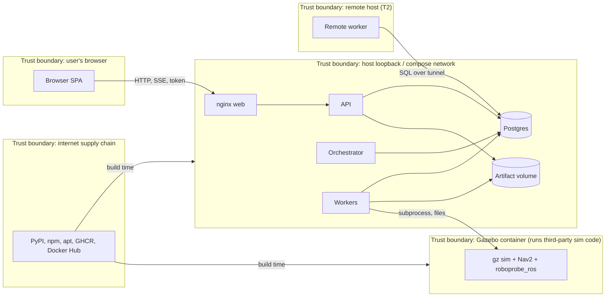

# 31 — Threat Model (STRIDE)

> Scope: RoboProbe v1 deployed per 29 (T1/T2). Method: data-flow diagram + STRIDE per element; risk = likelihood × impact (1–3 each).
> Related: [21 §1 controls](21-security-reproducibility-observability.md#1-security-controls-summary-analysis-in-31)

## 1. Assets

| Asset | Why it matters |
|-------|---------------|
| A1 Experiment data (runs, verdicts, modes) | research integrity; tampering would falsify results |
| A2 Artefacts (traces, bags, reports) | evidence; may be shared publicly |
| A3 Host machine | the owner's laptop; containers run simulators and subprocesses |
| A4 Credentials (DB password, API token, GitHub token in CI) | access control |
| A5 Source code & supply chain | malicious dependency ⇒ host compromise |

## 2. Data-flow diagram & trust boundaries

## 3. STRIDE analysis

| ID | Element | STRIDE | Threat | L | I | Risk | Mitigation (control) | Residual |
|----|---------|--------|--------|---|---|------|---------------------|----------|
| TM-01 | API | Spoofing | Another local user/process or LAN host calls the API | 2 | 2 | 4 | loopback bind; token auto-required off-loopback; constant-time compare | low |
| TM-02 | API | Tampering | Malicious YAML (billion laughs, code tags) in space upload | 2 | 3 | 6 | `yaml.safe_load`, size limit, JSON Schema, no custom tags | low |
| TM-03 | Constraint evaluator | Elevation | `eval` injection via constraint expression | 2 | 3 | 6 | restricted AST whitelist, no names except params, fuzz tests | low |
| TM-04 | Artefact download | Info disclosure | Path traversal `../../etc/passwd` | 2 | 3 | 6 | artefacts addressed by id; resolved path must be under root | low |
| TM-05 | Web | Tampering | XSS via user-provided labels/names | 2 | 2 | 4 | React escaping, CSP `default-src 'self'`, no `dangerouslySetInnerHTML` (lint rule) | low |
| TM-06 | Web | CSRF | Malicious site posts to local API | 2 | 2 | 4 | token in header (not cookie); CORS allow-list; JSON-only content types | low |
| TM-07 | Workers → Gazebo | Elevation | Sim subprocess escapes to host | 1 | 3 | 3 | container isolation, non-root, no privileged mode, dropped caps, no Docker socket mount | low |
| TM-08 | Subprocess launch | Tampering | Shell injection through scenario values in launch args | 2 | 3 | 6 | args passed as list; values only via generated YAML files; numeric validation | low |
| TM-09 | Postgres | Info disclosure | DB exposed on network (T2) | 2 | 3 | 6 | only compose network/WireGuard/SSH; strong password from secret file; `pg_hba` restrict | low |
| TM-10 | Supply chain | Tampering | Compromised PyPI/npm package | 2 | 3 | 6 | lockfiles with hashes, pip-audit/pnpm audit, Dependabot, digest-pinned images, Trivy | medium |
| TM-11 | CI | Info disclosure | Secrets leaked in logs/PRs from forks | 1 | 2 | 2 | no secrets except `GITHUB_TOKEN`; `pull_request` (not `pull_request_target`) for forks; least-privilege `permissions:` | low |
| TM-12 | Data | Repudiation / integrity | Results edited after the fact | 2 | 3 | 6 | outbox events as append-only audit; artefact SHA-256; manifests; reports embed hashes | low |
| TM-13 | API | DoS | Huge budget/batch or giant uploads exhaust laptop | 2 | 2 | 4 | `runner.max_budget`, `max_batch_size`, upload limits, pagination caps | low |
| TM-14 | Bundles | Tampering | Imported bundle contains malicious paths | 2 | 3 | 6 | safe tar extraction (reject absolute/`..`/symlinks), schema validation, hash check | low |
| TM-15 | Shared artefacts | Info disclosure | Host names/paths leak in shared manifests | 2 | 1 | 2 | hashed hostnames, relative paths | low |

## 4. Security requirements derived

NFR-SEC-001 (network/auth), NFR-SEC-002 (secrets & dependencies), NFR-SEC-003 (input handling: safe YAML, AST evaluator, path confinement, safe tar). Security tests listed in 18 §6.

## 5. Review cadence

Re-run this analysis when: a new trust boundary appears (e.g. cloud workers, multi-user auth), a new input format is accepted, or before each major release.
