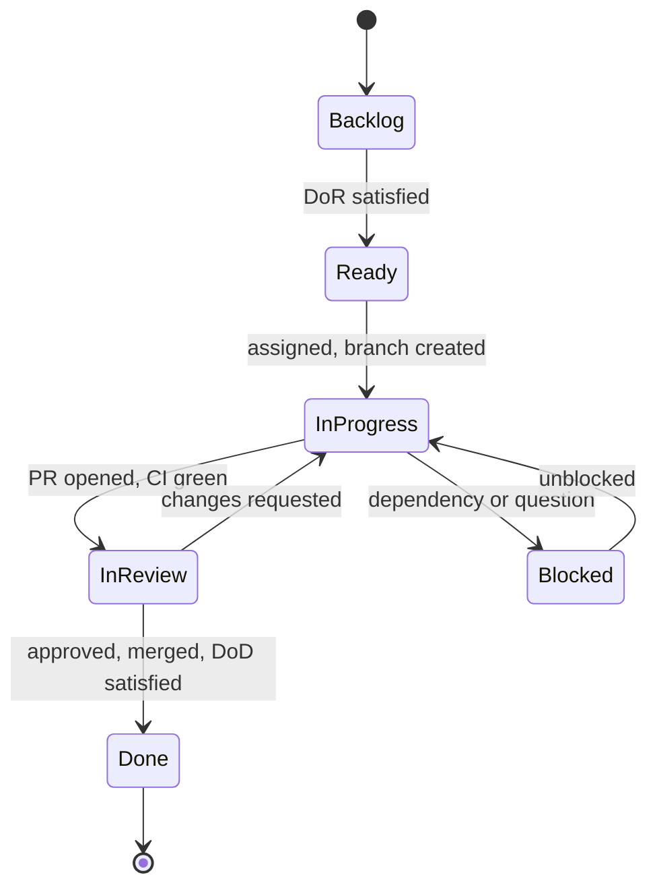

# 32 — Engineering Process: Workflow, Definition of Ready/Done, Code Review

> Applies to humans and AI agents alike. Related: [16 Standards](16-repository-structure-and-coding-standards.md) · [34 Design principles](34-design-principles-patterns-and-conventions.md) · [22 Tasks](22-roadmap-and-implementation-plan.md) · `AGENTS.md`

## 1. Work item lifecycle

Tracking: GitHub Issues (one per `T-NNN`, label `milestone:Mx`, `size:S|M|L`, `area:*`) + a GitHub Project board (free).

## 2. Definition of Ready (DoR) — a task may start only if
- [ ] It has an ID `T-NNN`, a clear goal and size ≤ L.
- [ ] Linked requirement IDs (FR/NFR/PR) and design sections exist and are unambiguous.
- [ ] Acceptance criteria are testable (stated in 22 or the issue).
- [ ] Dependencies are Done (or interfaces are frozen in 05).
- [ ] Required fixtures/data are identified.
- [ ] Open questions resolved or a documented default chosen.

## 3. Definition of Done (DoD) — a task is Done only if
- [ ] Code implements the linked requirements; docstrings reference IDs.
- [ ] Tests written first or alongside; new/changed behaviour covered; coverage gates hold (18 §3).
- [ ] `make lint typecheck test` green locally; CI green.
- [ ] No hard-coded tunables: new values added to settings/params with docs regenerated (27).
- [ ] Logging per 34 §6 at key events; errors per 34 §5.
- [ ] Public interfaces unchanged — or the change is reflected in 05/12 and versioned (33).
- [ ] Docs updated (behaviour, config, runbook if operational); traceability (28) updated.
- [ ] CHANGELOG `Unreleased` entry for user-visible changes.
- [ ] Migration included and tested if schema changed.
- [ ] PR reviewed and approved; squash-merged with a Conventional Commit title.
- [ ] Commits authored and committed solely by the repository owner's identity (see `AGENTS.md`).

## 4. Pull request rules
- One task per PR; ≤ 400 changed lines (excluding generated/lock files) — split otherwise.
- Title: Conventional Commit (`feat(selection): add straddle acquisition`), body via template: summary, linked `T-NNN`/requirements, test evidence, screenshots for UI, risk/rollback notes, checklist.
- Draft PRs welcome for early feedback; CI must be green before review is requested.

## 5. Code review guidelines

### 5.1 Reviewer checklist
**Correctness** — does it meet the AC? edge cases (empty history, INVALID runs, d=1, NaNs)? concurrency/transactions correct?
**Design** — respects layering (16 §2) and ports; SOLID (34 §2); no leaking ORM/DTO into domain; small cohesive functions.
**Config** — no magic numbers/paths/URLs; defaults documented; secrets as `SecretStr`.
**Determinism** — RNG injected and seeded; no wall-clock in domain logic; reproducible tests (no flaky sleeps).
**Errors & logging** — typed errors; no swallowed exceptions; structured log events with ids; no secrets in logs.
**Tests** — meaningful assertions; statistical tests over seeds where randomness exists; fixtures minimal.
**Performance** — vectorised NumPy for traces; no N+1 queries; pagination.
**Security** — input validation, path confinement, no shell=True, safe YAML.
**API/UI** — matches 12/13; OpenAPI snapshot updated intentionally; a11y (labels, focus, contrast).
**Docs** — updated where behaviour changed; ADR if a decision changed.

### 5.2 Review etiquette
Comment on code, not people; label comments `blocking:`, `suggestion:`, `nit:`, `question:`; approve when only nits remain. Authors respond to every comment (fix or explain). AI-generated code is reviewed exactly like human code — including running it.

### 5.3 Review SLA (self-managed project)
Reviews within 48 h; stale PRs (> 7 days) are closed or rebased.

## 6. Branching & merging
Trunk-based: short-lived branches off `main`, squash merge, delete branch after merge. Release tags from `main` (33). Hotfix: `fix/…` branch → PR → patch release.

## 7. RFC process (for larger changes)
Use [templates/rfc-template.md](templates/rfc-template.md) for anything that adds a module, changes a public interface/schema, adds a dependency of note, or changes evaluation methodology. Flow: draft RFC PR in `docs/rfc/NNNN-title.md` → discussion → decision recorded as ADR → implementation tasks added to 22.

## 8. Templates
- [ADR template](templates/adr-template.md) · [RFC template](templates/rfc-template.md) · [Task template](templates/task-template.md) · [Bug report template](templates/bug-report-template.md) · PR template in `.github/PULL_REQUEST_TEMPLATE.md`.
